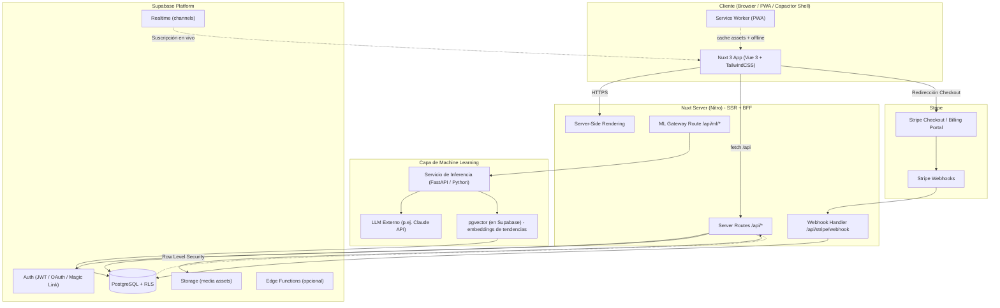
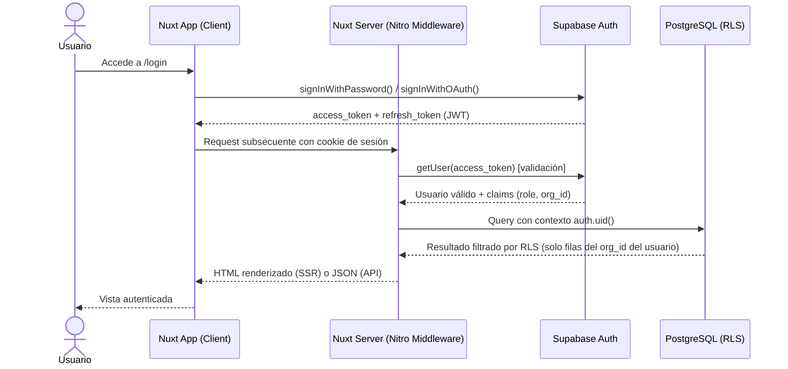
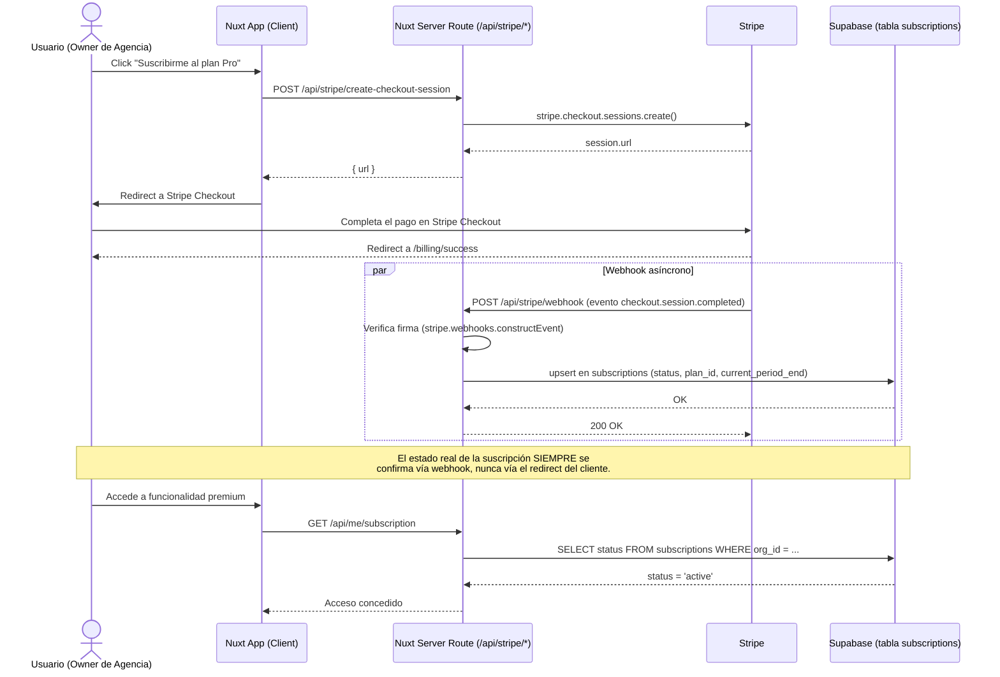
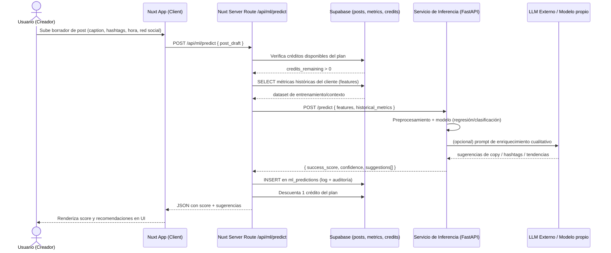

# 1. Arquitectura del Sistema

## 1.1 Visión General

**CIBERAN** es una plataforma SaaS/PWA para creadores de contenido y los partners que los contratan, que permite:

1. Gestionar en una línea de tiempo las entregas de contenido pendientes por cliente (vídeos, posts, stories).
2. Consolidar métricas de redes sociales (vistas, engagement, alcance) de múltiples plataformas.
3. Predecir el éxito potencial de una publicación y sugerir ideas/tendencias mediante Machine Learning.

El sistema se construye como una aplicación **Nuxt 3** (Vue 3) renderizada en modo híbrido (SSR + Client), respaldada por **Supabase** como backend-as-a-service (PostgreSQL, Auth, Storage, Realtime) y **Stripe** para monetización por suscripción. El componente de Machine Learning se expone como un servicio desacoplado, consumido vía API, para poder evolucionar independientemente del frontend.

### 1.1.1 Principios de diseño

- **Server-first, pero reactivo**: las rutas públicas y de dashboard crítico usan SSR para SEO y tiempo de carga; los paneles internos (timeline, métricas) usan client-side rendering con hidratación parcial e islas de interactividad.
- **Seguridad por defecto**: toda tabla en Supabase tiene RLS habilitado desde el día 1. Nunca se confía en el cliente para filtrar datos por `tenant`/`cliente`.
- **Desacoplamiento del ML**: el motor de predicción no vive dentro del monolito Nuxt; se invoca vía Server Routes (BFF) que a su vez llaman a un servicio de inferencia (Python/FastAPI o Edge Function) o a un proveedor LLM externo.
- **Multi-tenant por fila (Row-level multi-tenancy)**: una única base de datos compartida, aislada mediante RLS por `organization_id` / `agency_id`, en lugar de bases de datos separadas por cliente (más simple de mantener para un equipo de 2 personas).
- **PWA-first para móvil**: en lugar de builds nativos desde el día 1, se prioriza una PWA instalable (manifest + service worker) con posibilidad de empaquetar con Capacitor más adelante si se requiere acceso a APIs nativas (notificaciones push nativas, cámara, etc.).

## 1.2 Diagrama de Arquitectura General



## 1.3 Capas de la Aplicación

| Capa | Tecnología | Responsabilidad |
|---|---|---|
| Presentación | Vue 3 (Composition API) + TailwindCSS + shadcn-vue / Headless UI | Componentes de UI, timeline de entregas, dashboards de métricas |
| Framework / Meta-framework | Nuxt 3 (Nitro) | Enrutamiento, SSR/SSG, Server Routes (BFF), middlewares |
| Estado | Pinia | Estado global de sesión, cliente activo seleccionado, caché de métricas |
| Backend as a Service | Supabase | Auth, PostgreSQL, RLS, Storage, Realtime |
| Pagos | Stripe | Checkout, suscripciones, portal de cliente, webhooks |
| Machine Learning | Python (FastAPI) o Edge Functions + LLM API | Predicción de éxito, generación de ideas/tendencias |
| PWA / Móvil | Workbox (service worker) + Web App Manifest + Capacitor (futuro) | Instalación, caché offline, notificaciones push |

## 1.4 Flujo de Autenticación

Se utiliza **Supabase Auth** con soporte para email/password, magic link y OAuth (Google). El módulo `@nuxtjs/supabase` gestiona la sesión en cookies httpOnly para que el SSR pueda leer el usuario autenticado en cada request.



### Notas de seguridad

- El JWT de Supabase incluye el `user.id`; las políticas RLS usan `auth.uid()` para filtrar automáticamente.
- Los roles de aplicación (`owner`, `admin`, `editor`, `client_viewer`) se almacenan en una tabla `profiles`/`memberships` y se consultan dentro de las policies (no se confía en claims del JWT que el cliente pudiera manipular sin pasar por Supabase).
- Las Server Routes que requieren permisos elevados (p.ej. `service_role`) **nunca** se ejecutan en el cliente; viven exclusivamente en Nitro server routes con la `SUPABASE_SERVICE_ROLE_KEY` como variable de entorno server-only.

## 1.5 Flujo de Pagos con Stripe (Suscripciones + Webhooks)



### Eventos de Stripe relevantes a escuchar

| Evento | Acción en el sistema |
|---|---|
| `checkout.session.completed` | Crear/activar suscripción en `subscriptions`, asociar `stripe_customer_id` a la organización |
| `customer.subscription.updated` | Actualizar `plan_id`, `status`, `current_period_end` |
| `customer.subscription.deleted` | Marcar `status = 'canceled'`, revocar acceso premium |
| `invoice.payment_failed` | Marcar `status = 'past_due'`, notificar al usuario |
| `invoice.paid` | Confirmar renovación, resetear contador de créditos (si aplica modelo de créditos) |

## 1.6 Flujo de Inferencia de Machine Learning

El objetivo es predecir el éxito potencial de una publicación (score 0-100) y sugerir ideas/tendencias. Se diseña como un **Gateway pattern**: Nuxt nunca llama directamente a un proveedor LLM externo desde el cliente; todo pasa por una Server Route que controla rate-limiting, consumo de créditos y logging.



Ver detalle completo del pipeline en [`3-ML-PIPELINE.md`](./3-ML-PIPELINE.md).

## 1.7 Estructura de Carpetas Propuesta (Nuxt 3)

```
dweb-create/
├── docs/                       # Documentación del proyecto (este directorio)
├── app/
│   ├── assets/
│   ├── components/
│   │   ├── timeline/           # Línea de tiempo de entregas
│   │   ├── metrics/            # Dashboards y gráficos
│   │   ├── ml/                 # Widgets de predicción/sugerencias
│   │   └── ui/                 # Componentes base (botones, inputs, cards)
│   ├── composables/
│   │   ├── useAuth.ts
│   │   ├── useClients.ts
│   │   ├── useTimeline.ts
│   │   ├── useMetrics.ts
│   │   └── useMlPrediction.ts
│   ├── layouts/
│   ├── middleware/
│   │   ├── auth.global.ts
│   │   └── subscription.ts
│   ├── pages/
│   │   ├── index.vue
│   │   ├── login.vue
│   │   ├── dashboard/
│   │   ├── clients/[id]/
│   │   ├── timeline/
│   │   ├── metrics/
│   │   └── billing/
│   ├── stores/                 # Pinia
│   └── app.vue
├── server/
│   ├── api/
│   │   ├── stripe/
│   │   │   ├── create-checkout-session.post.ts
│   │   │   └── webhook.post.ts
│   │   ├── ml/
│   │   │   ├── predict.post.ts
│   │   │   └── trends.get.ts
│   │   └── clients/
│   ├── middleware/
│   └── utils/
├── supabase/
│   ├── migrations/
│   └── seed.sql
├── ml-service/                  # Servicio Python independiente (opcional, repo separado o monorepo)
│   ├── main.py
│   ├── models/
│   └── requirements.txt
├── public/
│   ├── manifest.webmanifest
│   └── icons/
├── nuxt.config.ts
└── package.json
```

## 1.8 Decisiones de Infraestructura y Despliegue

- **Hosting Frontend/SSR**: Vercel o Netlify (adapters nativos de Nitro) para despliegue continuo desde `main` y preview deployments por PR.
- **Supabase**: proyecto en la nube (free tier para desarrollo, plan Pro al escalar) con entornos separados `dev` y `production` (dos proyectos Supabase distintos).
- **Servicio ML**: contenedor Docker desplegado en Fly.io / Railway / Render (escalable independientemente del frontend); alternativa más simple inicial: Supabase Edge Functions (Deno) si la lógica ML es ligera o solo hace de proxy a un LLM.
- **Variables de entorno sensibles** (`SUPABASE_SERVICE_ROLE_KEY`, `STRIPE_SECRET_KEY`, `STRIPE_WEBHOOK_SECRET`, `ML_API_KEY`) solo se configuran en el servidor (Nitro runtime config `private`), nunca expuestas con prefijo `NUXT_PUBLIC_`.
- **Observabilidad**: Sentry (errores frontend + servidor), Supabase Logs, y un dashboard simple de uso de créditos ML por organización.

## 1.9 PWA y Estrategia Móvil

- **Fase 1 (Semanas 1-6)**: PWA instalable vía `@vite-pwa/nuxt`, con manifest, íconos, y caché offline de shell de la app (no de datos sensibles).
- **Fase 2 (post-MVP)**: evaluación de Capacitor para empaquetar como app nativa (iOS/Android) si se requieren notificaciones push nativas o acceso a cámara para subir contenido directamente.
- **Notificaciones**: en la fase PWA se usan Web Push (via Service Worker) para alertar sobre entregas próximas a vencer; en la fase Capacitor se migraría a FCM/APNs.

## 1.10 Próximos pasos relacionados

- Esquema de base de datos detallado: [`2-DATABASE-SCHEMA.md`](./2-DATABASE-SCHEMA.md)
- Pipeline de Machine Learning: [`3-ML-PIPELINE.md`](./3-ML-PIPELINE.md)
- Roadmap de ejecución: [`4-ROADMAP-AND-TASKS.md`](./4-ROADMAP-AND-TASKS.md)
