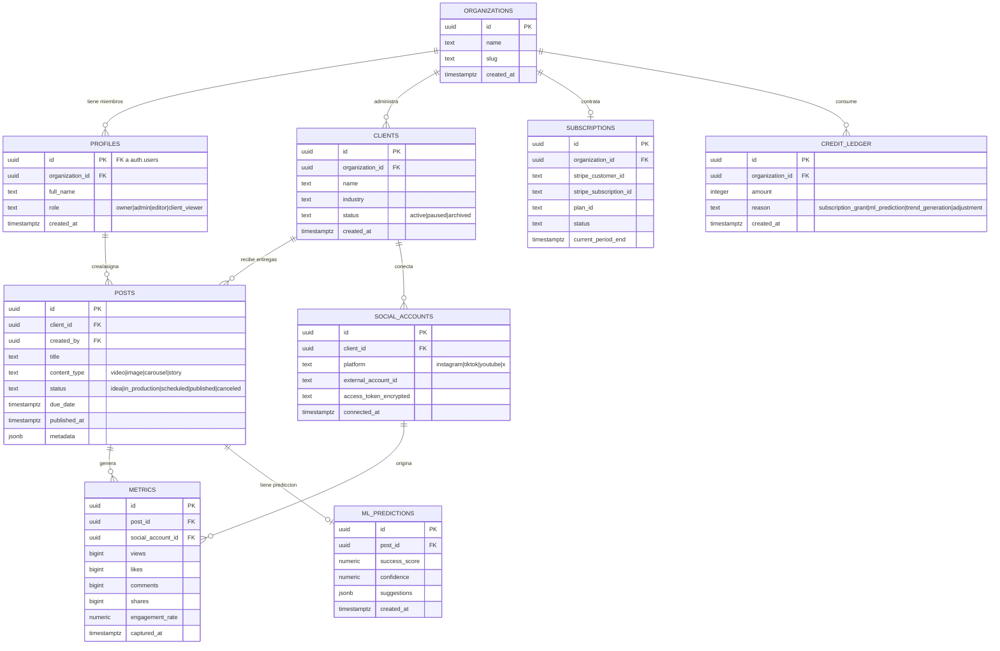

# 2. Esquema de Base de Datos (Supabase / PostgreSQL)

## 2.1 Modelo Conceptual

El sistema es **multi-tenant**: cada **Agencia/Creador** (`organizations`) tiene uno o varios **usuarios** (`profiles`) con distintos roles, administra varios **clientes** (`clients`), y para cada cliente gestiona **publicaciones** (`posts`) programadas en una línea de tiempo, cuyas **métricas** (`metrics`) se consolidan tras la publicación. La monetización se controla vía `subscriptions` y, opcionalmente, un sistema de créditos (`credit_ledger`) para el consumo de ML.



## 2.2 Definición DDL (PostgreSQL / Supabase)

> Convención: todas las tablas usan `uuid` como PK (`gen_random_uuid()`), timestamps `timestamptz` con `default now()`, y `organization_id` como ancla de aislamiento multi-tenant (directo o vía `client_id`/`post_id`).

```sql
-- Requiere la extensión pgcrypto para gen_random_uuid()
create extension if not exists "pgcrypto";
create extension if not exists "vector"; -- pgvector, usado en 3-ML-PIPELINE.md

-- =========================================================
-- 1. ORGANIZATIONS (Agencias / Creadores individuales)
-- =========================================================
create table public.organizations (
    id uuid primary key default gen_random_uuid(),
    name text not null,
    slug text unique not null,
    created_at timestamptz not null default now()
);

-- =========================================================
-- 2. PROFILES (extiende auth.users de Supabase)
-- =========================================================
create table public.profiles (
    id uuid primary key references auth.users(id) on delete cascade,
    organization_id uuid not null references public.organizations(id) on delete cascade,
    full_name text,
    role text not null check (role in ('owner', 'admin', 'editor', 'client_viewer')) default 'editor',
    created_at timestamptz not null default now()
);

create index idx_profiles_organization_id on public.profiles(organization_id);

-- =========================================================
-- 3. CLIENTS
-- =========================================================
create table public.clients (
    id uuid primary key default gen_random_uuid(),
    organization_id uuid not null references public.organizations(id) on delete cascade,
    name text not null,
    industry text,
    status text not null check (status in ('active', 'paused', 'archived')) default 'active',
    avatar_url text,
    created_at timestamptz not null default now()
);

create index idx_clients_organization_id on public.clients(organization_id);

-- =========================================================
-- 4. SOCIAL_ACCOUNTS (cuentas conectadas por cliente)
-- =========================================================
create table public.social_accounts (
    id uuid primary key default gen_random_uuid(),
    client_id uuid not null references public.clients(id) on delete cascade,
    platform text not null check (platform in ('instagram', 'tiktok', 'youtube', 'x', 'facebook', 'linkedin')),
    external_account_id text not null,
    access_token_encrypted text, -- cifrado a nivel de aplicación antes de guardar
    refresh_token_encrypted text,
    token_expires_at timestamptz,
    connected_at timestamptz not null default now(),
    unique (client_id, platform, external_account_id)
);

create index idx_social_accounts_client_id on public.social_accounts(client_id);

-- =========================================================
-- 5. POSTS (entregas de contenido / línea de tiempo)
-- =========================================================
create table public.posts (
    id uuid primary key default gen_random_uuid(),
    client_id uuid not null references public.clients(id) on delete cascade,
    created_by uuid references public.profiles(id) on delete set null,
    title text not null,
    description text,
    content_type text not null check (content_type in ('video', 'image', 'carousel', 'story', 'reel')),
    status text not null check (
        status in ('idea', 'in_production', 'ready_for_review', 'scheduled', 'published', 'canceled')
    ) default 'idea',
    due_date timestamptz not null,
    published_at timestamptz,
    media_url text,
    metadata jsonb not null default '{}'::jsonb, -- caption, hashtags, hora propuesta, red destino, etc.
    created_at timestamptz not null default now(),
    updated_at timestamptz not null default now()
);

create index idx_posts_client_id on public.posts(client_id);
create index idx_posts_due_date on public.posts(due_date);
create index idx_posts_status on public.posts(status);

-- =========================================================
-- 6. METRICS (snapshot de métricas por post)
-- =========================================================
create table public.metrics (
    id uuid primary key default gen_random_uuid(),
    post_id uuid not null references public.posts(id) on delete cascade,
    social_account_id uuid references public.social_accounts(id) on delete set null,
    views bigint not null default 0,
    likes bigint not null default 0,
    comments bigint not null default 0,
    shares bigint not null default 0,
    saves bigint not null default 0,
    engagement_rate numeric(6,3),
    captured_at timestamptz not null default now()
);

create index idx_metrics_post_id on public.metrics(post_id);
create index idx_metrics_captured_at on public.metrics(captured_at);

-- =========================================================
-- 7. ML_PREDICTIONS (resultado del motor de ML por post)
-- =========================================================
create table public.ml_predictions (
    id uuid primary key default gen_random_uuid(),
    post_id uuid not null references public.posts(id) on delete cascade,
    success_score numeric(5,2) not null check (success_score between 0 and 100),
    confidence numeric(4,3) check (confidence between 0 and 1),
    suggestions jsonb not null default '[]'::jsonb,
    model_version text,
    created_at timestamptz not null default now()
);

create index idx_ml_predictions_post_id on public.ml_predictions(post_id);

-- =========================================================
-- 8. TRENDS (tendencias detectadas, con embeddings para búsqueda semántica)
-- =========================================================
create table public.trends (
    id uuid primary key default gen_random_uuid(),
    platform text not null,
    topic text not null,
    description text,
    embedding vector(1536), -- pgvector, dimensión según modelo de embeddings usado
    score numeric(5,2),
    detected_at timestamptz not null default now()
);

create index idx_trends_embedding on public.trends using ivfflat (embedding vector_cosine_ops);

-- =========================================================
-- 9. SUBSCRIPTIONS (estado de Stripe por organización)
-- =========================================================
create table public.subscriptions (
    id uuid primary key default gen_random_uuid(),
    organization_id uuid not null unique references public.organizations(id) on delete cascade,
    stripe_customer_id text unique,
    stripe_subscription_id text unique,
    plan_id text not null default 'free' check (plan_id in ('free', 'starter', 'pro', 'agency')),
    status text not null check (
        status in ('trialing', 'active', 'past_due', 'canceled', 'incomplete')
    ) default 'trialing',
    current_period_end timestamptz,
    created_at timestamptz not null default now(),
    updated_at timestamptz not null default now()
);

-- =========================================================
-- 10. CREDIT_LEDGER (consumo de créditos de ML, modelo de créditos)
-- =========================================================
create table public.credit_ledger (
    id uuid primary key default gen_random_uuid(),
    organization_id uuid not null references public.organizations(id) on delete cascade,
    amount integer not null, -- positivo = ingreso de créditos, negativo = consumo
    reason text not null check (
        reason in ('subscription_grant', 'ml_prediction', 'trend_generation', 'adjustment', 'refund')
    ),
    related_post_id uuid references public.posts(id) on delete set null,
    created_at timestamptz not null default now()
);

create index idx_credit_ledger_organization_id on public.credit_ledger(organization_id);
```

## 2.3 Funciones Auxiliares para RLS

Supabase recomienda encapsular la lógica de pertenencia a organización en funciones `security definer` para evitar recursión infinita en las policies y reutilizar lógica.

```sql
-- Devuelve el organization_id del usuario autenticado actual
create or replace function public.current_org_id()
returns uuid
language sql
stable
security definer
set search_path = public
as $$
    select organization_id
    from public.profiles
    where id = auth.uid()
    limit 1;
$$;

-- Devuelve true si el usuario actual tiene rol admin/owner dentro de su organización
create or replace function public.is_org_admin()
returns boolean
language sql
stable
security definer
set search_path = public
as $$
    select exists (
        select 1 from public.profiles
        where id = auth.uid()
        and role in ('owner', 'admin')
    );
$$;
```

## 2.4 Políticas RLS (Row Level Security)

> Regla general: **habilitar RLS en TODAS las tablas**, sin excepción, incluso en desarrollo.

```sql
-- Habilitar RLS en todas las tablas
alter table public.organizations enable row level security;
alter table public.profiles enable row level security;
alter table public.clients enable row level security;
alter table public.social_accounts enable row level security;
alter table public.posts enable row level security;
alter table public.metrics enable row level security;
alter table public.ml_predictions enable row level security;
alter table public.subscriptions enable row level security;
alter table public.credit_ledger enable row level security;
alter table public.trends enable row level security;

-- =========================================================
-- ORGANIZATIONS: un usuario solo ve/edita su propia organización
-- =========================================================
create policy "org_select_own"
on public.organizations for select
using (id = public.current_org_id());

create policy "org_update_admin_only"
on public.organizations for update
using (id = public.current_org_id() and public.is_org_admin());

-- =========================================================
-- PROFILES: visibles solo dentro de la misma organización
-- =========================================================
create policy "profiles_select_same_org"
on public.profiles for select
using (organization_id = public.current_org_id());

create policy "profiles_update_self_or_admin"
on public.profiles for update
using (
    id = auth.uid()
    or (organization_id = public.current_org_id() and public.is_org_admin())
);

-- =========================================================
-- CLIENTS: CRUD completo solo para miembros de la organización dueña
-- =========================================================
create policy "clients_select_same_org"
on public.clients for select
using (organization_id = public.current_org_id());

create policy "clients_insert_same_org"
on public.clients for insert
with check (organization_id = public.current_org_id());

create policy "clients_update_same_org"
on public.clients for update
using (organization_id = public.current_org_id());

create policy "clients_delete_admin_only"
on public.clients for delete
using (organization_id = public.current_org_id() and public.is_org_admin());

-- =========================================================
-- POSTS: acceso vía client_id -> organization_id
-- =========================================================
create policy "posts_select_same_org"
on public.posts for select
using (
    client_id in (
        select id from public.clients where organization_id = public.current_org_id()
    )
);

create policy "posts_insert_same_org"
on public.posts for insert
with check (
    client_id in (
        select id from public.clients where organization_id = public.current_org_id()
    )
);

create policy "posts_update_same_org"
on public.posts for update
using (
    client_id in (
        select id from public.clients where organization_id = public.current_org_id()
    )
);

create policy "posts_delete_same_org"
on public.posts for delete
using (
    client_id in (
        select id from public.clients where organization_id = public.current_org_id()
    )
);

-- =========================================================
-- METRICS: solo lectura para miembros de la organización (escritura vía service_role / jobs)
-- =========================================================
create policy "metrics_select_same_org"
on public.metrics for select
using (
    post_id in (
        select p.id from public.posts p
        join public.clients c on c.id = p.client_id
        where c.organization_id = public.current_org_id()
    )
);
-- Nota: INSERT/UPDATE de metrics se realiza exclusivamente desde Server Routes
-- usando la service_role key (jobs de sincronización con APIs de redes sociales),
-- por lo que NO se define policy de insert/update para el rol "authenticated".

-- =========================================================
-- ML_PREDICTIONS: solo lectura para la organización dueña del post
-- =========================================================
create policy "ml_predictions_select_same_org"
on public.ml_predictions for select
using (
    post_id in (
        select p.id from public.posts p
        join public.clients c on c.id = p.client_id
        where c.organization_id = public.current_org_id()
    )
);

-- =========================================================
-- SUBSCRIPTIONS: solo visible por su propia organización; escritura solo vía webhook (service_role)
-- =========================================================
create policy "subscriptions_select_same_org"
on public.subscriptions for select
using (organization_id = public.current_org_id());

-- =========================================================
-- CREDIT_LEDGER: solo lectura de su propio historial
-- =========================================================
create policy "credit_ledger_select_same_org"
on public.credit_ledger for select
using (organization_id = public.current_org_id());

-- =========================================================
-- TRENDS: lectura pública para cualquier usuario autenticado (no es dato sensible por cliente)
-- =========================================================
create policy "trends_select_authenticated"
on public.trends for select
to authenticated
using (true);
```

### 2.4.1 Notas sobre el modelo de seguridad

- Las tablas que reciben escritura desde procesos de servidor (`metrics`, `ml_predictions`, `subscriptions`) **no** exponen policies de `insert`/`update` al rol `authenticated`; esas operaciones se ejecutan exclusivamente desde Server Routes de Nitro usando la `service_role key`, que **bypassa RLS** por diseño de Supabase. Esto evita que un cliente malicioso falsifique métricas o resultados de ML.
- `client_viewer` (rol de solo lectura para que el cliente final vea su propio avance) debe filtrarse adicionalmente a nivel de aplicación/():, o mediante una policy adicional que restrinja a un único `client_id` asociado en `profiles` (campo opcional `client_id` nullable para usuarios tipo portal-cliente). Se documenta como ítem de backlog para cuando se implemente el "Portal de Cliente".
- Todas las claves de acceso a redes sociales (`access_token_encrypted`) deben cifrarse a nivel de aplicación (p. ej. `pgsodium` o cifrado AES en la Server Route) antes de insertarse; RLS protege el acceso por fila, pero no sustituye el cifrado del secreto en reposo.

## 2.5 Vistas Útiles (opcional, para el dashboard)

```sql
-- Vista: resumen de entregas pendientes por cliente en la semana actual
create or replace view public.v_weekly_deliverables as
select
    c.organization_id,
    c.id as client_id,
    c.name as client_name,
    count(*) filter (where p.status not in ('published', 'canceled')) as pending_count,
    count(*) filter (where p.status = 'published') as published_count,
    count(*) as total_count
from public.clients c
join public.posts p on p.client_id = c.id
where p.due_date >= date_trunc('week', now())
  and p.due_date < date_trunc('week', now()) + interval '7 days'
group by c.organization_id, c.id, c.name;
```

> Nota: las vistas heredan RLS de las tablas subyacentes solo si se crean con `security invoker` (comportamiento por defecto en PostgreSQL 15+ usado por Supabase); se recomienda verificar con `select relrowsecurity from pg_class where relname = 'v_weekly_deliverables';` tras la migración.

## 2.6 Próximos pasos relacionados

- Ver cómo se consumen `posts`, `metrics` y `trends` en el pipeline de ML: [`3-ML-PIPELINE.md`](./3-ML-PIPELINE.md)
- Ver el checklist de implementación de estas migraciones: [`4-ROADMAP-AND-TASKS.md`](./4-ROADMAP-AND-TASKS.md)
