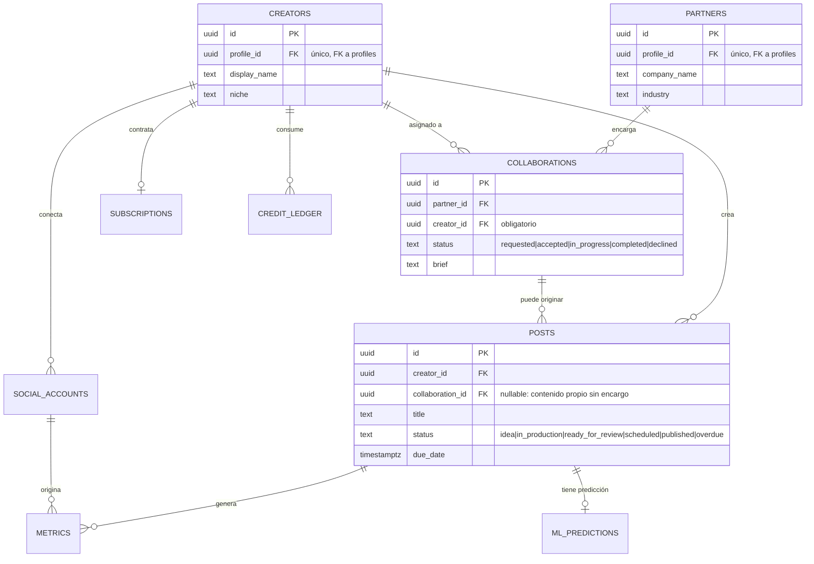

# 2. Esquema de Base de Datos (Supabase / PostgreSQL)

> Este documento explica el **por qué** del esquema. El SQL de verdad —el que de verdad se ejecuta y se prueba— vive en [`supabase/migrations/`](../supabase/migrations) y es la fuente de la verdad; si algo de aquí y el código no coinciden, manda el código. Guía paso a paso para aplicarlo: [`6-SUPABASE-SETUP.md`](./6-SUPABASE-SETUP.md).

## 2.1 Modelo Conceptual: un marketplace de 2 roles

FEEDMA es un **marketplace**: un partner contrata directamente a un creador de contenido. (Hasta la migración `20261021120000_remove_manager_rename_creator_partner.sql` existía un tercer rol, Manager/agencia, que repartía el trabajo entre varios influencers — se eliminó: en la práctica un manager es un partner más, categorizarlo aparte no aportaba nada.)

- **`creators`** — un creador de contenido.
- **`partners`** — la empresa/marca que contrata. No administra nada de otro: contrata, revisa y aprueba.
- **`collaborations`** — el "contrato" del marketplace: conecta a un partner con un creador concreto (`creator_id` es obligatorio). Es el eslabón que determina **qué puede ver cada uno**: un partner nunca ve todo el contenido de un creador, solo lo que está atado a una colaboración suya.
- **`posts`** — las entregas de contenido (el tablero semanal), siempre de un creador, opcionalmente atadas a una `collaboration`.

## 2.2 Las tablas, una por una

El DDL completo y probado está en [`supabase/migrations/`](../supabase/migrations) — el esquema original en `20261019120000_initial_schema.sql`, y la forma final (sin manager, con `creators`/`partners`) en `20261021120000_remove_manager_rename_creator_partner.sql`. Resumen de cada tabla y por qué existe:

| Tabla | Para qué sirve |
|---|---|
| `profiles` | Extiende `auth.users` de Supabase. Se crea sola al registrarse (trigger, ver 2.5). Guarda el `role` ('creator'\|'partner'). |
| `creators` | Ficha del creador de contenido. |
| `partners` | Ficha del partner (marca/empresa que contrata). |
| `collaborations` | El contrato del marketplace. `creator_id` obligatorio desde el alta — ya no hay manager que lo asigne más tarde. |
| `social_accounts` | Redes conectadas por un creador (tokens incluidos — nunca públicos). |
| `posts` | Las entregas del tablero. `collaboration_id` nullable porque un creador puede publicar contenido propio sin que nadie se lo haya encargado. |
| `metrics` | Snapshot de métricas por post. Solo las escribe el servidor (ver 2.4). |
| `ml_predictions` | Resultado del motor de ML por post. |
| `trends` | Catálogo global de tendencias, no pertenece a nadie en concreto. |
| `subscriptions` | El plan de pago de un creador (`creator_id` obligatorio). |
| `credit_ledger` | Consumo de créditos de ML, por creador. |
| `notifications` | Bandeja de entrada del usuario (icono junto al perfil) — login, alta de cuenta, solicitudes de colaboración. Solo la escriben triggers (`security definer`), nunca el cliente. |

## 2.3 Funciones auxiliares de seguridad

Definidas en [`supabase/migrations/20261019120100_rls_policies.sql`](../supabase/migrations/20261019120100_rls_policies.sql) y redefinidas (nombres nuevos) en `20261021120000_remove_manager_rename_creator_partner.sql`:

- `current_creator_id()` / `current_partner_id()` — devuelven la fila que le corresponde al usuario logueado para ese rol, o `null` si no aplica.
- `has_active_collaboration_with(creator_id)` — ¿el partner logueado tiene una colaboración con ese creador?

## 2.4 Políticas RLS (Row Level Security)

**Regla de oro: toda tabla tiene RLS activado, sin excepción, desde el primer día.** El detalle completo está en la migración de RLS; aquí el resumen de las decisiones importantes:

- **`creators` es un directorio público** (de solo lectura, solo para usuarios logueados): cualquiera puede *ver* el nombre y el nicho de un creador para poder contactarlo desde "Descubrir" — pero solo el propio creador puede *editar* su ficha.
- **`posts` es la tabla más delicada.** Un partner **nunca** ve todo el contenido de un creador: solo los posts cuyo `collaboration_id` apunta a una colaboración suya. Esto se comprobó de verdad (no en teoría) consultando como cada rol vía la API REST de Supabase — ver el checklist de verificación en [`6-SUPABASE-SETUP.md`](./6-SUPABASE-SETUP.md#5-probar-que-la-seguridad-funciona-opcional-pero-recomendado).
- **Un partner no tiene `UPDATE` directo sobre `posts`.** Si lo tuviera, podría cambiar el título, la fecha, cualquier columna. En vez de eso, aprobar o pedir cambios pasa por dos funciones estrechas (`approve_post`, `request_post_changes`, ver 2.5) que solo mueven el `status`, y solo si el post de verdad pertenece a una colaboración suya y está esperando revisión.
- **`metrics`, `ml_predictions`, `subscriptions` y `notifications` no tienen política de `insert`/`update` para usuarios normales.** Sin política no hay permiso — es la forma correcta de decir "esto solo lo toca el servidor" (vía `service_role`, que salta RLS, o un trigger `security definer`): jobs de sincronización de métricas, el motor de ML, el webhook de Stripe, y los avisos de la bandeja de entrada.

## 2.5 Funciones y triggers de soporte

En [`supabase/migrations/20261019120200_functions_and_triggers.sql`](../supabase/migrations/20261019120200_functions_and_triggers.sql) (y redefinidas más adelante según hicieron falta):

- **`handle_new_user()`** — trigger en `auth.users` que crea la fila en `profiles` **y** la ficha de rol (`creators`/`partners`) al registrarse, leyendo el rol elegido en el formulario desde los metadatos del `signUp()`. También dispara el aviso de bienvenida en `notifications`.
- **`set_updated_at()`** — mantiene `updated_at` al día en `collaborations`, `posts` y `subscriptions`.
- **`approve_post(post_id)` / `request_post_changes(post_id)`** — las únicas dos formas que tiene un partner de mover el estado de un post (ver 2.4). Comprueban por dentro que quien llama es de verdad el dueño de la colaboración antes de tocar nada.
- **`grant_welcome_credits()`** — trigger en `creators` (al crearse la ficha): regala 3 créditos de `/api/ml/predict`.
- **`notify_user_login()` / `notify_collaboration_created()` / `notify_collaboration_updated()`** — triggers que escriben en `notifications` (login, nueva solicitud de colaboración, respuesta a una solicitud).

## 2.6 Cuentas de prueba

[`scripts/seed-demo-users.mjs`](../scripts/seed-demo-users.mjs) crea 2 cuentas reales (vía la Admin API de Supabase, nunca escribiendo a mano en `auth.users`) ya relacionadas entre sí — un creador de contenido y un partner, con una colaboración y un post esperando aprobación. Instrucciones: [`6-SUPABASE-SETUP.md`](./6-SUPABASE-SETUP.md#4-crear-las-cuentas-de-prueba).

## 2.7 Próximos pasos relacionados

- Cómo aplicar todo esto a un proyecto real, paso a paso: [`6-SUPABASE-SETUP.md`](./6-SUPABASE-SETUP.md)
- Cómo se consumen `posts`, `metrics` y `trends` en el pipeline de ML: [`3-ML-PIPELINE.md`](./3-ML-PIPELINE.md)
- Checklist general de fases del proyecto: [`../README.md`](../README.md)
