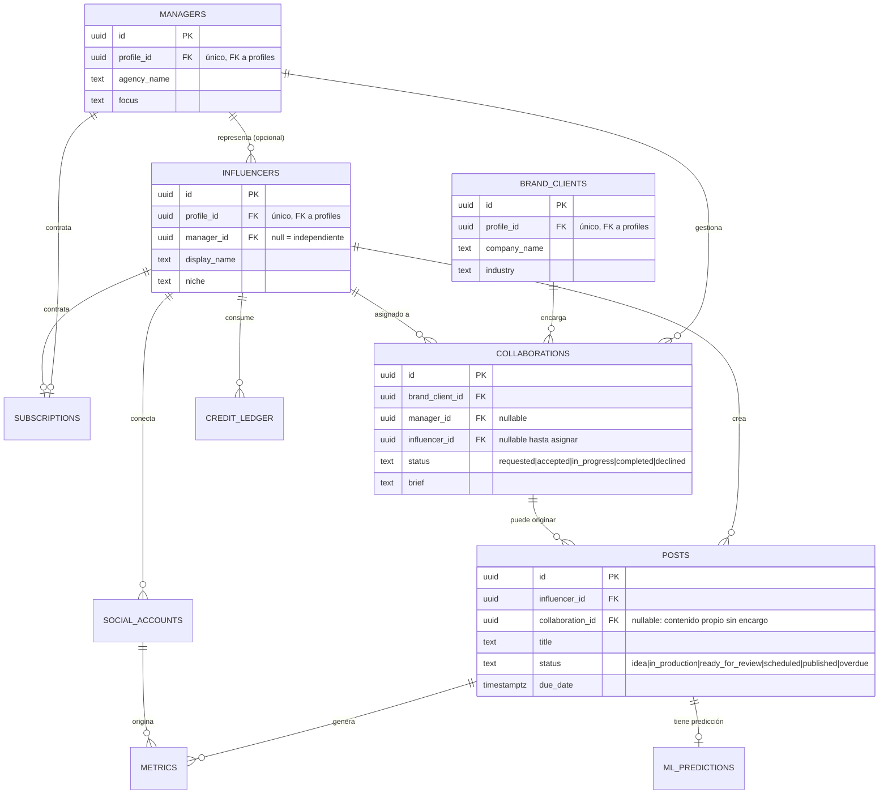

# 2. Esquema de Base de Datos (Supabase / PostgreSQL)

> Este documento explica el **por qué** del esquema. El SQL de verdad —el que de verdad se ejecuta y se prueba— vive en [`supabase/migrations/`](../supabase/migrations) y es la fuente de la verdad; si algo de aquí y el código no coinciden, manda el código. Guía paso a paso para aplicarlo: [`6-SUPABASE-SETUP.md`](./6-SUPABASE-SETUP.md).

## 2.1 Modelo Conceptual: un marketplace de 3 roles

FEEDMA no es un SaaS de un solo inquilino (una agencia con sus clientes); es un **marketplace**: una marca puede contratar a un **influencer** directamente, o a un **manager** que representa a varios influencers y les reparte el trabajo. Esto cambia la forma del esquema respecto a un CRM tradicional de agencia:

- **`managers`** — una agencia/representante. Tiene un **roster** (cartera) de influencers.
- **`influencers`** — un creador de contenido. `manager_id` es **opcional**: si es `null`, trabaja independiente y una marca le contacta directo; si tiene manager, la marca contacta al manager y es él quien asigna el trabajo.
- **`brand_clients`** — la marca que contrata. No administra nada de otro: contrata, revisa y aprueba.
- **`collaborations`** — el "contrato" del marketplace: conecta a una marca con un manager y/o un influencer concreto. Es el eslabón que determina **qué puede ver cada uno**: una marca nunca ve todo el contenido de un influencer, solo lo que está atado a una colaboración suya.
- **`posts`** — las entregas de contenido (el tablero semanal), siempre de un influencer, opcionalmente atadas a una `collaboration`.

## 2.2 Las tablas, una por una

El DDL completo y probado está en [`supabase/migrations/20261019120000_initial_schema.sql`](../supabase/migrations/20261019120000_initial_schema.sql). Resumen de cada tabla y por qué existe:

| Tabla | Para qué sirve |
|---|---|
| `profiles` | Extiende `auth.users` de Supabase. Se crea sola al registrarse (trigger, ver 2.5). Guarda el `role` ('manager'\|'influencer'\|'client'). |
| `managers` | Ficha de la agencia/representante. |
| `influencers` | Ficha del creador. `manager_id` nullable = el dato que decide "¿independiente o representado?". |
| `brand_clients` | Ficha de la marca. |
| `collaborations` | El contrato del marketplace. `constraint collaboration_has_a_target` obliga a que tenga manager_id o influencer_id (o ambos), nunca ninguno. |
| `social_accounts` | Redes conectadas por un influencer (tokens incluidos — nunca públicos). |
| `posts` | Las entregas del tablero. `collaboration_id` nullable porque un influencer puede publicar contenido propio sin que nadie se lo haya encargado. |
| `metrics` | Snapshot de métricas por post. Solo las escribe el servidor (ver 2.4). |
| `ml_predictions` | Resultado del motor de ML por post. |
| `trends` | Catálogo global de tendencias, no pertenece a nadie en concreto. |
| `subscriptions` | El plan de pago — de un manager **o** de un influencer, nunca de los dos a la vez (constraint `subscription_owner_is_exactly_one`). |
| `credit_ledger` | Consumo de créditos de ML, por influencer. |

## 2.3 Funciones auxiliares de seguridad

Definidas en [`supabase/migrations/20261019120100_rls_policies.sql`](../supabase/migrations/20261019120100_rls_policies.sql), se usan dentro de las políticas de abajo para no repetir subconsultas y evitar la recursión infinita típica de RLS:

- `current_manager_id()` / `current_influencer_id()` / `current_brand_client_id()` — devuelven la fila que le corresponde al usuario logueado para ese rol, o `null` si no aplica.
- `is_in_my_roster(influencer_id)` — ¿ese influencer está representado por el manager logueado?
- `has_active_collaboration_with(influencer_id)` — ¿la marca logueada tiene una colaboración con ese influencer?

## 2.4 Políticas RLS (Row Level Security)

**Regla de oro: toda tabla tiene RLS activado, sin excepción, desde el primer día.** El detalle completo está en la migración de RLS; aquí el resumen de las decisiones importantes:

- **`managers` e `influencers` son un directorio público** (de solo lectura, solo para usuarios logueados): cualquiera puede *ver* el nombre y el nicho de un influencer para poder contactarlo desde "Descubrir" — pero solo el propio influencer o su manager pueden *editar* su ficha.
- **`posts` es la tabla más delicada.** Una marca **nunca** ve todo el contenido de un influencer: solo los posts cuyo `collaboration_id` apunta a una colaboración suya. Esto se comprobó de verdad (no en teoría) consultando como cada rol vía la API REST de Supabase — ver el checklist de verificación en [`6-SUPABASE-SETUP.md`](./6-SUPABASE-SETUP.md#5-probar-que-la-seguridad-funciona-opcional-pero-recomendado).
- **Una marca no tiene `UPDATE` directo sobre `posts`.** Si lo tuviera, podría cambiar el título, la fecha, cualquier columna. En vez de eso, aprobar o pedir cambios pasa por dos funciones estrechas (`approve_post`, `request_post_changes`, ver 2.5) que solo mueven el `status`, y solo si el post de verdad pertenece a una colaboración suya y está esperando revisión.
- **`metrics`, `ml_predictions` y `subscriptions` no tienen política de `insert`/`update` para usuarios normales.** Sin política no hay permiso — es la forma correcta de decir "esto solo lo toca el servidor" (vía `service_role`, que salta RLS): jobs de sincronización de métricas, el motor de ML, y el webhook de Stripe.

## 2.5 Funciones y triggers de soporte

En [`supabase/migrations/20261019120200_functions_and_triggers.sql`](../supabase/migrations/20261019120200_functions_and_triggers.sql):

- **`handle_new_user()`** — trigger en `auth.users` que crea la fila en `profiles` automáticamente al registrarse, leyendo el rol elegido en el formulario desde los metadatos del `signUp()`.
- **`set_updated_at()`** — mantiene `updated_at` al día en `collaborations`, `posts` y `subscriptions`.
- **`approve_post(post_id)` / `request_post_changes(post_id)`** — las únicas dos formas que tiene una marca de mover el estado de un post (ver 2.4). Comprueban por dentro que quien llama es de verdad el dueño de la colaboración antes de tocar nada.

## 2.6 Cuentas de prueba

[`scripts/seed-demo-users.mjs`](../scripts/seed-demo-users.mjs) crea 3 cuentas reales (vía la Admin API de Supabase, nunca escribiendo a mano en `auth.users`) ya relacionadas entre sí — un manager, un influencer representado por él, y una marca con una colaboración y un post esperando aprobación. Instrucciones: [`6-SUPABASE-SETUP.md`](./6-SUPABASE-SETUP.md#4-crear-las-3-cuentas-de-prueba).

## 2.7 Próximos pasos relacionados

- Cómo aplicar todo esto a un proyecto real, paso a paso: [`6-SUPABASE-SETUP.md`](./6-SUPABASE-SETUP.md)
- Cómo se consumen `posts`, `metrics` y `trends` en el pipeline de ML: [`3-ML-PIPELINE.md`](./3-ML-PIPELINE.md)
- Checklist general de fases del proyecto: [`../README.md`](../README.md)
