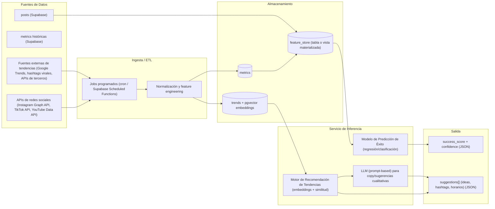

# 3. Pipeline de Machine Learning

## 3.1 Objetivos del Motor de ML

El motor de ML de **dweb-create** tiene dos funciones principales:

1. **Predicción de éxito (Success Score)**: dado un borrador de publicación (caption, hashtags, tipo de contenido, hora propuesta, red social, historial del cliente), estimar un score de 0 a 100 que indique la probabilidad de buen desempeño (engagement relativo al promedio histórico del cliente/industria).
2. **Generación de ideas y tendencias (Trend Engine)**: analizar tendencias actuales por plataforma/nicho y sugerir ideas de contenido, hooks, hashtags y mejores horarios de publicación.

Ambas funciones se exponen como Server Routes en Nuxt que actúan de **Gateway/BFF** hacia un servicio de inferencia desacoplado, nunca invocado directamente desde el cliente.

## 3.2 Arquitectura de Datos del Pipeline



## 3.3 Entradas (Features) del Modelo de Predicción de Éxito

| Feature | Origen | Tipo | Descripción |
|---|---|---|---|
| `content_type` | `posts.content_type` | categórica | video, imagen, carrusel, story, reel |
| `platform` | `social_accounts.platform` | categórica | instagram, tiktok, youtube, etc. |
| `caption_length` | derivado de `posts.metadata.caption` | numérica | longitud del texto |
| `caption_sentiment` | NLP sobre `caption` | numérica (-1 a 1) | polaridad del texto |
| `hashtag_count` | `posts.metadata.hashtags` | numérica | cantidad de hashtags usados |
| `hashtag_trend_score` | join con `trends` | numérica | promedio del score de tendencia de los hashtags usados |
| `scheduled_hour` / `scheduled_weekday` | `posts.due_date` / hora propuesta | categórica/numérica | franja horaria propuesta |
| `client_historical_avg_engagement` | agregación de `metrics` últimos 90 días | numérica | baseline del cliente |
| `client_industry` | `clients.industry` | categórica | para comparables cross-cliente |
| `days_since_last_post` | derivado de `posts` | numérica | frecuencia de publicación |
| `media_duration_seconds` (si video) | `posts.metadata.duration` | numérica | duración del clip |

## 3.4 Procesamiento

### 3.4.1 Fase de Ingesta (batch, periódica)

- **Job programado** (diario, p. ej. 03:00 UTC) que:
  1. Consulta las APIs oficiales de cada red social conectada (Instagram Graph API, TikTok for Developers, YouTube Data API) para posts publicados en las últimas 24-48h.
  2. Inserta/actualiza filas en `metrics`.
  3. Recalcula `client_historical_avg_engagement` (vista materializada o tabla `feature_store`).
  4. Ingresa tendencias detectadas (hashtags en ascenso, sonidos virales en TikTok, temas en Google Trends) en la tabla `trends`, generando su `embedding` vía un modelo de embeddings (p. ej. `text-embedding-3-small` o modelo equivalente) para habilitar búsqueda semántica con pgvector.

- Implementación recomendada: **Supabase Scheduled Edge Function** (cron) o un worker ligero en el `ml-service` (FastAPI + APScheduler/Celery) si el volumen de datos lo justifica.

### 3.4.2 Fase de Inferencia (síncrona, on-demand)

1. El usuario redacta un borrador de post en la UI (`/timeline` o `/posts/new`) y pulsa "Predecir éxito".
2. El cliente llama a `POST /api/ml/predict` (Server Route Nuxt).
3. La Server Route:
   - Verifica autenticación y créditos disponibles (`credit_ledger`).
   - Recupera features agregadas del cliente desde Supabase (`feature_store` / vista).
   - Llama al `ml-service` (FastAPI) vía HTTP interno con el payload normalizado.
4. El `ml-service`:
   - Aplica el modelo de predicción de éxito (ver 3.5) → `success_score`, `confidence`.
   - Opcionalmente, construye un prompt para un LLM que enriquezca la respuesta con sugerencias cualitativas (mejoras de copy, hashtags alternativos, horario óptimo).
5. La Server Route persiste el resultado en `ml_predictions`, descuenta 1 crédito en `credit_ledger`, y devuelve el JSON combinado al cliente.

## 3.5 Modelos a Utilizar

| Etapa del MVP | Enfoque | Justificación |
|---|---|---|
| **Fase 1 (Semanas 1-6, MVP)** | Modelo heurístico basado en reglas + regresión lineal simple (scikit-learn) entrenado con pocos datos propios + benchmarks públicos de engagement por industria | Sin datos propios suficientes al inicio; un modelo simple y explicable da resultados razonables y permite iterar rápido |
| **Fase 2 (post-MVP, con datos propios)** | Gradient Boosting (XGBoost/LightGBM) entrenado con histórico real de `metrics` por cliente/industria | Captura relaciones no lineales entre features una vez hay volumen suficiente de datos (recomendado > 500-1000 posts etiquetados) |
| **Sugerencias cualitativas (copy, hashtags, tendencias)** | LLM vía API (p. ej. Claude API) con prompt estructurado + contexto de `trends` recuperado por similitud (pgvector) | Generación de lenguaje natural de alta calidad sin necesidad de entrenar un modelo propio; approach RAG sobre tendencias |
| **Detección de tendencias** | Embeddings + clustering (k-means o HDBSCAN) sobre hashtags/temas recientes, o consumo directo de APIs de tendencias de terceros | Agrupa temas similares y detecta picos de crecimiento |

### 3.5.1 Formato del Prompt para el LLM (sugerencias cualitativas)

```text
Eres un estratega de contenido para redes sociales especializado en {platform}.

Contexto del cliente:
- Industria: {client_industry}
- Engagement promedio histórico: {client_historical_avg_engagement}%
- Tendencias relevantes detectadas (top 5 por similitud): {trends_context}

Borrador del creador:
- Tipo de contenido: {content_type}
- Caption: "{caption}"
- Hashtags actuales: {hashtags}
- Horario propuesto: {scheduled_weekday} a las {scheduled_hour}h

Score numérico de éxito calculado por el modelo: {success_score}/100 (confianza: {confidence})

Tarea:
1. Explica en 1-2 frases por qué el score es alto/medio/bajo.
2. Sugiere 3 mejoras concretas al caption.
3. Sugiere 5 hashtags alternativos o complementarios basados en las tendencias detectadas.
4. Sugiere el mejor horario alternativo si el propuesto no es óptimo.

Responde ÚNICAMENTE en el formato JSON especificado, sin texto adicional.
```

## 3.6 Formato de Salida (JSON)

### 3.6.1 Respuesta de `POST /api/ml/predict`

```json
{
  "post_id": "c1a2b3c4-...",
  "success_score": 72.5,
  "confidence": 0.81,
  "score_breakdown": {
    "base_model_score": 68.0,
    "trend_alignment_bonus": 4.5
  },
  "suggestions": {
    "explanation": "El score es medio-alto porque el horario propuesto coincide con picos históricos de engagement del cliente, aunque el caption es más corto que el promedio de sus posts exitosos.",
    "caption_improvements": [
      "Añade una pregunta al final para incentivar comentarios.",
      "Incluye un call-to-action claro (ej. 'Guarda este post').",
      "Menciona el beneficio principal en las primeras 2 líneas (se corta en 'ver más')."
    ],
    "hashtag_suggestions": ["#tendencia1", "#tendencia2", "#nicho3", "#reto2026", "#descubrimiento"],
    "optimal_schedule": {
      "weekday": "jueves",
      "hour_range": "18:00-20:00",
      "reason": "Pico histórico de engagement del cliente en los últimos 90 días"
    }
  },
  "model_version": "v1-heuristic-2026.01",
  "credits_consumed": 1
}
```

### 3.6.2 Respuesta de `GET /api/ml/trends?platform=tiktok&niche=fitness`

```json
{
  "generated_at": "2026-10-19T12:00:00Z",
  "platform": "tiktok",
  "niche": "fitness",
  "trends": [
    {
      "topic": "Rutinas de 10 minutos sin equipo",
      "trend_score": 88.3,
      "growth_rate_7d": "+34%",
      "related_hashtags": ["#homeworkout", "#10minworkout", "#fitnesstips"],
      "suggested_formats": ["reel corto con transición", "antes/después"]
    },
    {
      "topic": "Mitos de nutrición desmentidos",
      "trend_score": 76.1,
      "growth_rate_7d": "+19%",
      "related_hashtags": ["#nutritionmyths", "#fitfacts"],
      "suggested_formats": ["video explicativo con texto en pantalla"]
    }
  ]
}
```

## 3.7 Prompts y Modelos a Utilizar (resumen técnico)

- **Embeddings**: modelo de embeddings de propósito general (dimensión 1536) para indexar `trends.description` + hashtags, almacenados en `pgvector` dentro de Supabase. Permite búsquedas de similitud (`<=>` operador de pgvector) para recuperar las tendencias más relevantes al nicho/industria del cliente antes de armar el prompt del LLM (patrón **RAG**).
- **LLM de generación**: Claude API (modelo de la familia Claude, seleccionado por costo/latencia según el volumen esperado) para las sugerencias cualitativas. Se usa **function calling / structured output** (JSON schema) para garantizar que la respuesta sea parseable de forma determinista por la Server Route.
- **Modelo de predicción numérica**: entrenado y servido desde el `ml-service` (Python). En el MVP puede ser tan simple como un `scikit-learn` `Pipeline` (preprocesamiento + `GradientBoostingRegressor` o `LogisticRegression` si se modela como clasificación binaria "éxito/no éxito" con umbral).
- **Versionado de modelos**: cada predicción guarda `model_version` en `ml_predictions` para poder comparar desempeño de versiones sucesivas y hacer rollback si una versión nueva degrada resultados.

## 3.8 Métricas de Evaluación del Modelo (para iterar)

| Métrica | Uso |
|---|---|
| MAE (Mean Absolute Error) | Error promedio entre `success_score` predicho y engagement real normalizado a 0-100 |
| Precisión/Recall (si se modela como clasificación "viral/no viral") | Evaluar capacidad de detectar outliers positivos |
| Feedback explícito del usuario (👍/👎 sobre la sugerencia) | Señal de calidad percibida, almacenada para reentrenamiento futuro |
| Tasa de adopción de sugerencias | % de veces que el usuario aplica el hashtag/horario sugerido, correlacionado con desempeño real posterior |

## 3.9 Consideraciones de Costos y Rate Limiting

- Cada llamada a `/api/ml/predict` o `/api/ml/trends` consume **créditos** (`credit_ledger`), controlados por plan de suscripción (ver [`2-DATABASE-SCHEMA.md`](./2-DATABASE-SCHEMA.md) sección `subscriptions`/`credit_ledger`).
- Se recomienda cachear resultados de `trends` (TTL de 6-12h) ya que no cambian por usuario, reduciendo llamadas redundantes al LLM/embeddings.
- Rate limiting adicional por IP/usuario en la Server Route para prevenir abuso, independientemente del sistema de créditos.

## 3.10 Próximos pasos relacionados

- Ver cómo se integra esto en el flujo general de la app: [`1-ARCHITECTURE.md`](./1-ARCHITECTURE.md)
- Ver tareas concretas de implementación del pipeline por semana: [`4-ROADMAP-AND-TASKS.md`](./4-ROADMAP-AND-TASKS.md)
