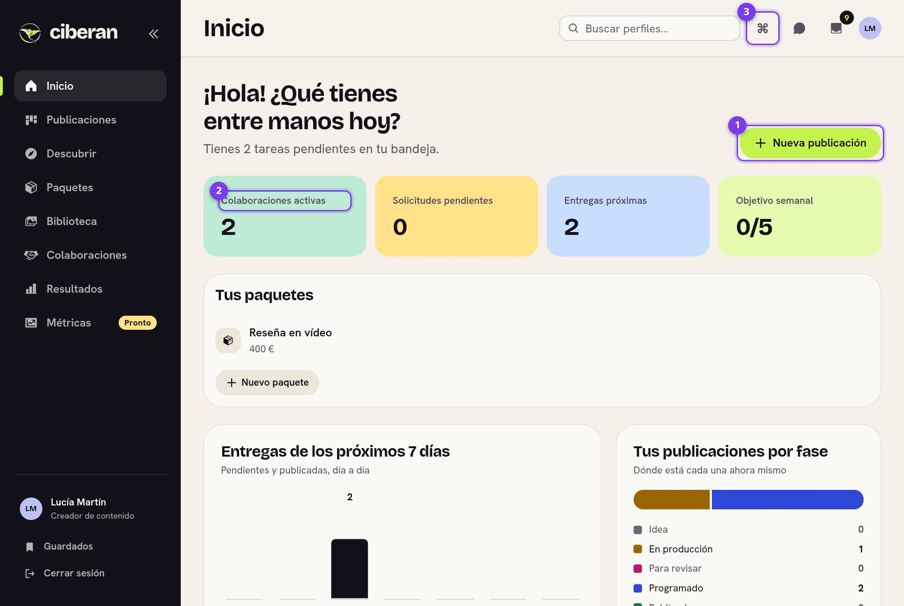
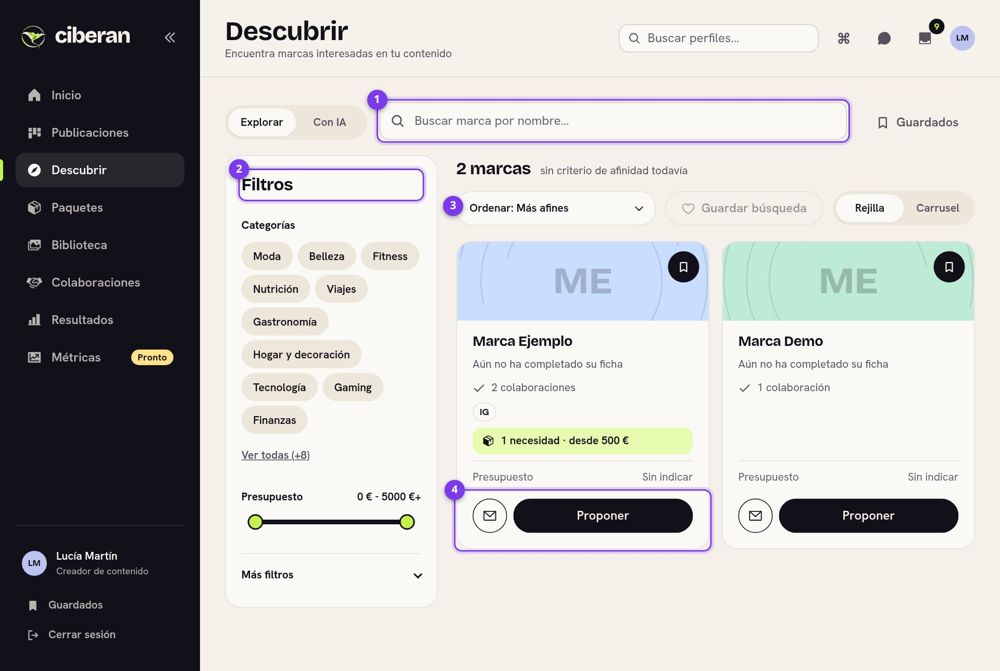
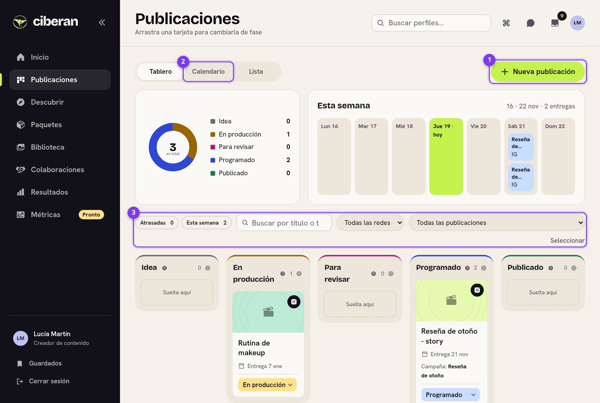

# Empieza en 6 pasos

CIBERAN te une con marcas y te ayuda a organizar tu contenido y tus colaboraciones. Es **gratis durante el lanzamiento**. Para el detalle de cada pantalla, consulta el *Manual de usuario*.

## 1. Crea tu cuenta

1. Abre CIBERAN y pulsa **Crear cuenta**.
2. Elige **Creador de contenido**, escribe tu nombre, tu email y una contraseña de al menos 8 caracteres.
3. Abre el correo de confirmación y pulsa el enlace. **Sin confirmar el email no podrás entrar.**

> **Consejo:** si no ves el correo, mira el spam. Si olvidas la contraseña: **¿Olvidaste tu contraseña?** en la pantalla de acceso. Usa siempre el último correo recibido.

## 2. Completa tu perfil

1. Pulsa tu avatar (arriba a la derecha) → **Perfil → Editar ficha**.
2. Añade foto, portada, una frase de presentación, tu biografía, tus categorías y tu tarifa orientativa.
3. Vigila el indicador **Ficha completa al…**: cuanto más alto, mejor te encuentran.

## 3. Publica tu primer paquete

Un **paquete** es lo que ofreces y a qué precio (por ejemplo «Reel + 3 Stories · 300 €»).

1. Menú **Paquetes → Añadir paquete**.
2. Elige una plantilla o escribe el título, los entregables y el **precio**.
3. Pulsa **Publicar paquete**. Destácalo con la estrella para que salga primero.

## 4. Encuentra marcas

1. Menú **Descubrir**. Filtra por categoría o presupuesto.
2. En una tarjeta de marca, pulsa **Proponer**: pon tu tarifa, tus entregables y marca la casilla de que la propuesta es vinculante.
3. Pulsa **Enviar propuesta**.

## 5. Responde a las solicitudes

Cuando una marca te contacta, aparece en **Colaboraciones → Solicitudes** y en tu **Bandeja de entrada**. Tienes **7 días**.

| Opción | Qué hace |
|---|---|
| **Aceptar** | La colaboración queda aceptada. |
| **Hacer contraoferta** | Propones otro importe. |
| **Rechazar solicitud** | Pide confirmación y **no se puede deshacer**. |

Mira siempre el **Siguiente paso** de cada colaboración: te dice si te toca a ti.

## 6. Crea y entrega tu contenido

1. Menú **Publicaciones → Nueva publicación**. Si es de una colaboración, elige **Para una colaboración**.
2. Llévala por las fases: **Idea → En producción → Para revisar → Programado → Publicado** (arrastra la tarjeta o usa el botón de la ficha).
3. En **Para revisar**, la marca **aprueba** o **pide cambios**. Corrige y reenvía si hace falta.
4. Cuando todo está aprobado y publicado, pulsa **Marcar como completada** y valora a la marca.

# Trucos para ir más rápido

| Quiero… | Cómo |
|---|---|
| Ir a cualquier pantalla | **Ctrl + K** (o **Cmd + K** en Mac): escribe unas letras y pulsa Intro. |
| Reutilizar una portada | **Biblioteca**: sube imágenes y úsalas con **Elegir de la biblioteca**. |
| No escribir lo mismo dos veces | **Duplicar publicación** o **Guardar como plantilla**. |
| Recuperar algo que borré sin querer | Pulsa **Deshacer** en los 8 segundos siguientes. |
| Dar el borrador a la marca | En la publicación, pega el **Enlace al borrador**. |
| Ver cómo me va | Menú **Resultados**. |

> **Atención:** CIBERAN **no gestiona pagos**. El importe acordado lo cobras directamente de la marca.

> **Próximamente:** las métricas de tus redes y la predicción de rendimiento con IA **no están disponibles todavía**.
