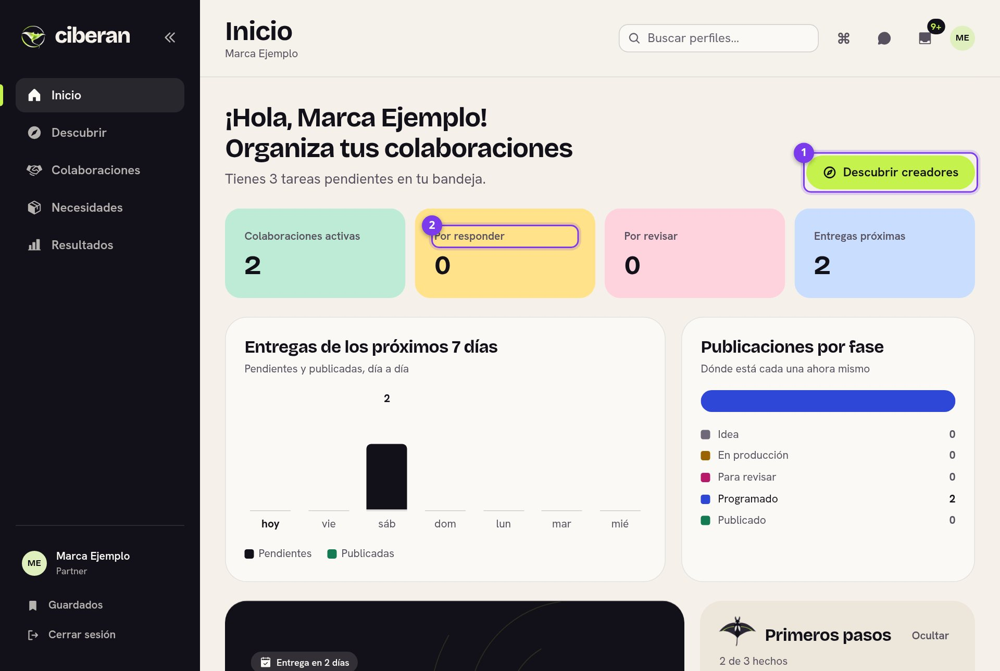
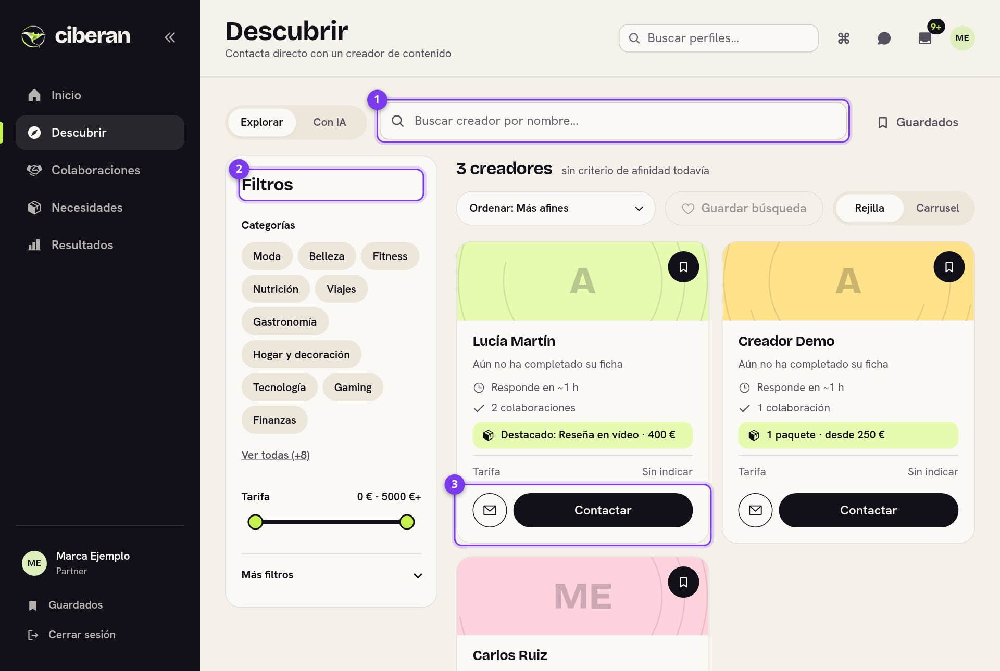
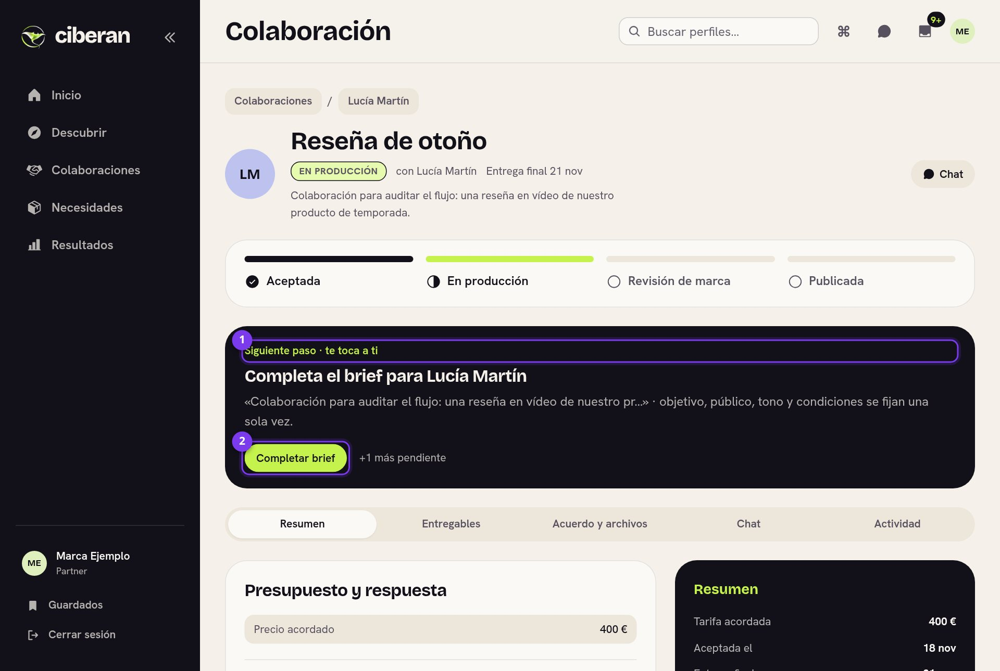

# Empieza en 6 pasos

CIBERAN te ayuda a encontrar creadores, acordar las condiciones y revisar el contenido antes de que salga. Es **gratis durante el lanzamiento**. Para el detalle de cada pantalla, consulta el *Manual de usuario*.

## 1. Crea tu cuenta

1. Abre CIBERAN y pulsa **Crear cuenta**.
2. Elige **Partner**, escribe tu nombre, el nombre de la empresa, tu email y una contraseña de al menos 8 caracteres.
3. Abre el correo de confirmación y pulsa el enlace. **Sin confirmar el email no podrás entrar.**

> **Consejo:** si no ves el correo, mira el spam. Si olvidas la contraseña: **¿Olvidaste tu contraseña?** en la pantalla de acceso. Usa siempre el último correo recibido.

## 2. Completa tu ficha

1. Pulsa tu avatar → **Perfil → Editar ficha**.
2. Añade logo, portada, biografía, categorías, presupuesto y **qué tipo de creador buscas**.

## 3. Encuentra creadores

1. Menú **Descubrir**. Filtra por categoría y tarifa, y ordena por afinidad, respuesta o precio.
2. Fíjate en cuánto tardan en responder, sus colaboraciones, su paquete destacado y su valoración.
3. Guarda con el marcador a los que te interesen y revisa su perfil completo antes de decidir.

## 4. Contacta y propón

1. En la tarjeta del creador, pulsa **Contactar** (o **Invitar a colaborar** en su perfil).
2. Cuenta tu campaña, pon tu **presupuesto** y, si quieres, objetivo, público, tono y condiciones.
3. Pulsa enviar. **Las condiciones quedan fijadas al enviar.**

También puedes **Hacer oferta** sobre un paquete concreto, o **Enviar mensaje**.

## 5. Negocia y acepta

El creador tiene **7 días** para responder. Puede aceptar, rechazar o hacer una **contraoferta**. Tú, en el bloque **Presupuesto y respuesta**:

| Opción | Qué hace |
|---|---|
| **Aceptar** | La colaboración queda aceptada. |
| **Hacer contraoferta** | Propones otro importe. |
| **Rechazar solicitud** | Pide confirmación y **no se puede deshacer**. |

El **Siguiente paso** te dice siempre a quién le toca mover ficha.

## 6. Define, revisa y cierra

1. Con la colaboración aceptada, pulsa **Completar brief** (objetivo, público, tono, condiciones) y **Definir entregables** (uno por línea). **Ambas cosas se fijan una sola vez.**
2. Cuando el creador envía contenido, aparece en **Por revisar**: pulsa **Aprobar** o **Pedir cambios** (con un comentario concreto).
3. Con todo aprobado, pulsa **Marcar como completada** y valora al creador.

# Trucos para ir más rápido

| Quiero… | Cómo |
|---|---|
| Ir a cualquier pantalla | **Ctrl + K** (o **Cmd + K** en Mac): escribe unas letras y pulsa Intro. |
| Publicar lo que busco | Menú **Necesidades → Añadir necesidad**: los creadores te harán ofertas. |
| Encontrar colaboraciones de una misma campaña | Usa el mismo **nombre de campaña** al contactar. |
| Ver el calendario de entregas | **Colaboraciones → Calendario**. |
| Exportar mis colaboraciones | **Colaboraciones → Exportar CSV**. |
| Ver cómo van mis colaboraciones | Menú **Resultados**. |
| Volver a estas guías | Menú → **Ayuda**. |

> **Atención:** CIBERAN **no gestiona pagos**. El importe acordado lo pagas directamente al creador por el medio que acordéis.

> **Próximamente:** las métricas de redes de los creadores **no están disponibles todavía**. Valóralos por su valoración, sus colaboraciones y su tiempo de respuesta.
