# Antes de empezar

## Cómo usar este manual

Este manual explica CIBERAN como lo vería alguien que nunca ha usado una plataforma de colaboraciones. No hace falta saber nada técnico. Cada tarea sigue el mismo formato:

- **Qué queremos hacer**: de qué se trata, en una frase.
- **Pasos**: qué pulsar y dónde, en orden.
- **Qué sucede después**: lo que verás al terminar.
- **Consejo**: una recomendación, cuando la hay.

Si eres **creador de contenido**, lee la Parte I, la Parte II y la Parte III. Si eres **marca o empresa (partner)**, lee la Parte I, la Parte II y la Parte IV. La Parte V cuenta una colaboración completa, vista por los dos lados, y es la mejor manera de entender cómo encaja todo.

> **Consejo:** si solo tienes cinco minutos, lee la sección «Conceptos básicos» de la Parte I y la Parte V. Con eso entenderás el 80 % de CIBERAN.

## Lo que este manual no promete

Este manual describe lo que la aplicación hace **hoy**. Hay funciones previstas que todavía no están disponibles y se indican siempre con un aviso gris de «No disponible» o «Próximamente». Las más importantes:

| Función | Estado |
|---|---|
| Métricas de tus redes sociales (seguidores, alcance, likes…) | **Próximamente.** El menú ya muestra «Métricas» con la etiqueta «Pronto». |
| Pagos y cobros dentro de CIBERAN | **No disponible.** CIBERAN es gratis durante el lanzamiento y no gestiona dinero. |
| Predicción de rendimiento con IA | **No disponible** en este momento (está desactivada en el lanzamiento gratuito). |
| Entrar con Google | **No disponible.** Solo se entra con email y contraseña. |

> **Aviso:** las capturas del manual son de la aplicación real, pero los nombres, emails y marcas que aparecen se han sustituido por datos ficticios (por ejemplo «Lucía Martín» o «Marca Ejemplo») para proteger la privacidad. Donde no se ha podido hacer una captura, se indica con un recuadro de «Captura pendiente».

# Parte I · Conociendo CIBERAN

## Qué es CIBERAN

CIBERAN es un lugar donde **creadores de contenido** y **marcas** se encuentran, se ponen de acuerdo y trabajan juntos en cada publicación, sin salir de la plataforma.

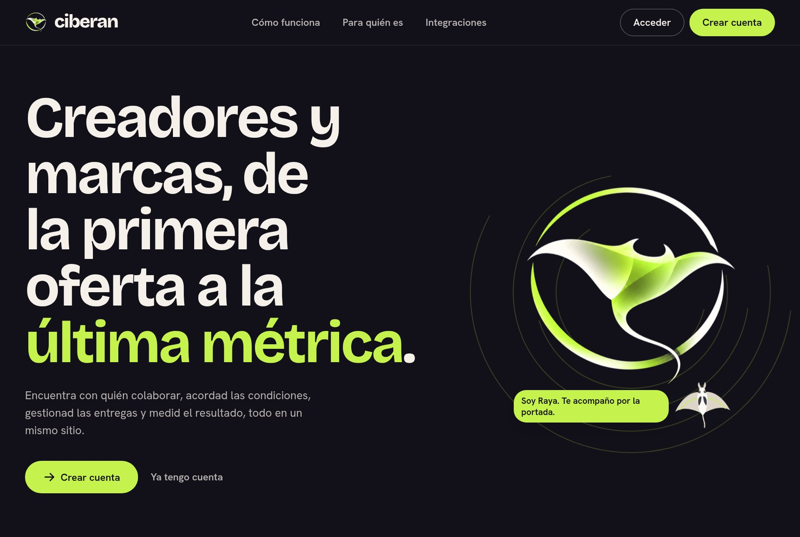

## Para qué sirve

Con CIBERAN puedes:

- **Encontrar con quién colaborar**: los creadores aparecen en el buscador de las marcas, y las marcas en el de los creadores.
- **Acordar las condiciones**: precio, entregables y plazos quedan escritos, con propuesta, contraoferta y aceptación.
- **Organizar el trabajo**: cada pieza de contenido pasa por fases (idea, producción, revisión, programada, publicada).
- **Revisar y aprobar**: la marca ve el contenido antes de que salga y puede aprobarlo o pedir cambios.
- **Ver cómo van las colaboraciones**: plazos, tiempos de respuesta y resultados.

## Qué problemas resuelve

| Antes | Con CIBERAN |
|---|---|
| Se negocia por mensajes sueltos y se pierde lo acordado. | Cada colaboración guarda el acuerdo, el precio y el historial. |
| «¿En qué punto estamos?» | Un indicador de **Siguiente paso** dice qué toca hacer y a quién le toca. |
| Los archivos se pierden entre correos y chats. | Cada colaboración tiene su espacio de archivos y su chat. |
| Nadie sabe si algo está aprobado. | Cada entrega tiene un estado claro: enviada, aprobada o con cambios pedidos. |

## Creador y partner: dos perfiles

Al crear tu cuenta eliges uno de los dos perfiles. **No se puede ser los dos a la vez con la misma cuenta.**

| | **Creador de contenido** | **Partner (marca o empresa)** |
|---|---|---|
| Quién es | Persona que crea contenido y lo publica en sus redes. | Marca, empresa o agencia que quiere contratar contenido. |
| Qué hace | Gestiona sus publicaciones, sus colaboraciones y sus resultados. | Contacta con creadores, acuerda la colaboración y aprueba el contenido. |
| Qué publica en su perfil | **Paquetes**: lo que ofrece y a qué precio. | **Necesidades**: lo que busca y con qué presupuesto. |
| Su menú | Inicio, Publicaciones, Descubrir, Paquetes, Biblioteca, Colaboraciones, Resultados y Métricas (próximamente). | Inicio, Descubrir, Colaboraciones, Necesidades y Resultados. |
| Decide el contenido | Lo crea y lo envía a revisión. | Lo revisa: aprueba o pide cambios. |

## Cómo se relacionan ambos perfiles

1. **El partner contacta con un creador** (o el creador propone a una marca). Eso crea una **solicitud** de colaboración.
2. **La otra parte responde**: acepta, rechaza o hace una **contraoferta** con otro importe.
3. Cuando las dos partes están de acuerdo, la colaboración queda **aceptada**.
4. El creador **produce el contenido** y lo envía a revisión.
5. El partner **aprueba** o **pide cambios**.
6. Con todo aprobado y publicado, la colaboración se **completa** y cada parte puede valorar a la otra.

## Conceptos básicos

| Palabra | Qué significa |
|---|---|
| **Colaboración** | Un acuerdo concreto entre un creador y un partner, con importe, entregables y plazos. |
| **Solicitud** | El primer paso: alguien propone colaborar y espera respuesta. Caduca a los 7 días si nadie responde. |
| **Contraoferta** | Una respuesta con otro importe, en lugar de aceptar o rechazar. |
| **Paquete** | Lo que ofrece un creador (por ejemplo «1 Reel + 3 Stories», 300 €). |
| **Necesidad** | Lo que busca un partner (por ejemplo «Campaña de temporada», 500 €). |
| **Entregable** | Cada pieza de contenido que se acuerda entregar. |
| **Publicación** | Una pieza de contenido que el creador prepara. Si es de una colaboración, es un entregable. |
| **Siguiente paso** | El aviso que dice qué hay que hacer ahora y quién tiene que hacerlo. |

El glosario completo está en la Parte VII.

# Parte II · Primeros pasos

## Acceder a CIBERAN

**Qué queremos hacer:** abrir CIBERAN por primera vez.

#### Pasos

1. Abre la dirección web de CIBERAN en el navegador del móvil o del ordenador.
2. Verás la página de inicio, con los botones **Acceder** y **Crear cuenta** arriba a la derecha y **Crear cuenta** y **Ya tengo cuenta** en el centro.
3. Si ya tienes cuenta, pulsa **Acceder**. Si no, pulsa **Crear cuenta**.

#### Qué sucede después

Irás a la pantalla de acceso o a la de registro.

> **Consejo:** puedes instalar CIBERAN como una app en tu móvil, sin pasar por ninguna tienda. La página **Instalar** explica cómo hacerlo en iPhone, Android y escritorio.

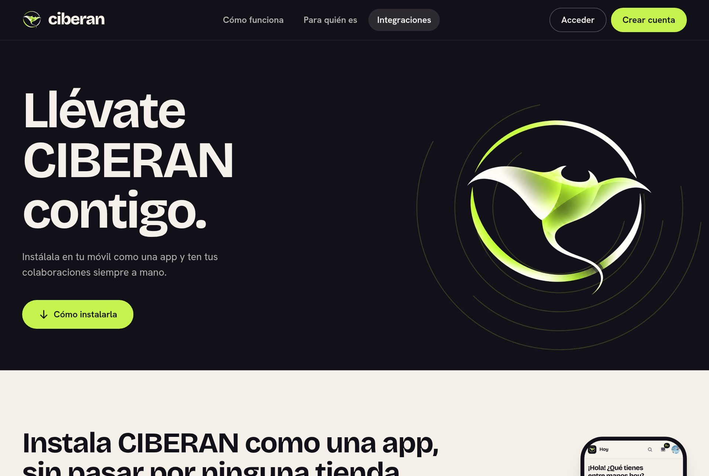

## Registrarse

**Qué queremos hacer:** crear una cuenta gratuita.

#### Pasos

1. Pulsa **Crear cuenta**.
2. En el **Paso 1 de 2**, elige tu perfil: (1) **Creador de contenido** o (2) **Partner**.
3. En el **Paso 2 de 2** (**Crea tu cuenta**), escribe tu nombre. Si eres partner, también el nombre de la empresa.
4. Escribe tu **email** y una **contraseña** de al menos 8 caracteres. Repítela.
5. Marca la casilla de aceptación de los términos y la política de privacidad (puedes leerlos antes en los enlaces que aparecen).
6. Pulsa el botón para crear la cuenta.

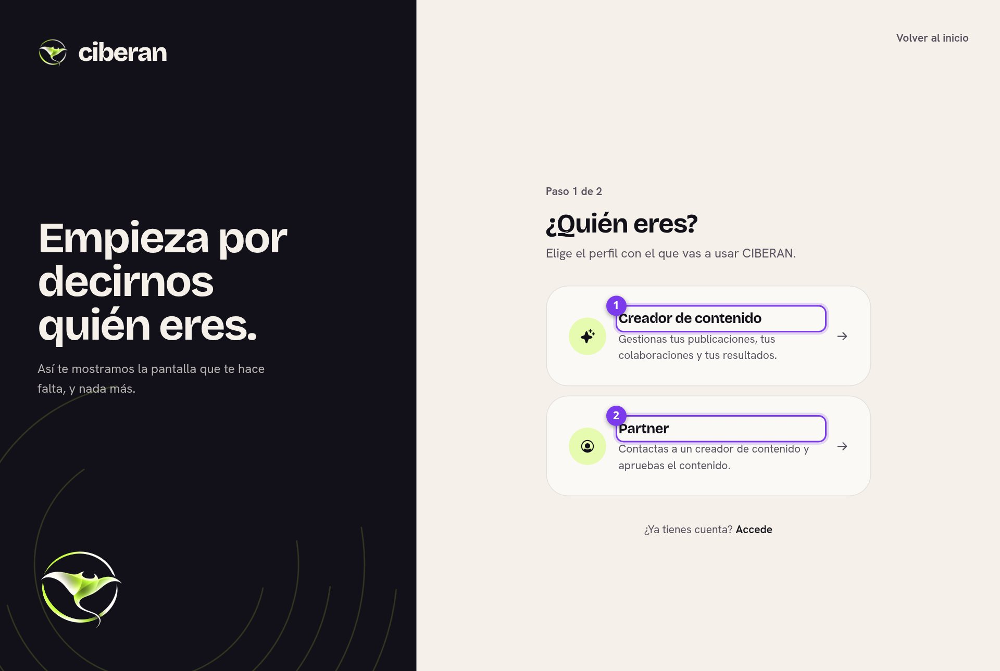

#### Qué sucede después

CIBERAN te envía un **correo de confirmación** y te muestra la pantalla **Revisa tu email**. Abre el correo y pulsa el enlace para activar la cuenta.

> **Atención:** hasta que no confirmes el email no podrás entrar. Si no lo ves, mira en la carpeta de spam o promociones. En la propia pantalla puedes pedir que te lo enviemos otra vez o pulsar **Cambiar el email** si te equivocaste de dirección.

> **Aviso:** crear la cuenta es gratis. Tu perfil será visible para otros usuarios y, si no lo cambias en Privacidad, también para quien tenga su enlace sin iniciar sesión.

## Iniciar sesión

**Qué queremos hacer:** entrar en tu cuenta.

#### Pasos

1. En la página de inicio, pulsa **Acceder**.
2. Escribe tu **Email** (1) y tu **Contraseña**.
3. Pulsa **Acceder** (3).

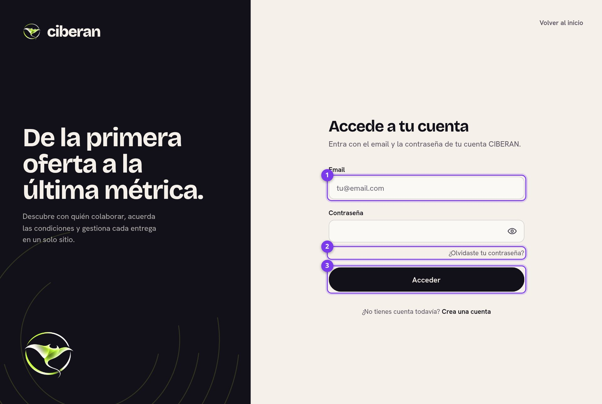

#### Qué sucede después

Entras en tu página de **Inicio**: la del creador o la del partner según el perfil que elegiste.

Si algo falla, verás uno de estos mensajes:

| Mensaje | Qué hacer |
|---|---|
| «Email o contraseña incorrectos.» | Revisa los datos. Si no recuerdas la contraseña, usa «¿Olvidaste tu contraseña?». |
| «Todavía no has confirmado tu email — revisa tu bandeja de entrada.» | Abre el correo de confirmación. Puedes pedir que te lo enviemos otra vez. |
| «Demasiados intentos seguidos — espera un momento y vuelve a intentarlo.» | Espera unos minutos antes de volver a probar. |

## Recuperar el acceso

**Qué queremos hacer:** crear una contraseña nueva si no recuerdas la tuya.

#### Pasos

1. En la pantalla de acceso, pulsa **¿Olvidaste tu contraseña?** (2).
2. En **Recupera tu contraseña**, escribe el email de tu cuenta y pulsa **Enviar enlace**.
3. Abre el correo que recibirás y pulsa el enlace. **Ábrelo en el mismo navegador** donde hiciste la petición.
4. En **Elige una contraseña nueva**, escribe la contraseña (mínimo 8 caracteres) y repítela.
5. Confirma. Ya puedes entrar con la contraseña nueva.

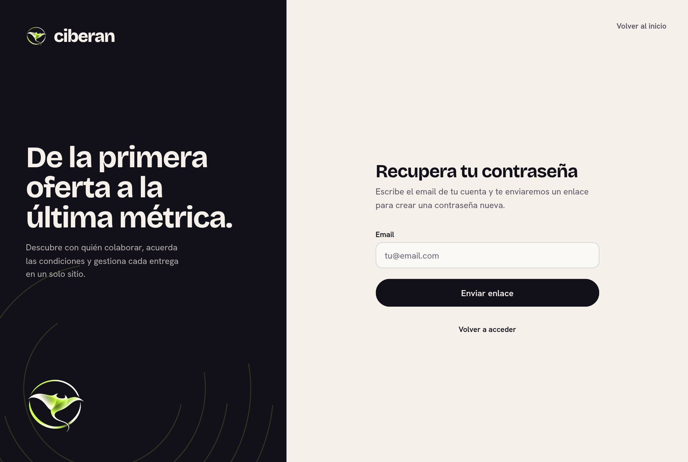

> **Consejo:** si ya estás dentro de CIBERAN y solo quieres cambiar la contraseña, hazlo en **Perfil → Privacidad y cuenta → Acceso a la cuenta**.

> **Atención:** los enlaces duran poco y **solo valen una vez**. Usa siempre el último correo que recibas: los anteriores dejan de valer.

#### Si el enlace no funciona

Si ves **«No podemos usar este enlace»**, tu contraseña no se ha cambiado. Pulsa **Pedir un enlace nuevo** y repite el proceso. Las causas habituales son que el enlace haya caducado, que ya lo hayas usado o que lo abras en otro navegador.

Si ves **«Hay otra sesión abierta»**, pulsa **Cerrar sesión y pedir un enlace nuevo**.

> **Sin verificar:** el envío real de correos depende de la configuración del servicio de correo de CIBERAN. Si no te llega ningún mensaje tras varios intentos, escribe al equipo de CIBERAN.

## Completar tu perfil

**Qué queremos hacer:** que tu perfil esté completo para que te encuentren y se fíen de ti.

#### Pasos

1. Pulsa tu **avatar** (arriba a la derecha) para ir a **Perfil**.
2. Mira el indicador **Ficha completa al…** y la lista **Te falta:** (foto de perfil, foto de portada, biografía, categorías, tarifa…).
3. Pulsa **Editar ficha** y rellena lo que falte.

#### Qué sucede después

El porcentaje sube. Cuanto más completa esté tu ficha, mejor te muestran los buscadores de **Descubrir**.

Los detalles de cada campo están en la Parte III (creadores) y en la Parte IV (partners).

## El primer acceso: el recorrido de bienvenida

La primera vez que entras, CIBERAN te enseña un **recorrido de bienvenida** de unos seis pasos. Va señalando, en el menú real, cada apartado de la aplicación y para qué sirve. Puedes pulsar **Siguiente** para avanzar o **Saltar recorrido** cuando quieras.

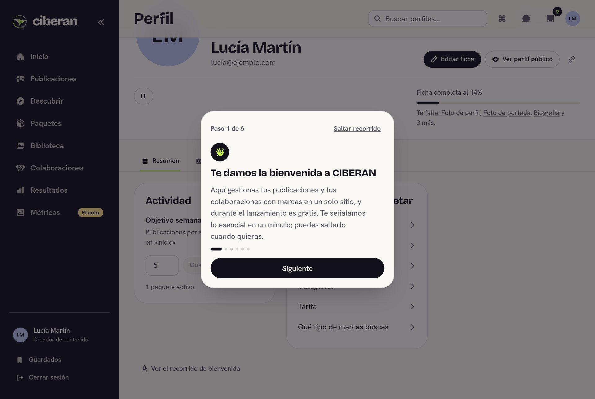

> **Consejo:** si lo saltaste y quieres verlo otra vez, entra en **Perfil → Resumen** y pulsa **Ver el recorrido de bienvenida**, al final de la página.

En tu página de Inicio también verás el cuadro **Primeros pasos** (por ejemplo «Completa tu ficha pública» o «Publica tu primer paquete»). Se va marcando solo según avanzas, y puedes ocultarlo con **Ocultar**.

## Cómo moverte por CIBERAN

En el ordenador, el **menú** está a la izquierda. En el móvil, abajo, con un botón **Más** para el resto de apartados.

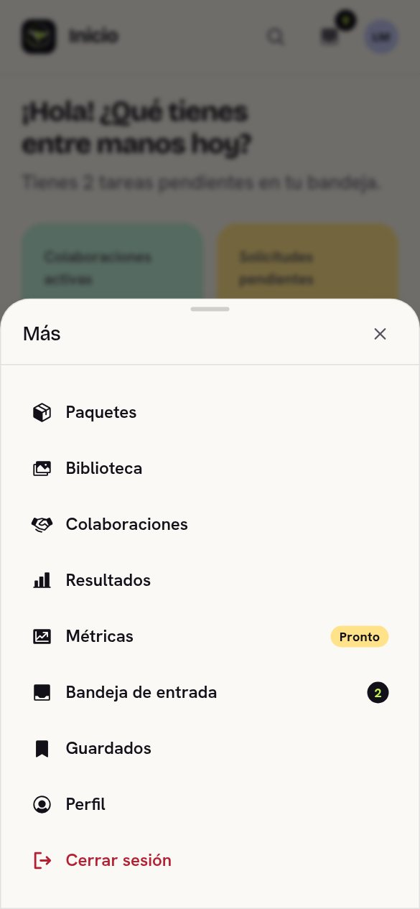

Arriba a la derecha tienes siempre cuatro accesos:

- **Buscar perfiles**: escribe un nombre para encontrar a cualquier creador o marca.
- **Buscar y acciones (Ctrl K)**: la paleta de comandos. Salta a cualquier pantalla, o busca colaboraciones y perfiles, escribiendo unas letras.
- **Chat**: tus conversaciones.
- **Bandeja de entrada**: lo que te toca hacer y tus avisos. El número indica lo pendiente.

Tu avatar lleva a tu **Perfil**. Abajo del menú están **Guardados**, **Ayuda** (los manuales en PDF) y **Cerrar sesión**.

### La paleta de comandos (Ctrl o Cmd + K)

**Qué queremos hacer:** ir a una pantalla o encontrar algo sin recorrer el menú.

#### Pasos

1. Pulsa a la vez **Ctrl** y **K** (en Mac, **Cmd** y **K**), o pulsa el botón del símbolo ⌘ de la barra superior.
2. Escribe unas letras. Por ejemplo «biblio» para ir a la Biblioteca.
3. Con las flechas **↑ ↓** elige un resultado y pulsa **Intro**. Con **Esc** la cierras.

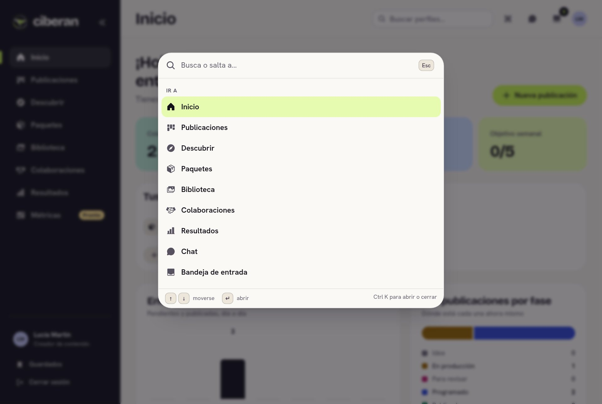

#### Qué sucede después

Se abre la pantalla elegida. Si escribes algo que no existe, verás «Nada coincide». Además de las pantallas, la paleta busca **colaboraciones** y **perfiles** por su nombre.

> **Aviso:** la paleta ofrece solo las pantallas de tu perfil. Un partner, por ejemplo, no verá «Biblioteca», que es del creador.

# Parte III · Manual del creador

Esta parte es para quien eligió el perfil **Creador de contenido**. El menú del creador tiene estos apartados: **Inicio, Publicaciones, Descubrir, Paquetes, Biblioteca, Colaboraciones, Resultados** y **Métricas** (próximamente).

## Inicio

**Qué queremos hacer:** ver de un vistazo qué tengo pendiente.

#### Pasos

1. Pulsa **Inicio** en el menú.
2. Mira el saludo: te dice cuántas tareas tienes pendientes en la bandeja.
3. Recorre las tarjetas de colores y los bloques de debajo.

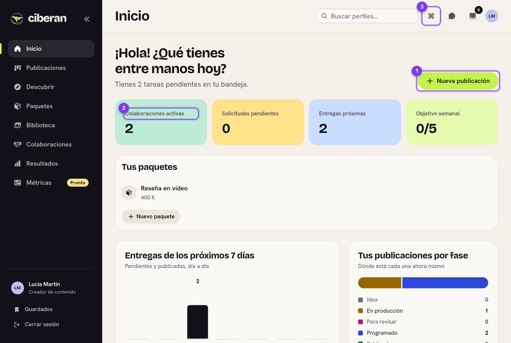

Marcadores de la imagen: (1) botón **Nueva publicación**, (2) tarjeta de **Colaboraciones activas**, (3) botón de la paleta de comandos.

#### Qué significa cada tarjeta

| Tarjeta | Qué cuenta |
|---|---|
| **Colaboraciones activas** | Las colaboraciones aceptadas que siguen en marcha. |
| **Solicitudes pendientes** | Solicitudes de marcas que esperan tu respuesta. |
| **Entregas próximas** | Publicaciones con fecha de entrega en los próximos días. |
| **Objetivo semanal** | Cuántas publicaciones llevas esta semana frente a tu objetivo (por ejemplo 0/5). El objetivo lo eliges en **Perfil → Resumen**. |

Debajo encontrarás:

- **Tus paquetes**: tus ofertas, con un botón **Nuevo paquete**.
- **Entregas de los próximos 7 días**: un gráfico, día a día, de lo pendiente y lo publicado.
- **Tus publicaciones por fase**: cuántas hay en Idea, En producción, Para revisar, Programado y Publicado.
- **Entrega en N días**: la próxima entrega, con enlace **Ver publicación**.
- **Marcas que podrían interesarte**: sugerencias, con enlace **Ver todo**.
- **Necesita tu atención**: lo que vence pronto.
- **Primeros pasos**: una lista que se marca sola (completar la ficha, publicar un paquete, contactar con una marca, crear una publicación). Puedes ocultarla con **Ocultar**.

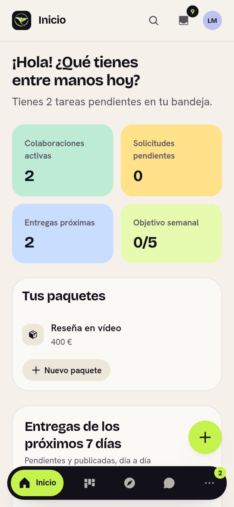

> **Consejo:** si no sabes por dónde seguir, empieza siempre por Inicio. Si una tarjeta tiene un número, es que hay algo que hacer.

## Perfil público

Tu perfil es lo primero que ven las marcas. Se compone de tu **ficha** (lo que escribes) y de tus **paquetes** (lo que ofreces).

### Verlo y editarlo

**Qué queremos hacer:** ver cómo me ven las marcas y mejorar mi ficha.

#### Pasos

1. Pulsa tu avatar, arriba a la derecha, para ir a **Perfil**.
2. Pulsa (2) **Ver perfil público** para ver tu perfil tal como lo ven los demás, o el icono de enlace para copiar su dirección.
3. Pulsa (1) **Editar ficha** para cambiar tus datos.
4. Observa (3) **Ficha completa al…**: el porcentaje y la lista de lo que falta.

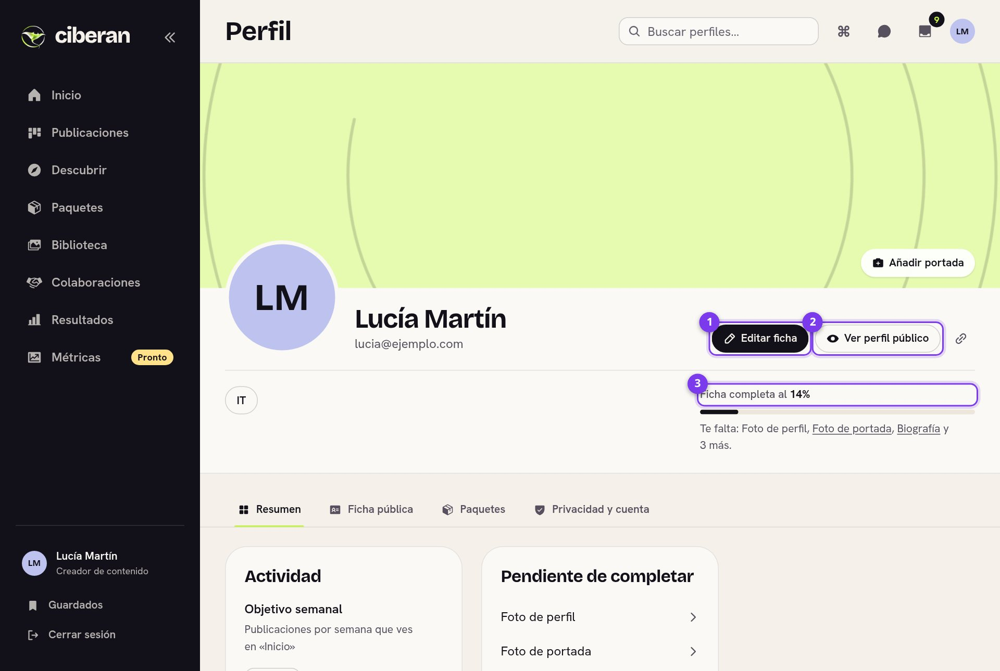

El perfil tiene cuatro pestañas: **Resumen**, **Ficha pública**, **Paquetes** y **Privacidad y cuenta**.

### La ficha pública

En la pestaña **Ficha pública** completas lo que ve un partner en Descubrir. Cuanto más completa, mejor encajan los resultados.

| Apartado | Qué escribes |
|---|---|
| **Presentación** | Una **frase de presentación** (hasta 80 caracteres), tu **ubicación** (hasta 80) y tu **biografía** (hasta 500). También tu foto de perfil y tu foto de portada. |
| **Categorías** | Los temas de tu contenido (Moda, Belleza, Fitness, Viajes, Tecnología…). Los partners te encuentran por ellas. |
| **Colaboración** | Tu **tarifa orientativa** (desde / hasta, en euros), **qué tipo de marcas buscas** (hasta 300 caracteres) y si quieres **mostrar con quién has colaborado**. |
| **Audiencia** | Los países, las edades y el género de tu audiencia, en porcentaje. La declaras tú: las marcas la ven marcada como «declarada por el creador». Déjalo en blanco lo que no sepas. |

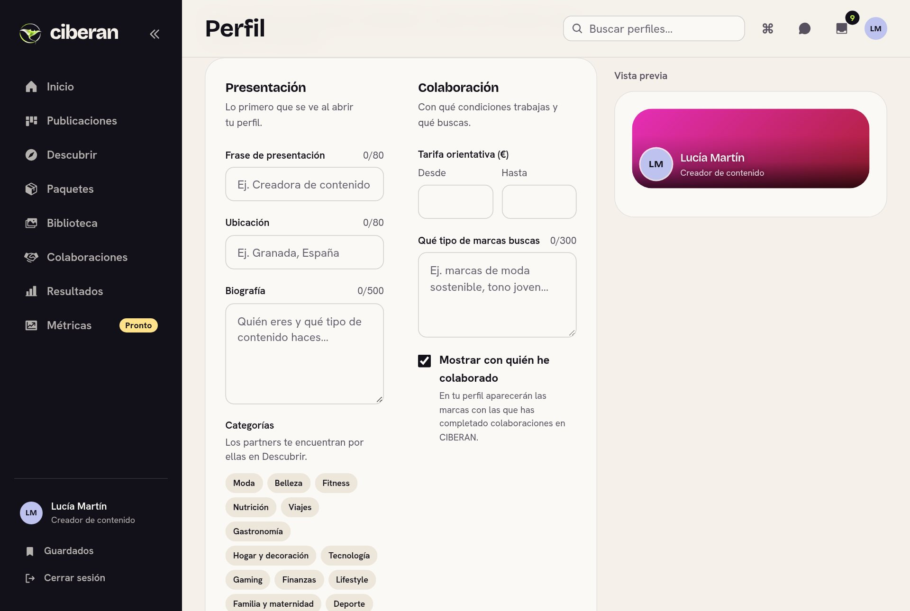

> **Importante:** la audiencia la declaras tú y CIBERAN no la verifica. Escribe solo lo que sepas con seguridad.

> **No disponible:** aún no se puede conectar tus redes para mostrar tus métricas reales. Llegará más adelante (ver «Métricas»).

> **Consejo:** una foto de portada, una biografía clara y un paquete bien descrito son lo que más ayuda a que una marca te elija.

### Privacidad y cuenta

En la pestaña **Privacidad y cuenta** decides:

- **Privacidad del chat**: **Cualquiera** (cualquier perfil puede escribirte) o **Solo tras oferta aceptada** (solo te escriben en texto libre quienes ya tienen una oferta aceptada contigo; aun así, cualquiera puede mandarte una oferta).
- **Visibilidad del perfil**: si tu perfil se ve **sin iniciar sesión** para quien abra tu enlace. Verá tu nombre, foto, presentación, categorías, contenido destacado y valoración. Las tarifas, el catálogo y el contacto siguen pidiendo sesión.
- **Avisos**: las solicitudes, ofertas y revisiones se avisan siempre. Eliges si quieres recordatorios de plazo, avisos de valoraciones, de notas del registro y de inicios de sesión. También los **avisos por correo**: un resumen si tienes avisos sin leer.
- **Acceso a la cuenta**: ves tu email y puedes **cambiar tu contraseña o tu email** (los pasos están justo debajo).
- **Tus datos**: **Descargar** una copia de tus datos (un ZIP con una hoja por tema), y **Eliminar mi cuenta**.

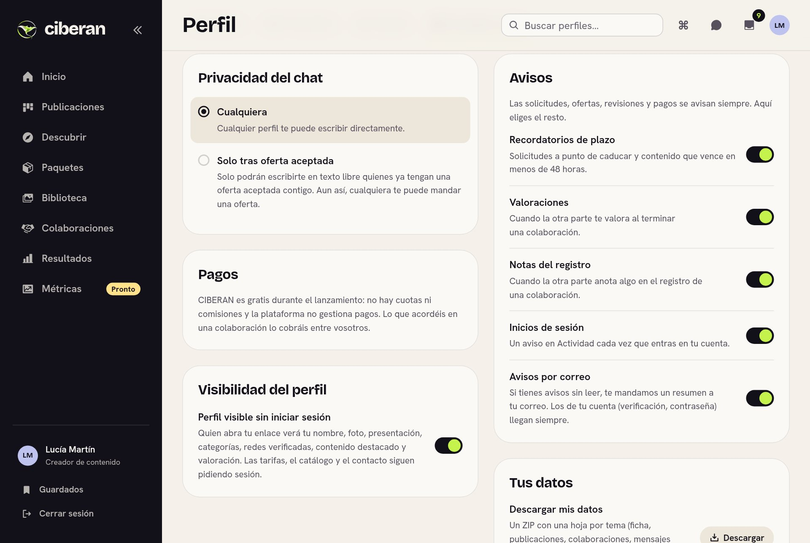

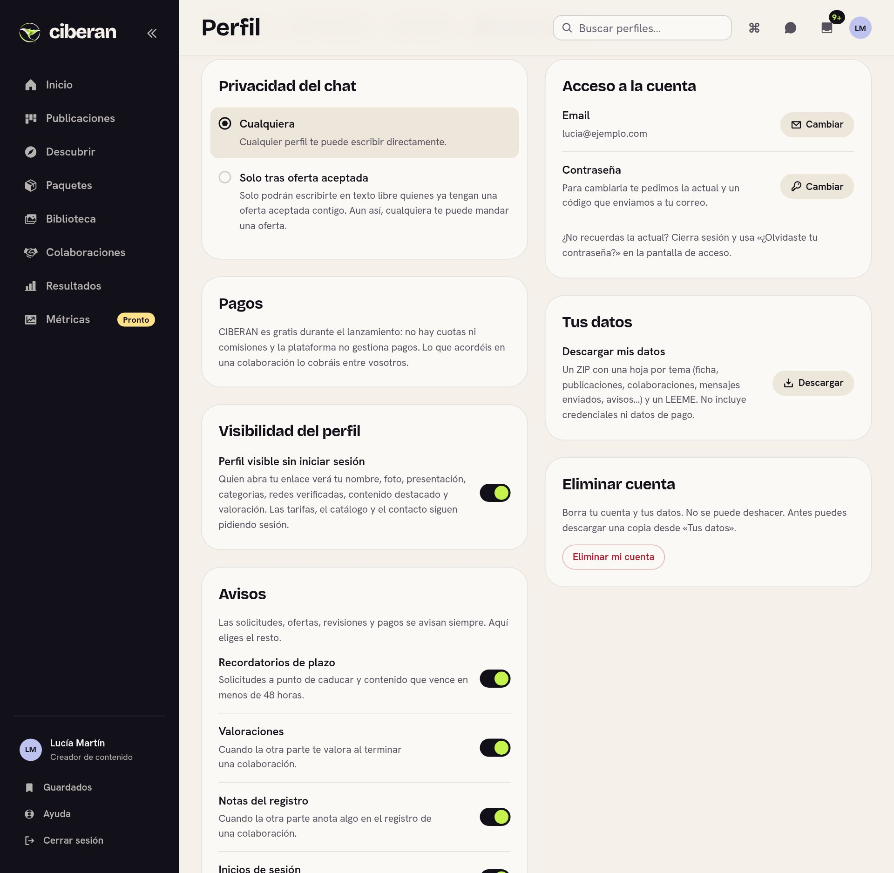

### Cambiar la contraseña

**Qué queremos hacer:** poner una contraseña nueva estando dentro de tu cuenta.

#### Pasos

1. Ve a **Perfil → Privacidad y cuenta → Acceso a la cuenta** (en el partner, **Perfil → Privacidad**) y pulsa **Cambiar** junto a «Contraseña».
2. **Paso 1 de 2:** escribe tu **contraseña actual** y pulsa **Enviar código al correo**.
3. **Paso 2 de 2:** abre el correo que te hemos enviado y escribe el **código de 6 dígitos** (puedes pegarlo tal cual llega, con o sin guiones).
4. Escribe la **contraseña nueva** y repítela. Mientras escribes, un medidor te dice si es **Muy débil, Débil, Aceptable, Buena o Excelente** y te da un consejo.
5. Deja marcada (o desmarca) la casilla **Cerrar la sesión en mis otros dispositivos**.
6. Pulsa **Cambiar contraseña**.

#### Qué sucede después

Verás el aviso «Contraseña cambiada». Si dejaste la casilla marcada, se cierra la sesión en tus demás dispositivos y tendrás que volver a entrar en ellos con la contraseña nueva.

> **Consejo:** una contraseña **larga** protege más que una corta con símbolos. Una frase de 3 o 4 palabras sin relación entre sí es fácil de recordar y difícil de adivinar. Evita tu nombre, tu email y las contraseñas típicas («password123», «12345678»): CIBERAN no las admite.

> **Atención:** el código caduca en unos minutos. Si no llega, mira el spam y pulsa **Reenviar código** (hay que esperar un minuto entre envíos). Si has perdido el acceso al correo de tu cuenta, no podrás cambiar la contraseña desde aquí: escribe al equipo de CIBERAN.

> **Sin verificar:** el envío real del código depende del servicio de correo de CIBERAN. Los pasos, las validaciones y el medidor están comprobados; el segundo paso completo (con el código llegando a un buzón real) no se ha podido probar de principio a fin. No hay captura del segundo paso por el mismo motivo.

> **Atención:** **Eliminar mi cuenta** borra tu cuenta y tus datos y **no se puede deshacer**. Antes puedes descargar una copia desde «Tus datos».

## Descubrir

**Qué es:** el buscador de **marcas**. Aquí encuentras empresas interesadas en tu contenido y puedes proponerles una colaboración.

> **Aviso:** esta sección es la misma que el partner ve para buscar creadores, pero con los papeles cambiados. Tú ves marcas; ellos ven creadores.

#### Pasos

1. Pulsa **Descubrir** en el menú.
2. Para buscar por nombre, escribe en (1) **Buscar marca por nombre**.
3. Afina con los (2) **Filtros**: **Categorías**, **Presupuesto** y **Más filtros**.
4. Cambia el orden con (3) **Ordenar**: más afines, más colaboraciones, responden antes, presupuesto o precio del paquete (de menor a mayor o al revés).
5. Cambia entre **Rejilla** y **Carrusel** para ver las tarjetas de otra forma.
6. Pulsa **Guardar búsqueda** para guardar tus filtros.

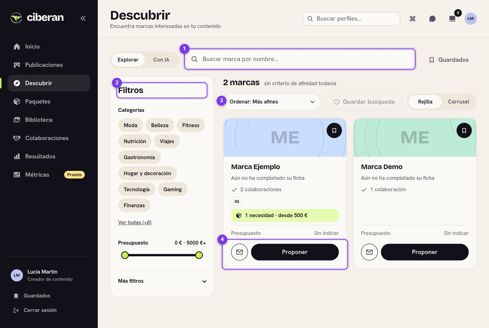

#### Cómo leer una tarjeta de marca

Cada tarjeta muestra el nombre de la marca, cuántas colaboraciones tiene, si ha publicado **necesidades** (por ejemplo «1 necesidad · desde 500 €»), su **presupuesto** y tres acciones: (4) **Proponer**, el icono de **marcador** para guardarla y el icono de **mensaje** para escribirle.

> **Aviso:** si una marca no ha completado su ficha, la tarjeta lo dice («Aún no ha completado su ficha»). Eso no impide proponerle una colaboración.

> **Aviso:** los perfiles que todavía no han rellenado su ficha salen **al final** de los resultados, sea cual sea el orden que elijas.

Con **Guardados** (en el menú, abajo) ves a quienes has marcado. En el buscador también existe un modo **Con IA**, que permite describir con tus palabras lo que buscas.

> **Sin verificar:** el modo **Con IA** existe en pantalla, pero en la preparación de este manual no se ha probado su funcionamiento.

### Proponer una colaboración a una marca

**Qué queremos hacer:** enviar a una marca una propuesta con mi tarifa y mis entregables.

#### Pasos

1. En una tarjeta de marca, pulsa **Proponer**. Se abre la hoja **Proponer a…**.
2. Escribe (o ajusta con el deslizador) **Tu tarifa (€)**. Si la marca indicó un rango, lo verás al lado.
3. En **Entregables**, elige cuántos **Reels / vídeos**, **Posts** y **Stories** ofreces, con los botones **+** y **−**. Hace falta al menos uno.
4. En **Uso del contenido por la marca**, elige: **Sin uso**, **1 mes**, **3 meses**, **6 meses**, **1 año** o **Perpetuo**.
5. Si quieres, pon un **Nombre de la campaña** y un **Mensaje**.
6. En **Más condiciones (opcional)** puedes indicar el objetivo, el público, el tono, las revisiones incluidas y si pides **exclusividad**.
7. Marca la casilla: «Entiendo que la propuesta es vinculante…».
8. Pulsa **Enviar propuesta**.

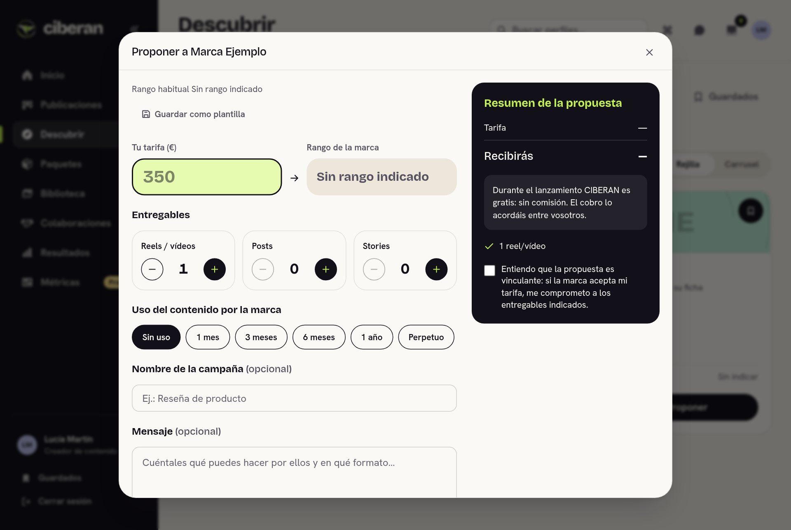

#### Qué sucede después

Verás «Propuesta enviada» y «Te avisamos en cuanto responda». La solicitud aparece en **Colaboraciones → Solicitudes**.

> **Atención:** la propuesta es **vinculante**: si la marca acepta tu tarifa, te comprometes a los entregables indicados. Las condiciones adicionales quedan fijadas al enviar y **no se pueden editar después**.

> **Consejo:** si vas a enviar propuestas parecidas, pulsa **Guardar como plantilla** en la hoja. La próxima vez, elige la plantilla en el desplegable **Usar una plantilla…** y retoca solo lo que cambie.

## Colaboraciones

Aquí vive cada acuerdo, desde que se propone hasta que se cierra. Pulsa **Colaboraciones** en el menú.

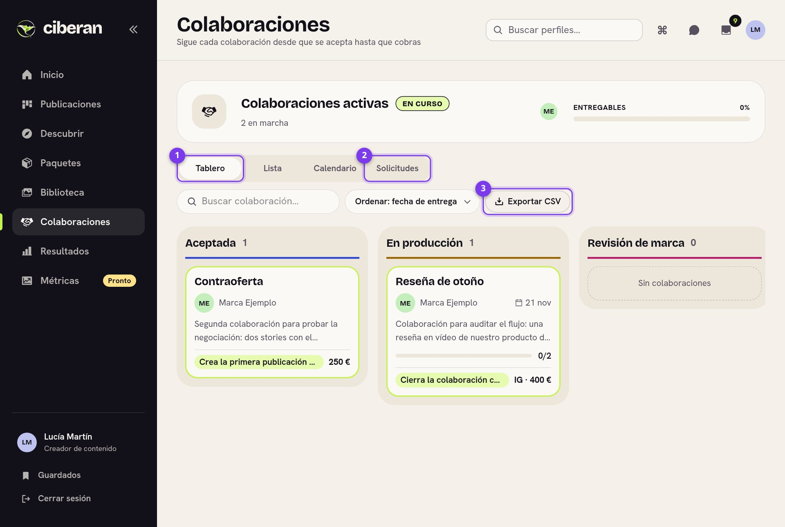

La página tiene cuatro vistas (1): **Tablero**, **Lista**, **Calendario** y **Solicitudes**, y arriba un resumen de las colaboraciones en marcha y del avance de los entregables. Puedes **buscar** una colaboración, **ordenarla** (por fecha de entrega, importe o más recientes) y pulsar (3) **Exportar CSV** para descargar el listado en una hoja de cálculo.

| Vista | Para qué sirve |
|---|---|
| **Tablero** | Columnas por fase: Aceptada, En producción, Revisión de marca y Publicada. |
| **Lista** | Todas en filas, agrupadas por fase, con formato, avance de entregables, fecha e importe. |
| **Calendario** | Las fechas de entrega en un calendario mensual. |
| **Solicitudes** | Las propuestas que aún no están aceptadas: las que tú recibes y las que tú envías. |

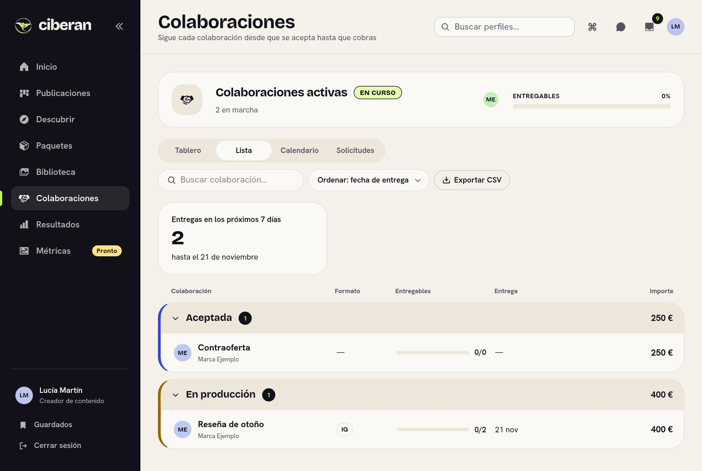

> **Aviso:** el avance de entregables que ves en el tablero y en la lista (por ejemplo «2/2») cuenta las publicaciones **listas**: las aprobadas por la marca y las ya publicadas.

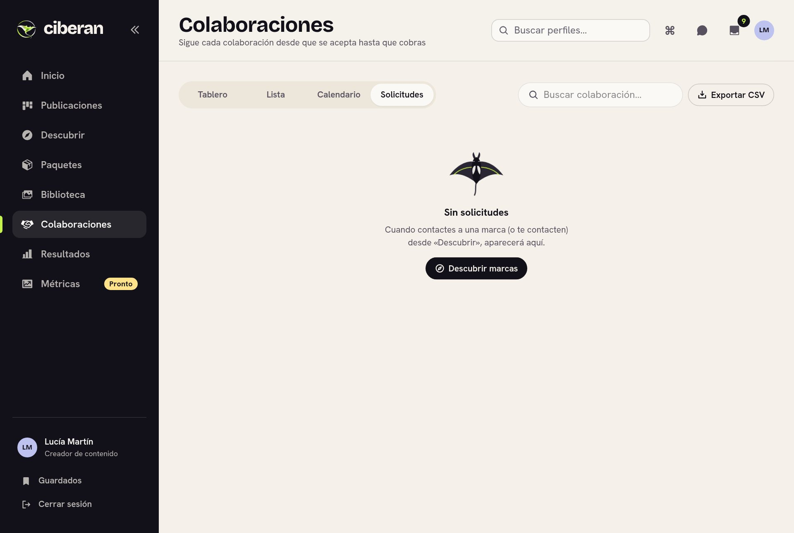

### Recibir y responder a una solicitud

**Qué queremos hacer:** responder a una marca que me propone colaborar.

#### Pasos

1. Fíjate en el aviso de **Bandeja de entrada** o en la tarjeta **Solicitudes pendientes** de Inicio.
2. Entra en **Colaboraciones → Solicitudes** y pulsa la solicitud.
3. Lee el resumen: quién escribe, el **importe**, el **brief** y los plazos. Verás un aviso de caducidad: las solicitudes caducan a los 7 días.
4. En el bloque **Presupuesto y respuesta**, elige una de tres opciones.

| Opción | Qué hace |
|---|---|
| **Aceptar · (importe)** | Aceptas las condiciones. La colaboración pasa a **Aceptada**. |
| **Hacer contraoferta** | Propones otro importe, con un mensaje opcional. La otra parte decide. |
| **Rechazar solicitud** | La rechazas. Pide una confirmación. |

> **Captura pendiente:** este bloque con los tres botones solo aparece cuando hay una solicitud esperando respuesta, y no la había en el momento de preparar el manual. La descripción está comprobada en la aplicación; falta la imagen.

#### Hacer una contraoferta

1. Pulsa **Hacer contraoferta**.
2. Escribe el **nuevo importe (€)** y, si quieres, un mensaje (por ejemplo, por qué).
3. Envía la contraoferta.

Ahora le **toca a la otra parte**. Verás el aviso **Siguiente paso**: «te toca a ti» o «le toca a (la otra persona)» según quién deba mover ficha. Los avisos **Por responder** y **Siguiente paso** se calculan según quién hizo la **última propuesta**: si tú hiciste la última, esperas; si la hizo la otra parte, te toca a ti.

#### Rechazar una solicitud

1. Pulsa **Rechazar solicitud**.
2. CIBERAN pregunta: **«¿Seguro? No se puede deshacer.»**
3. Pulsa **Cancelar** para volver atrás o **Sí, rechazar** para confirmar.

Al confirmar, verás el aviso «Solicitud rechazada» y volverás al listado. La colaboración queda en estado **Rechazada**.

> **Atención:** rechazar **no se puede deshacer**. Si dudas, usa antes una contraoferta.

#### Qué sucede después de aceptar

La colaboración queda **Aceptada** y se abre su espacio de trabajo, que se explica a continuación.

### El espacio de una colaboración

Al abrir una colaboración aceptada verás tres zonas.

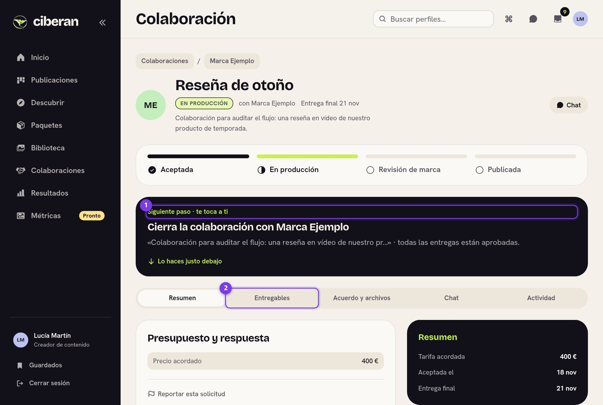

1. **La cabecera**, con el nombre de la colaboración, su estado, la marca, la entrega final y un botón **Chat**. Debajo, una barra con las **fases**: **Aceptada → En producción → Revisión de marca → Publicada**.
2. **Siguiente paso** (1): una caja oscura que dice qué hay que hacer ahora y si **te toca a ti** o le toca a la otra parte. Por ejemplo, «Crea la primera publicación para…» o «Cierra la colaboración con…».
3. **Cinco pestañas** (2): **Resumen**, **Entregables**, **Acuerdo y archivos**, **Chat** y **Actividad**.

> **Aviso:** el nombre de la colaboración sale del **nombre de campaña** que pusieron al proponerla. Si no hay, se usa el nombre del paquete o la primera frase del brief.

#### Fases de una colaboración

| Fase | Cuándo se alcanza |
|---|---|
| **Aceptada** | Se aceptó, pero aún no hay ninguna publicación empezada. |
| **En producción** | Hay alguna publicación en marcha. |
| **Revisión de marca** | Alguna publicación espera la aprobación de la marca. |
| **Publicada** | Todo está publicado, o la colaboración se ha completado. |

> **Aviso:** las fases no se marcan a mano: CIBERAN las deduce del estado de las publicaciones. No existe una fase de «Pagada» porque CIBERAN no gestiona pagos.

#### Estados de una colaboración

| Estado | Significado |
|---|---|
| **Pendiente de respuesta** | Alguien propuso y falta que la otra parte responda. |
| **Aceptada** | Las dos partes están de acuerdo. |
| **En curso** | Se trabaja en las publicaciones. |
| **Completada** | Se cerró con todo entregado. |
| **Rechazada** | Alguien rechazó la solicitud. |
| **Cancelada** | Las dos partes acordaron cancelarla. |
| **Terminada por incumplimiento** | Una parte la dio por terminada porque no se cumplió lo pactado. |

### Los entregables

La pestaña **Entregables** lista las publicaciones vinculadas a la colaboración, cada una con su estado (**Programado**, **Para revisar**…), su aprobación (**Aprobada**) y su versión (**v1**).

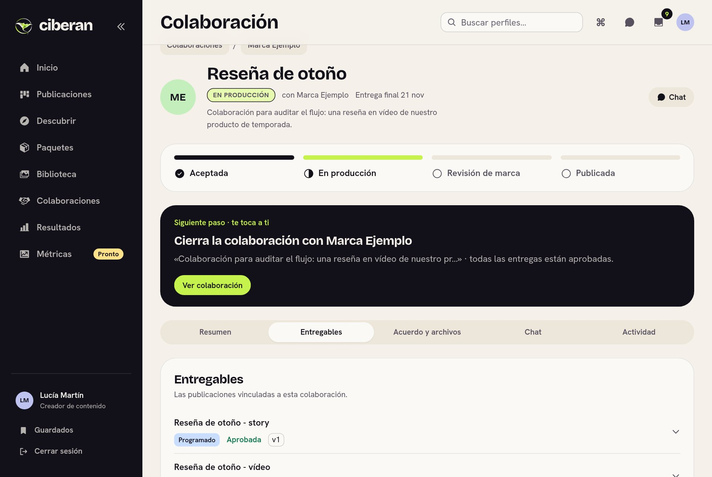

En esta pestaña puedes:

- Ver cuántos entregables están resueltos («**N de M** resueltos»).
- **Crear publicación** para un entregable (te lleva al editor con la colaboración ya elegida) o **Asignar** una que ya tienes.
- **Confirmar entregables** cuando la marca los ha definido. Hasta que los confirmes, no son exigibles para completar la colaboración.
- Usar las opciones avanzadas de cada entregable: **Aceptar sin aprobación**, **Renunciar** y **Reabrir**. Todas piden un **motivo obligatorio** (mínimo 10 caracteres) que ven las dos partes.

Algunas etiquetas pueden aparecer junto a un entregable: **Aprobación invalidada**, **Editada tras publicar**, **Sin aprobación** o **Decisión caducada**. Indican que el contenido cambió después de aprobarse y puede necesitar una nueva revisión.

### Acuerdo y archivos

La pestaña **Acuerdo y archivos** recoge el brief, las condiciones pactadas, el presupuesto y los archivos compartidos.

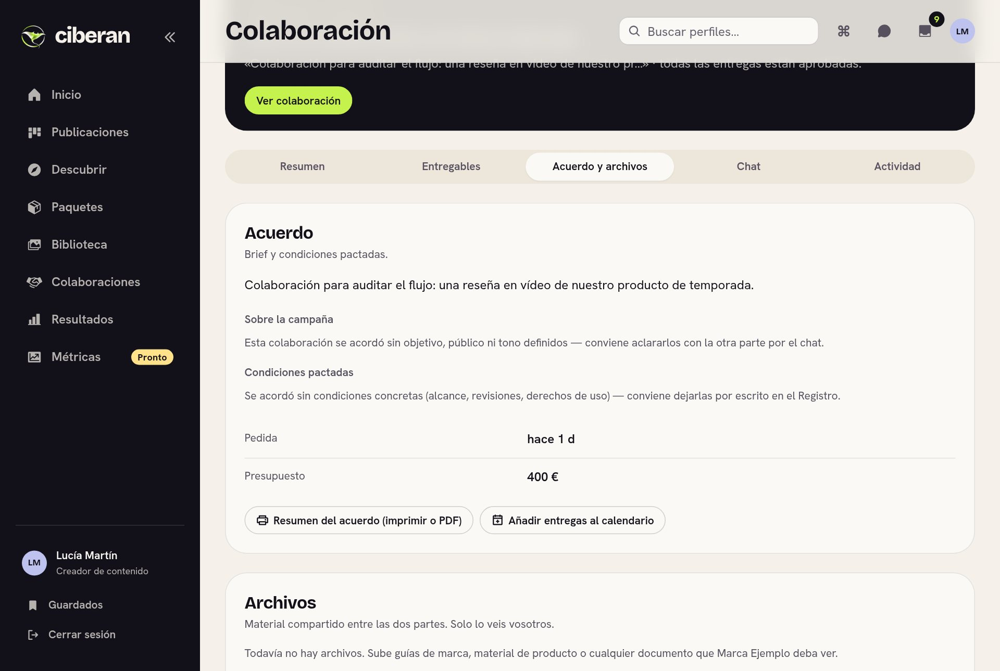

- **Acuerdo**: el brief, **Sobre la campaña** (objetivo, público y tono) y las **Condiciones pactadas** (alcance, revisiones y derechos de uso). Si no se fijaron, la pantalla lo dice y recomienda aclararlo por chat.
- **Resumen del acuerdo (imprimir o PDF)**: abre un resumen para guardar o imprimir.
- **Añadir entregas al calendario**: descarga un archivo para tu calendario (Google, Apple, Outlook).
- **Archivos**: material compartido solo entre las dos partes. Se aceptan PDF, imágenes y documentos de hasta 10 MB, con un máximo de 20 archivos. Se sube con **Subir archivo**.

### Chat y actividad

- **Chat**: la conversación de esta colaboración. Tiene respuestas rápidas («Recibido, gracias», «¿Puedes revisarlo?», «Propongo otra fecha», «Lo tengo esta semana»).
- **Actividad**: la **cronología** de todo lo ocurrido, de lo más reciente a lo más antiguo: solicitud, aceptación, envíos a revisión, cambios pedidos y aprobaciones. Con **Añadir apunte** dejas una nota que ven las dos partes, y puedes filtrar por **Todo** o **Mensajes y acciones**.

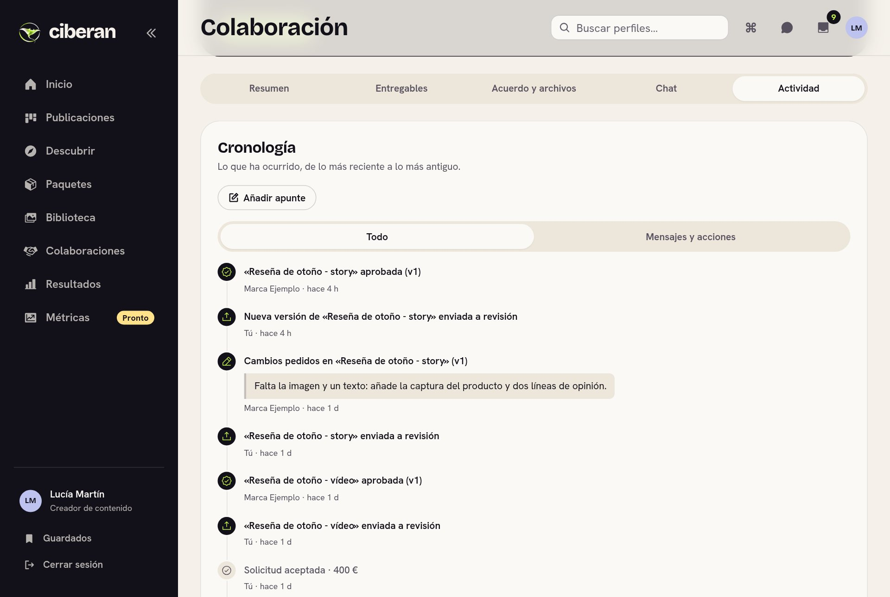

### Completar la colaboración

**Qué queremos hacer:** cerrar la colaboración cuando todo está entregado.

#### Pasos

1. Cuando todas las entregas están aprobadas, el **Siguiente paso** dice «Cierra la colaboración…».
2. En el bloque **Presupuesto y respuesta**, pulsa **Marcar como completada**.

#### Qué sucede después

La colaboración pasa a **Completada**. Cada parte puede dejar una **valoración** de la otra, con estrellas y un comentario opcional sobre la comunicación y el cumplimiento de plazos. La valoración alimenta el apartado **Valoración** del perfil.

> **Aviso:** CIBERAN **no gestiona pagos ni cobra comisión**. Verás el mensaje: «el importe acordado te lo paga la marca por el medio que acordéis». El cobro lo arregláis entre vosotros.

### Cancelar o terminar una colaboración

En **Más acciones** tienes dos opciones.

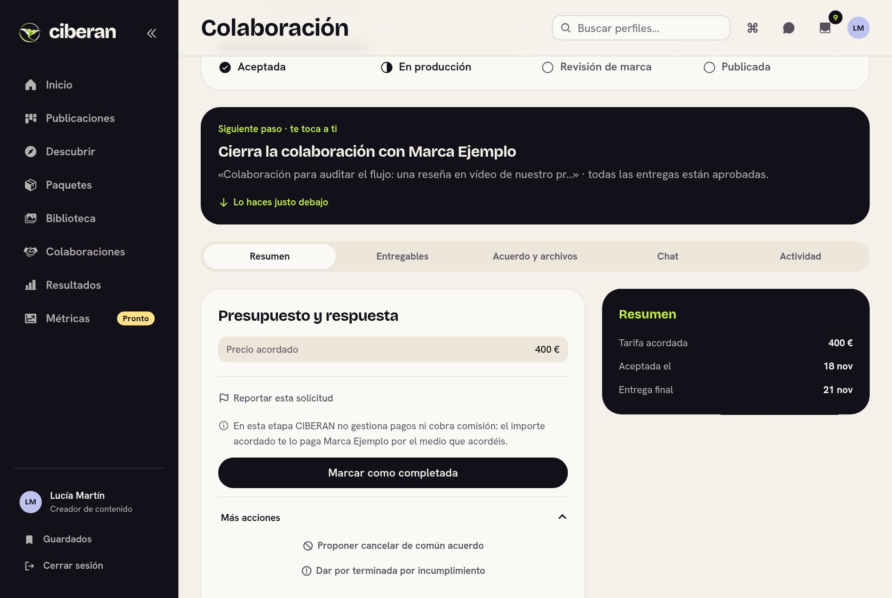

| Opción | Cómo funciona |
|---|---|
| **Proponer cancelar de común acuerdo** | Explicas el motivo. La otra parte puede **Aceptar la cancelación** o **Seguir con la colaboración**. Hasta que responda, todo sigue igual, y tú puedes **Retirar la propuesta**. |
| **Dar por terminada por incumplimiento** | Cierra la colaboración sin esperar a la otra parte. Úsalo solo si de verdad no se cumplió lo pactado. Queda en la cronología y lo ve el equipo de CIBERAN. |

También puedes usar **Reportar esta solicitud** si algo te parece indebido. El equipo revisa los reportes y puede avisar o bloquear cuentas, pero no puede reclamar importes ni emprender acciones legales.

> **Atención:** dar por terminada una colaboración por incumplimiento deja constancia. Úsalo con cuidado y describe con claridad qué se acordó y qué no se cumplió.

## Publicaciones

Es el centro de trabajo del creador: aquí preparas cada pieza de contenido y la llevas de la idea a la publicación. Pulsa **Publicaciones** en el menú.

> **Aviso:** en la aplicación **no existe una sección llamada «CIBERAN Studio»**. Lo que se conoce como las herramientas de creación son las que se describen en este apartado y en los siguientes: **Publicaciones**, **Biblioteca**, **Paquetes**, las **plantillas**, **Deshacer** y la **paleta de comandos**.

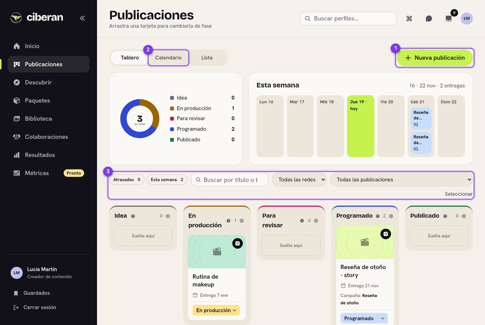

### Las tres vistas

Arriba (2) eliges **Tablero**, **Calendario** o **Lista**.

| Vista | Qué muestra |
|---|---|
| **Tablero** | Una columna por fase: **Idea, En producción, Para revisar, Programado, Publicado**. Arrastra una tarjeta a otra columna para cambiarla de fase. |
| **Calendario** | Un calendario mensual. Arrastra una entrega a otro día para reprogramarla. |
| **Lista** | Todas las publicaciones en filas. |

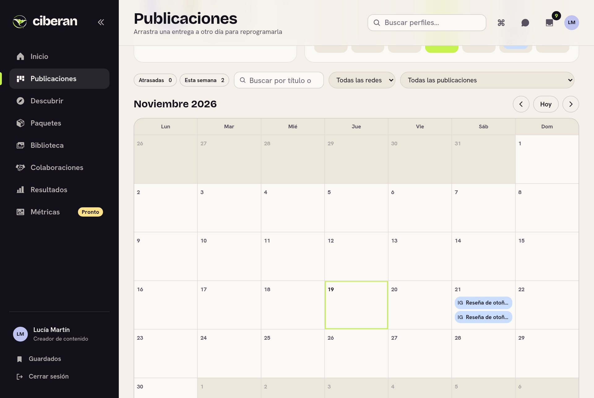

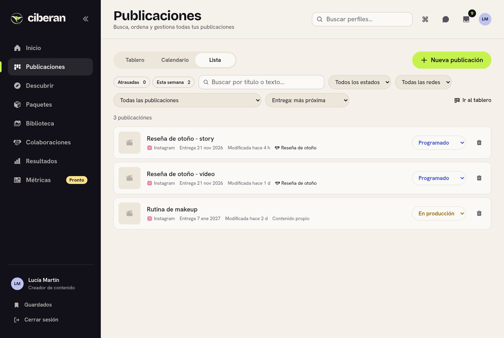

Encima del tablero verás la semana actual, con cada entrega en su día y los contadores **Atrasadas** y **Esta semana**. Puedes buscar por título, texto o hashtags, y filtrar por (3) **red** y por **colaboración** (todas, contenido propio o una en concreto).

### Crear una publicación

**Qué queremos hacer:** anotar una pieza de contenido nueva.

#### Pasos

1. En Publicaciones, pulsa (1) **Nueva publicación** (también está en Inicio).
2. Escribe el **Título interno** (solo para reconocerla en tu tablero).
3. Si quieres, escribe el **Texto de la publicación** (hasta 2.200 caracteres) y los **Hashtags** (separados por espacios o comas; la almohadilla se pone sola).
4. En **¿Para quién es?**, elige **Contenido propio** (solo lo ves tú, no cuenta como entregable) o **Para una colaboración** (y elige cuál).
5. Elige la **Red donde se publicará** (TikTok, YouTube, X, Instagram, Facebook o LinkedIn). Si va también a otras redes, márcalas en **¿También en otras redes?**.
6. Elige el **Formato** (por ejemplo, Reel) y la **Fecha de entrega**.
7. Guarda.

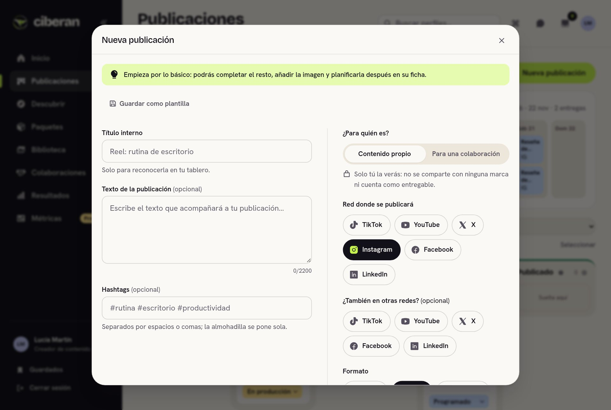

#### Qué sucede después

La publicación aparece en el tablero, en la columna que corresponda, y en el calendario. Si es de una colaboración, la marca la ve y cuenta como entregable.

#### Borrador automático

Si cierras la ventana de «Nueva publicación» a medias, CIBERAN **guarda lo que habías escrito** (hasta 14 días) y te lo devuelve la próxima vez que la abras, con el aviso «Hemos recuperado tu borrador». Pulsa **Descartar** para empezar de cero. El borrador se guarda en tu navegador: no se ve desde otro dispositivo ni desde otro navegador.

> **Consejo:** no hace falta rellenarlo todo. La ventana lo dice: «Empieza por lo básico: podrás completar el resto, añadir la imagen y planificarla después en su ficha».

### La ficha de una publicación

Al abrir una publicación ves toda su información.

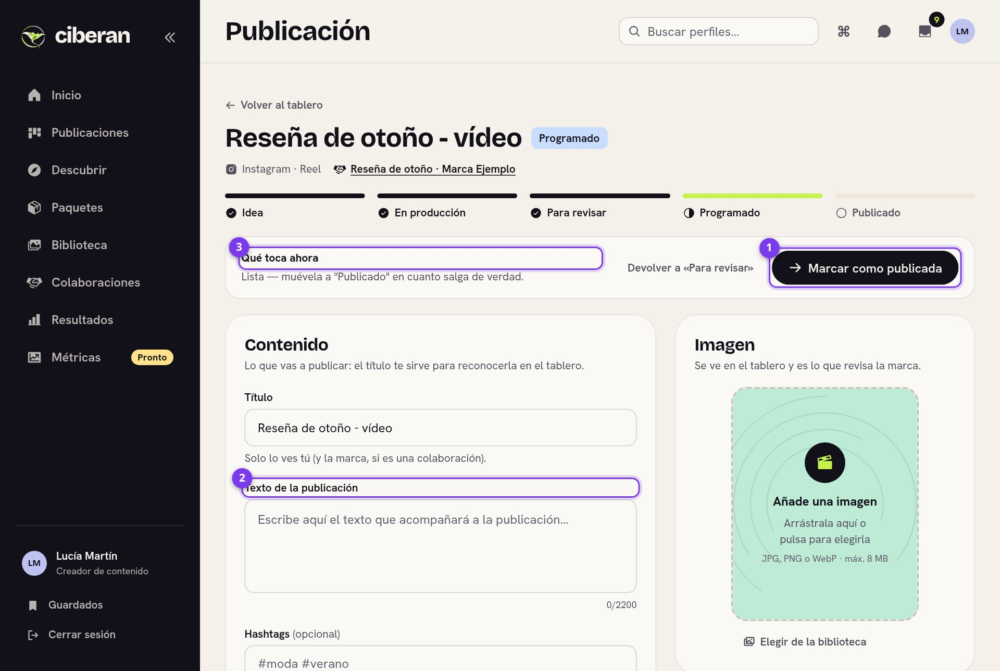

- **Barra de fases**: Idea, En producción, Para revisar, Programado, Publicado.
- **Qué toca ahora** (3): te propone la siguiente acción, con un botón principal como (1) **Marcar como publicada**, y otro para **devolverla a «Para revisar»**.
- **Contenido**: título, **Texto de la publicación** (2) con contador y **Hashtags**. El botón **Copiar texto y hashtags** te lo deja listo para pegar en la red.
- **Historial de revisión**: lo que ha dicho la marca (por ejemplo, «aprobó esta publicación»).
- **Imagen**: la que ve la marca al revisar. Se sube arrastrándola o pulsando, o con **Elegir de la biblioteca** (JPG, PNG o WebP, máximo 8 MB).
- **Entrega**: enlaces para que la marca vea el **borrador** y, al final, el **resultado**. Se explican más abajo.
- **Planificación**: fecha de entrega, red, formato, versión y fechas de creación y edición.
- **Checklist**: apuntes de lo que no quieres olvidar (grabar, editar, subtítulos).
- **Etiquetas**: para agrupar publicaciones en el tablero.
- **Reutilizar**: **Duplicar publicación** y **Guardar como plantilla**.
- **Eliminar publicación**.

#### Los enlaces de entrega

En el apartado **Entrega** hay dos campos opcionales:

- **Enlace al borrador**: para un vídeo o archivo pesado en Drive, WeTransfer o un enlace privado. **La marca lo ve al revisar.**
- **Enlace de la publicación**: cuando ya está publicada en la red, pega aquí su enlace. **Queda como resultado de la colaboración.**

#### Varias redes en una publicación

Una publicación tiene una **red principal** y puede indicar **otras redes** donde también se publicará. Se elige al crearla.

### Revisión por la marca

Cuando una publicación es de una colaboración y la envías a revisión (estado **Para revisar**), la marca puede **aprobarla** o **pedir cambios** con un comentario. Tú ves lo que dice en el **Historial de revisión** y en la **Actividad** de la colaboración.

1. Envía la publicación a **Para revisar** (con el botón de «Qué toca ahora» o arrastrando la tarjeta).
2. La marca la revisa: **Aprobar** o **Pedir cambios**.
3. Si pide cambios, lee su comentario, corrige el contenido y vuelve a enviarla: se crea una **nueva versión** (v2, v3…).
4. Si la aprueba, aparece **Aprobada** y puedes programarla y publicarla.

> **Captura pendiente:** la pantalla de revisión de la marca (botones **Aprobar** y **Pedir cambios**) se muestra en el apartado del partner. Del lado del creador, el resultado se ve en el **Historial de revisión** y en **Actividad**.

> **Atención:** si cambias una publicación **después** de aprobada, la aprobación puede quedar **invalidada** y la marca tendrá que revisarla de nuevo.

### Duplicar y guardar como plantilla

**Qué queremos hacer:** no escribir lo mismo dos veces.

#### Pasos

1. Abre la publicación que quieres reutilizar.
2. En **Reutilizar**, pulsa **Duplicar publicación** para empezar otra pieza con los mismos datos, o **Guardar como plantilla**.
3. Para una plantilla, ponle un **nombre** y guarda. Si usas un nombre que ya existe, se actualiza esa plantilla.
4. La próxima vez, al pulsar **Nueva publicación**, elige la plantilla en **Usar una plantilla…**. Se rellena el formulario y puedes retocar lo que quieras antes de guardar.

> **Aviso:** al aplicar una plantilla se avisa de que revises los datos. Una plantilla solo rellena el formulario: no crea nada hasta que guardas.

### Deshacer

CIBERAN te deja **deshacer** algunas acciones durante unos segundos:

| Acción | Cómo deshacerla |
|---|---|
| **Eliminar una publicación** | Aparece el aviso «…eliminada» con **Deshacer**. Tienes **8 segundos**. Pasado ese tiempo se borra del todo. |
| **Cambiar el estado de una publicación** | Tras mover la tarjeta, el aviso incluye **Deshacer** para devolverla a su fase anterior. |
| **Eliminar una imagen de la biblioteca** | Igual: 8 segundos para **Deshacer**. |

> **Atención:** si la publicación **forma parte de una colaboración**, la marca deja de verla al borrarla. Por eso CIBERAN pide una **confirmación** antes («Es una pieza de una colaboración: la marca dejará de verla…»). Aun así, tienes 8 segundos para deshacerlo. Si cierras la pestaña antes de que pasen, el borrado se cancela.

## Biblioteca de archivos

**Qué es:** tu almacén de imágenes listas para reutilizar como portada de publicaciones y de paquetes. Es una función **solo del creador**.

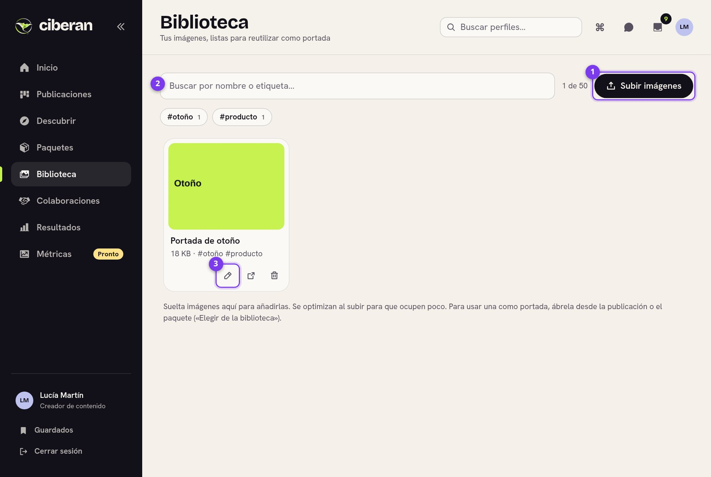

| Qué | Detalle |
|---|---|
| **Formatos** | JPG, PNG y WebP. |
| **Tamaño** | Hasta 8 MB por archivo. |
| **Cantidad** | Hasta 50 archivos. El contador (por ejemplo «1 de 50») está arriba. |
| **Optimización** | Al subir, CIBERAN reduce cada imagen (como mucho 2.000 píxeles de lado) y la guarda en un formato más ligero. Se ve igual, pero ocupa mucho menos. |

#### Subir imágenes

1. Pulsa **Subir imágenes** (1), o arrastra imágenes sobre la página.
2. Si algún archivo no es válido (formato o tamaño), verás un aviso con el motivo.

#### Buscar, etiquetar y renombrar

1. Escribe en (2) **Buscar en la biblioteca** para filtrar por nombre o etiqueta, o pulsa una etiqueta (por ejemplo **#otoño**) para ver solo esas imágenes.
2. Pulsa (3) el icono del lápiz (**Editar nombre y etiquetas**) para cambiar el nombre y poner hasta 8 etiquetas (por ejemplo «#otoño #producto»).
3. Con el icono de enlace abres la imagen en otra pestaña, y con la papelera la borras (con 8 segundos para deshacer).

#### Usar una imagen de la biblioteca

1. Abre la publicación o el paquete donde quieres la imagen.
2. Pulsa **Elegir de la biblioteca**.
3. Busca y pulsa la imagen que quieras.
4. Si todavía no la tienes en la biblioteca, pulsa **Subir una imagen** en el propio selector. Si subes una sola, se elige automáticamente.

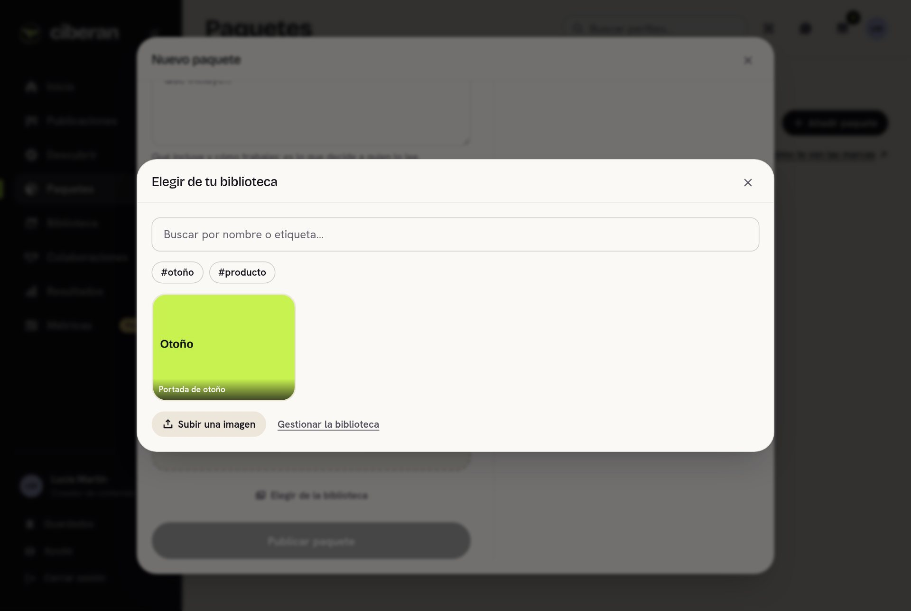

> **Importante:** al elegir una imagen se hace una **copia**. Si luego **borras el original** de la biblioteca, las publicaciones y paquetes que ya usaban esa imagen **no se ven afectados**: conservan su propia copia.

## Paquetes

**Qué son:** lo que ofreces. Un paquete describe un servicio y su precio (por ejemplo «Reseña en vídeo · 400 €»). Una marca puede hacerte una **oferta** sobre cualquiera.

> **Aviso:** los partners tienen su propia página, llamada **Necesidades**, que funciona igual pero al revés: describe lo que buscan. Está en la Parte IV.

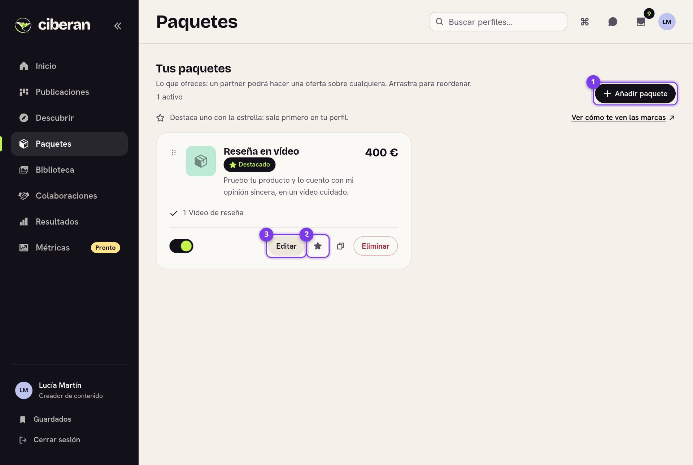

### Crear un paquete

#### Pasos

1. Pulsa **Paquetes** en el menú y luego (1) **Añadir paquete** (también hay un **Nuevo paquete** en Inicio).
2. Si quieres ir más rápido, elige una plantilla en **Empieza con una plantilla**: **1 Reel**, **Reel + 3 Stories**, **3 Stories**, **Reseña en vídeo**, **Unboxing** o **Pack mensual**. Luego lo puedes editar todo.
3. Escribe el **Título** y, si quieres, la **Descripción** (qué incluye y cómo trabajas).
4. Escribe los **Entregables**, uno por uno, y pulsa **Intro** después de cada uno. Tienes sugerencias debajo.
5. Escribe el **Precio del paquete**: lo que cobras por el paquete completo.
6. Si quieres, añade una **portada**: sube una imagen o pulsa **Elegir de la biblioteca**.
7. Mira la **Vista previa** y pulsa **Publicar paquete**.

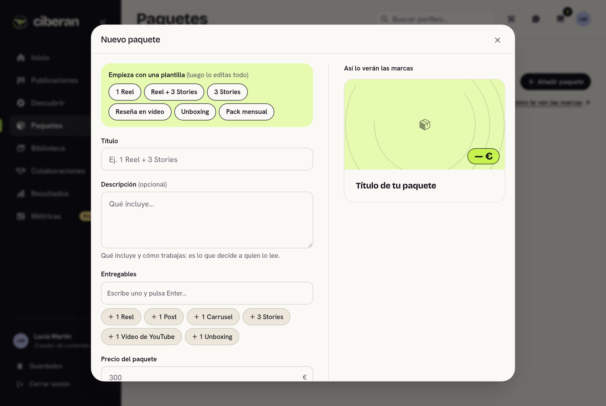

#### Qué sucede después

El paquete aparece en tu lista y en tu perfil público. Los partners pueden hacerte una oferta sobre él.

### Gestionar los paquetes

Cada tarjeta tiene acciones: **Pausar paquete** (deja de aparecer sin borrarlo), **Editar**, **Duplicar paquete**, **Eliminar** y la **estrella** para destacarlo.

- **Destacado** (2): el paquete destacado sale **primero en tu perfil**. Solo se puede destacar uno. Aparece una etiqueta **Destacado** y, para quitarlo, **Quitar como destacado**.
- **Reordenar**: arrastra las tarjetas para cambiar el orden.
- **Ver cómo te ven las marcas**: abre tu perfil público.

> **Atención:** al **eliminar** un paquete se borra de forma permanente, **junto con las ofertas** que se hubieran hecho sobre él. CIBERAN pide confirmación antes.

> **Consejo:** si no quieres borrar un paquete pero no quieres recibir ofertas ahora mismo, usa **Pausar paquete**.

## Ofertas y chat

Además de las solicitudes de colaboración, hay otra forma de empezar a trabajar: una **oferta sobre un paquete**.

- Un partner puede ir a tu perfil público y pulsar **Hacer oferta** sobre uno de tus paquetes, o hacerla desde el chat con el botón **Oferta**. Puede proponer un precio distinto al listado, para negociar.
- Tú la ves en el **chat**, en una tarjeta con los botones **Aceptar** y **Rechazar**. Si el paquete ya no existe, la tarjeta dice «Esta oferta ya no está disponible».

El **Chat** (icono de burbuja, arriba) lista tus conversaciones con filtros **Todas**, **No leídas** y **Ofertas**, y un buscador por nombre. Las ofertas que esperan tu respuesta aparecen marcadas. Para iniciar un chat, ve al perfil de alguien en **Descubrir** y pulsa el icono de mensaje. Las conversaciones en las que todavía no se ha escrito nada no aparecen en la lista hasta que haya un mensaje.

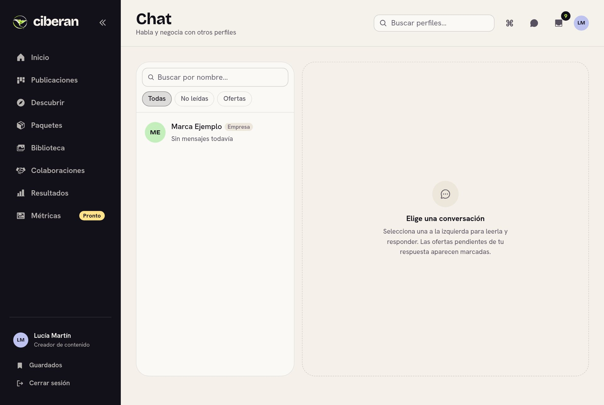

> **Aviso:** quién puede escribirte lo decides en **Perfil → Privacidad y cuenta → Privacidad del chat**.

## Resultados

**Qué es:** cómo van tus colaboraciones **dentro de CIBERAN**. Pulsa **Resultados** en el menú y elige el periodo: **3 meses**, **6 meses**, **12 meses** o **Todo**.

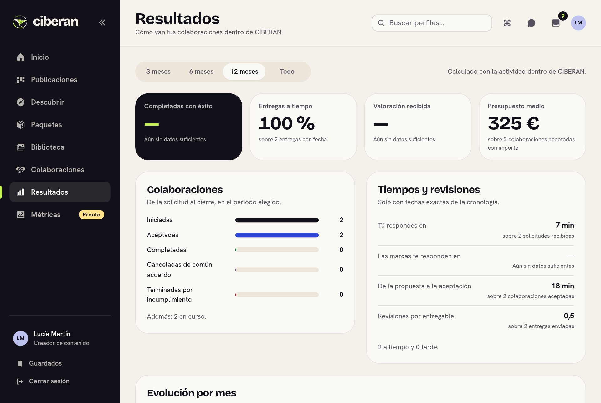

| Indicador | Qué mide |
|---|---|
| **Completadas con éxito** | Colaboraciones cerradas con todo entregado. |
| **Entregas a tiempo** | Porcentaje de entregas que llegaron a su fecha. |
| **Valoración recibida** | La media de las valoraciones que te dan las marcas. |
| **Presupuesto medio** | El importe medio de tus colaboraciones aceptadas. |
| **Colaboraciones** | Cuántas se iniciaron, aceptaron, completaron, cancelaron de común acuerdo o terminaron por incumplimiento, y cuántas hay en curso. |
| **Tiempos y revisiones** | En cuánto respondes tú, en cuánto responden las marcas, cuánto tarda una propuesta en aceptarse y cuántas revisiones lleva cada entregable. |
| **Evolución por mes** | Un gráfico mensual de iniciadas, aceptadas y completadas. |

> **Aviso:** cuando no hay datos suficientes, la pantalla dice «Aún sin datos suficientes» en lugar de inventar una cifra. Todo se calcula con tu actividad en CIBERAN.

## Métricas de redes

El menú muestra **Métricas** con la etiqueta **Pronto**. Al pulsarla, la página dice «Próximamente».

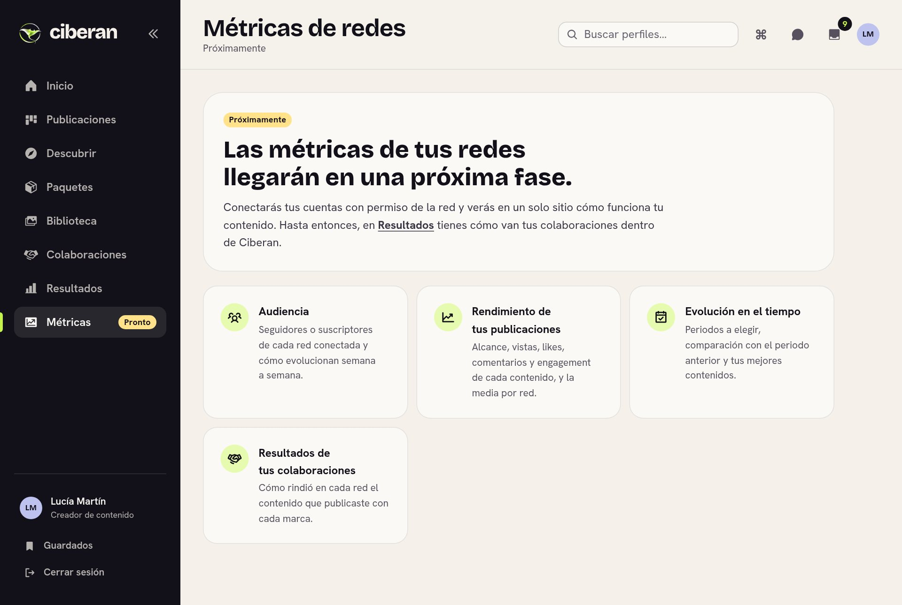

> **Próximamente:** las métricas de tus redes (audiencia, rendimiento de cada publicación, evolución en el tiempo y resultados por colaboración) llegarán en una fase posterior, conectando tus cuentas con permiso de cada red. **Hoy no se pueden consultar métricas de redes en CIBERAN.** Mientras tanto, usa **Resultados**.

## Predicción de rendimiento

> **No disponible:** la **predicción de éxito con IA** está desactivada en el lanzamiento gratuito. No aparece en la aplicación y no se puede usar. Por eso este manual no describe su uso. Cuando se active, se añadirá en una próxima versión.

## Calendario

CIBERAN tiene calendario en dos sitios:

- **Publicaciones → Calendario**: tus publicaciones por día. Se pueden **arrastrar a otro día** para cambiar la fecha de entrega, y **crear una publicación** desde un día.
- **Colaboraciones → Calendario**: las fechas de entrega de tus colaboraciones.

Además, en la pestaña **Acuerdo y archivos** de cada colaboración, **Añadir entregas al calendario** descarga un archivo para llevarlas a Google Calendar, Apple Calendar u Outlook.

### Suscribirte al calendario (se actualiza solo)

**Qué queremos hacer:** ver tus fechas de entrega en Google Calendar, Apple Calendar u Outlook sin descargar nada cada vez.

#### Pasos

1. Entra en **Colaboraciones** y abre la vista **Calendario**.
2. Pulsa **Suscribirme al calendario**.
3. Pulsa **Copiar enlace** (o **Abrir en mi calendario**, que lo abre directamente en la aplicación de tu dispositivo).
4. En tu calendario, añade una suscripción «desde una dirección web» y pega el enlace:
   - **Google Calendar:** Otros calendarios (+) → Desde URL.
   - **Apple Calendar:** Archivo → Nueva suscripción a calendario.
   - **Outlook:** Agregar calendario → Suscribirse desde la web.

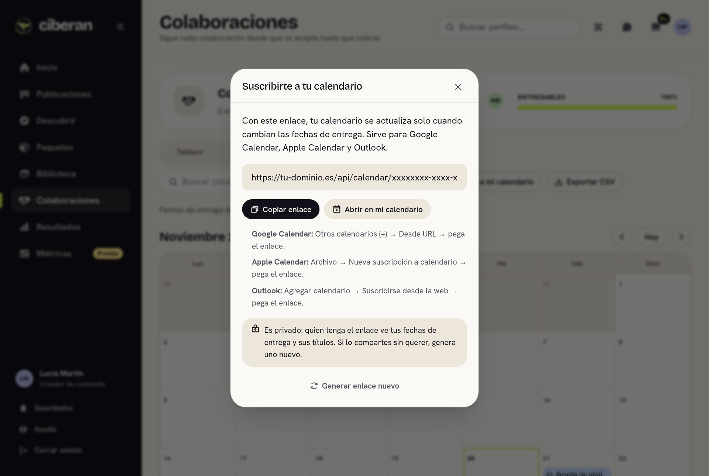

#### Qué sucede después

Tu calendario consulta el enlace cada cierto tiempo y muestra tus entregas con fecha (las de colaboraciones y, si eres creador, también tu contenido propio), de los últimos 30 días en adelante. Los cambios de fecha se reflejan solos; el tiempo que tarda depende de cada aplicación de calendario.

> **Atención:** el enlace es **privado**: quien lo tenga puede ver tus fechas de entrega y sus títulos, sin iniciar sesión. Si lo compartes sin querer, pulsa **Generar enlace nuevo**: el anterior deja de funcionar y tendrás que suscribirte de nuevo con el nuevo.

> **Sin verificar:** la suscripción solo funciona cuando CIBERAN está publicada en una dirección accesible desde internet; en un servidor local los calendarios externos no pueden alcanzarla. Cada aplicación de calendario actualiza a su ritmo.

## Bandeja de entrada

La **Bandeja de entrada** (icono arriba a la derecha) reúne lo que te toca hacer y tus avisos, en tres pestañas.

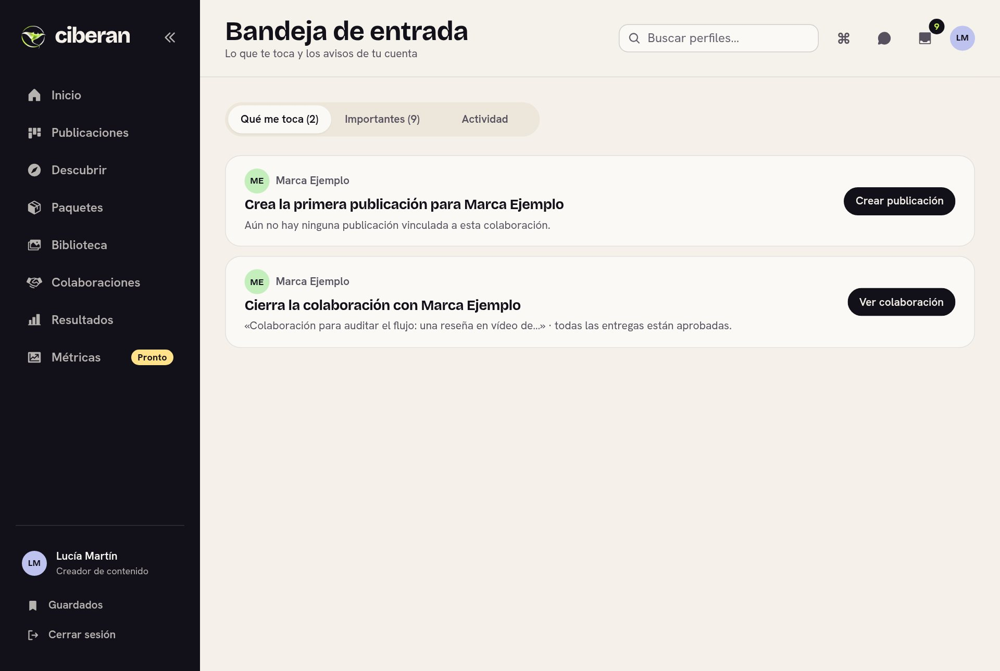

| Pestaña | Qué contiene |
|---|---|
| **Qué me toca** | Tareas con botón de acción (por ejemplo **Crear publicación** o **Ver colaboración**). |
| **Importantes** | Avisos que conviene leer: solicitudes, revisiones, plazos. |
| **Actividad** | El resto de la actividad de tu cuenta. |

## Cuenta y configuración

Todo lo de tu cuenta está en **Perfil**, en las pestañas **Resumen**, **Ficha pública**, **Paquetes** y **Privacidad y cuenta**.

| Quiero… | Dónde |
|---|---|
| Cambiar mi foto, portada, biografía o categorías | **Perfil → Editar ficha** |
| Cambiar mi objetivo semanal de publicaciones | **Perfil → Resumen → Objetivo semanal** |
| Ver el recorrido de bienvenida otra vez | **Perfil → Resumen → Ver el recorrido de bienvenida** |
| Decidir quién me escribe, qué avisos recibo o si mi perfil se ve sin iniciar sesión | **Perfil → Privacidad y cuenta** |
| Descargar mis datos o borrar mi cuenta | **Perfil → Privacidad y cuenta → Tus datos** |
| Cerrar sesión | Abajo del menú: **Cerrar sesión** |
| Cambiar mi contraseña o mi email | **Perfil → Privacidad y cuenta → Acceso a la cuenta** |
| Ver los manuales en PDF | Menú → **Ayuda** |
| No recuerdo mi contraseña | **¿Olvidaste tu contraseña?** en la pantalla de acceso |

> **Aviso:** para cambiar la contraseña o el email, CIBERAN pide antes tu contraseña actual, y el email nuevo no sustituye al actual hasta que abras el enlace que enviamos a ese correo.

> **Sin verificar:** el envío de ese correo depende de la configuración del servicio de correo; no se ha podido garantizar su entrega.

#### Cerrar sesión

1. En el menú (abajo a la izquierda en el ordenador, o dentro de **Más** en el móvil), pulsa **Cerrar sesión**.
2. Volverás a la página de inicio.

> **Consejo:** si usas un ordenador compartido, cierra siempre la sesión al terminar.

# Parte IV · Manual del partner

Esta parte es para quien eligió el perfil **Partner** (marca, empresa o agencia). El menú del partner tiene cinco apartados: **Inicio, Descubrir, Colaboraciones, Necesidades** y **Resultados**.

> **Aviso:** el partner **no tiene** Publicaciones, Biblioteca ni Paquetes propios: el contenido lo crea y lo gestiona el creador. Tu papel es contactar, acordar y **revisar**.

## Inicio

**Qué queremos hacer:** ver cómo van mis colaboraciones y qué tengo pendiente.

#### Pasos

1. Pulsa **Inicio** en el menú.
2. Lee el saludo («¡Hola, … Organiza tus colaboraciones!») y cuántas tareas tienes en la bandeja.
3. Recorre las tarjetas y los bloques.

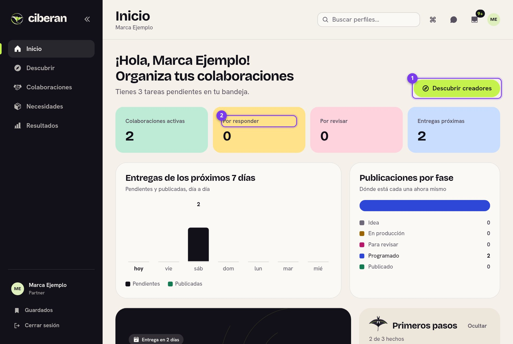

Marcadores: (1) botón **Descubrir creadores**, (2) tarjeta **Por responder**.

| Tarjeta | Qué cuenta |
|---|---|
| **Colaboraciones activas** | Las que están en marcha. |
| **Por responder** | Propuestas que esperan tu respuesta (te toca a ti). |
| **Por revisar** | Contenido que un creador te ha enviado y espera tu aprobación. |
| **Entregas próximas** | Entregas con fecha en los próximos días. |

Debajo verás **Entregas de los próximos 7 días**, **Publicaciones por fase** (Idea, En producción, Para revisar, Programado, Publicado), **Tu calendario** (con el porcentaje de lo ya revisado), **Creadores que podrían encajar** y **Primeros pasos** («Completa tu ficha pública», «Contacta con un creador», «Acordad la colaboración»).

## Descubrir creadores

**Qué queremos hacer:** encontrar creadores que encajen con mi marca y contactar con ellos.

#### Pasos

1. Pulsa **Descubrir** en el menú.
2. Escribe en (1) **Buscar creador por nombre** o usa los (2) **Filtros**: **Categorías** y **Tarifa**, además de **Más filtros** (por ejemplo, tiempo de respuesta).
3. Ordena con **Ordenar**: más afines, más colaboraciones, responden antes, tarifa o precio del paquete (de menor a mayor o al revés).
4. Cambia entre **Rejilla** y **Carrusel**.
5. Pulsa **Guardar búsqueda** para conservar tus filtros, o el icono de marcador de una tarjeta para guardar a un creador.

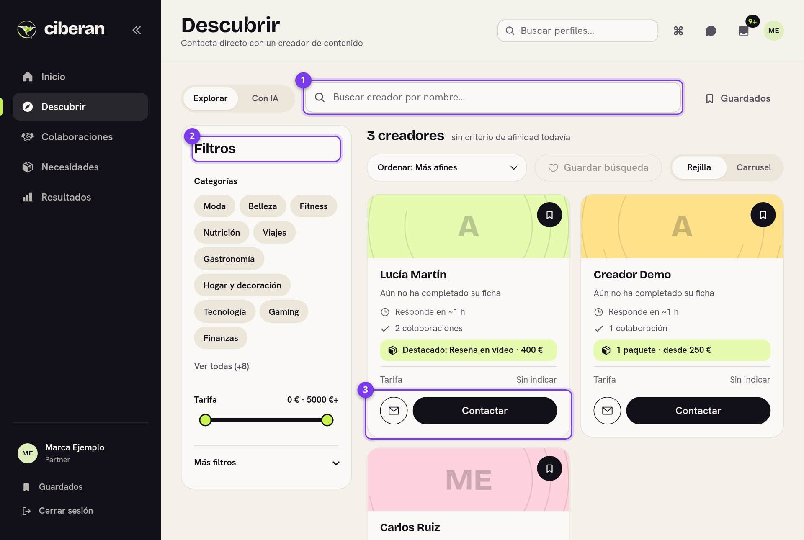

#### Cómo leer una tarjeta de creador

La tarjeta muestra el nombre, sus categorías, **cuánto tarda en responder** («Responde en ~1 h»), el **número de colaboraciones** que ha hecho, su **paquete destacado** con precio («Destacado: Reseña en vídeo · 400 €») o «1 paquete · desde 250 €», y su **tarifa**. Abajo, (3) **Contactar**.

> **Aviso:** «Aún no ha completado su ficha» significa que ese creador no ha rellenado su perfil. Puedes contactarle igualmente, pero tendrás menos información para valorar.

Con **Guardados** (menú, abajo) recuperas a los creadores que marcaste, para compararlos.

> **Sin verificar:** al igual que en el lado del creador, existe el modo **Con IA** para describir con tus palabras lo que buscas. No se ha probado su funcionamiento al preparar este manual.

### Comparar creadores

Desde **Guardados** puedes comparar de 2 a 3 perfiles a la vez:

1. Guarda a los creadores que te interesen con el icono de marcador.
2. Abre **Guardados** y pulsa **Comparar** (aparece cuando tienes más de uno guardado).
3. Marca entre 2 y 3 perfiles y pulsa **Comparar (N)**.
4. Verás una comparación con su **tarifa**, su **reputación** y otros datos, y un botón **Ver perfil completo** en cada uno.

> **Consejo:** compara con calma sus paquetes, su audiencia declarada y su valoración antes de contactar.

## Perfiles de creadores

**Qué queremos hacer:** valorar a un creador antes de contactarle.

#### Pasos

1. Pulsa el nombre de un creador en una tarjeta o escríbelo en **Buscar perfiles** (arriba).
2. Se abre su perfil público.

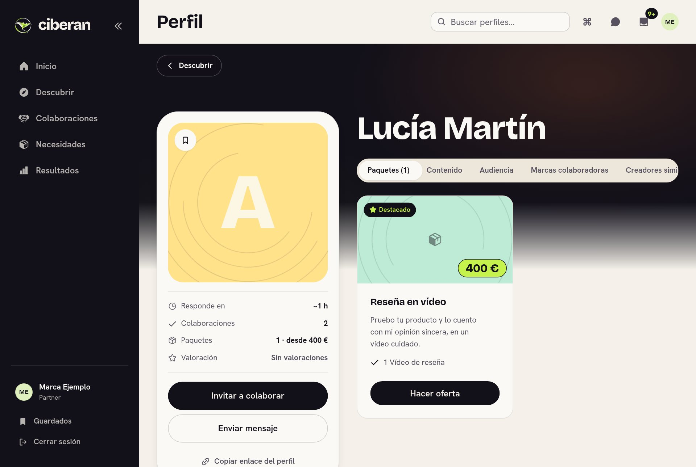

#### Qué puedes consultar

- **Responde en**: su tiempo de respuesta habitual.
- **Colaboraciones**: cuántas ha hecho en CIBERAN.
- **Paquetes**: cuántos tiene y desde qué precio.
- **Valoración**: lo que han dicho otras marcas. «Sin valoraciones» si todavía no tiene.
- Pestañas **Paquetes**, **Contenido**, **Audiencia**, **Marcas colaboradoras** y **Creadores similares**.

La **audiencia** la declara el propio creador y se marca como «declarada por el creador»: CIBERAN no la verifica.

> **No disponible:** en este momento CIBERAN no muestra **métricas reales de redes sociales** (seguidores, alcance, interacciones). Llegarán más adelante. Para evaluar a un creador, apóyate en su valoración, sus colaboraciones previas, su tiempo de respuesta, sus paquetes y lo que él mismo declara.

#### Qué elementos ayudan a valorar una colaboración

| Elemento | Qué te dice |
|---|---|
| **Valoración** | Cómo fue colaborar con él para otras marcas. |
| **Colaboraciones** | Su experiencia dentro de CIBERAN. |
| **Responde en…** | Si es ágil en la comunicación. |
| **Paquetes y precios** | Qué ofrece y a qué precio. |
| **Marcas colaboradoras** | Con quién ha trabajado (si decidió mostrarlo). |

Desde el perfil tienes tres botones: **Invitar a colaborar**, **Enviar mensaje** y, en cada paquete, **Hacer oferta**. También hay un icono para **copiar el enlace del perfil**.

## Colaboraciones

Todo lo que acuerdas con creadores está en **Colaboraciones**. Es igual que la del creador: cuatro vistas (**Tablero**, **Lista**, **Calendario**, **Solicitudes**), buscador, orden y **Exportar CSV**.

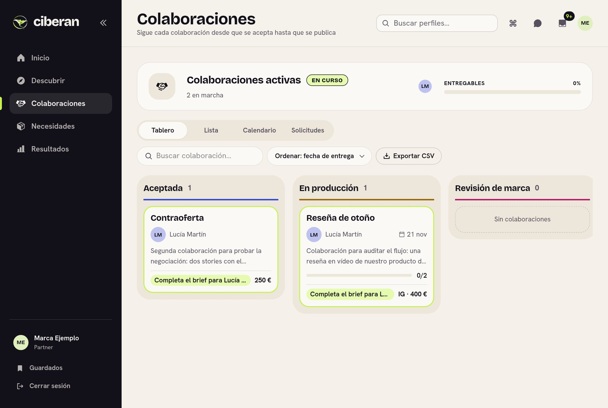

### Iniciar una colaboración (contactar con un creador)

**Qué queremos hacer:** proponer a un creador que trabaje conmigo.

#### Pasos

1. En **Descubrir**, pulsa **Contactar** en la tarjeta del creador (o **Invitar a colaborar** en su perfil). Se abre la hoja **Contactar a…**.
2. Si quieres, escribe un **Nombre de la campaña** (opcional).
3. En **Cuéntales tu campaña**, explica qué necesitas y para cuándo.
4. Escribe tu **Presupuesto (€)**.
5. Si quieres, completa **Sobre la campaña** (**Objetivo**, **Público objetivo**, **Tono**) y **Condiciones** (**Alcance**, **Revisiones incluidas**, **Derechos de uso del contenido**).
6. Pulsa el botón de enviar.

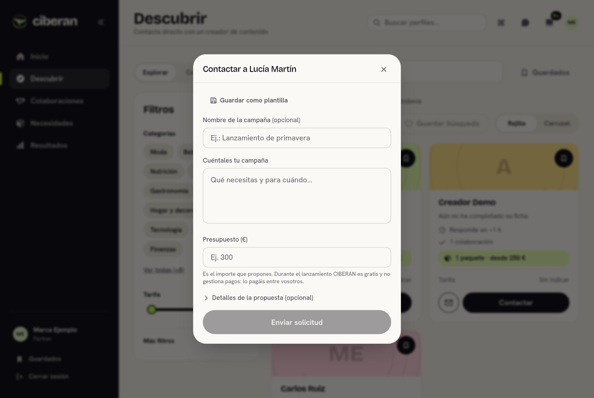

#### Qué sucede después

Verás «Solicitud enviada» y «Te avisamos en cuanto responda». Con **Ver mis solicitudes** vas a la vista **Solicitudes**. El creador recibe un aviso y tiene **7 días** para responder: pasado ese plazo la solicitud caduca.

> **Atención:** las condiciones que escribes quedan **fijadas tal cual al enviar** y no se pueden editar después. Revísalas antes de enviar.

### Enviar una propuesta u oferta

Hay tres caminos para proponer trabajo a un creador. Elige el que mejor encaje:

| Camino | Cuándo usarlo |
|---|---|
| **Contactar / Invitar a colaborar** | Quieres proponer una campaña propia, con tu presupuesto y tus condiciones. |
| **Hacer oferta** (sobre un paquete) | Te interesa un paquete concreto del creador y quieres ofertar sobre él, con el precio del listado u otro distinto. |
| **Enviar mensaje** | Quieres hablar antes de proponer nada. |

Si el creador tiene la privacidad del chat en «Solo tras oferta aceptada», no podrás escribirle en texto libre hasta que acepte una oferta tuya, pero sí mandarle una oferta.

### Negociar y gestionar contraofertas

Cuando el creador responde con una **contraoferta**, te llega un aviso y la colaboración queda **«te toca a ti»**. Dentro, en el bloque **Presupuesto y respuesta**, tienes las mismas tres opciones:

| Opción | Qué hace |
|---|---|
| **Aceptar · (importe)** | Aceptas el importe. La colaboración queda **Aceptada**. |
| **Hacer contraoferta** | Propones otro importe, con un mensaje opcional. |
| **Rechazar solicitud** | La rechazas. Pide confirmación: «¿Seguro? No se puede deshacer.» |

El aviso **Siguiente paso** te dice siempre a quién le toca. Se calcula según quién hizo la **última propuesta**: la otra parte espera tu respuesta, y tú la suya cuando haga una contraoferta.

> **Atención:** rechazar una solicitud **no se puede deshacer**.

### Completar el brief y definir los entregables

Una vez aceptada la colaboración, el **Siguiente paso** del partner suele ser **Completar brief**.

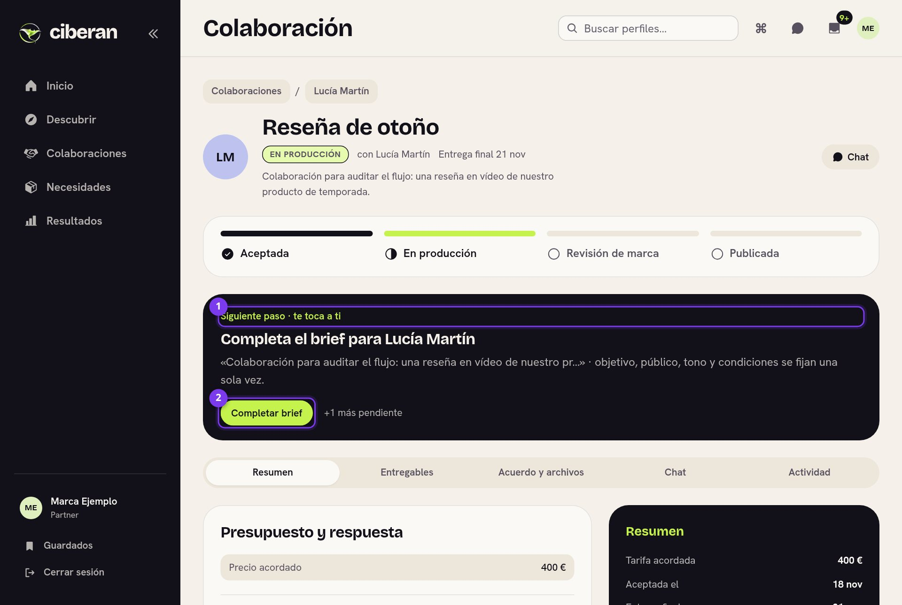

#### Completar el brief

1. En la caja de **Siguiente paso**, pulsa (2) **Completar brief**.
2. Rellena lo que falte: **Objetivo de la campaña**, **Público objetivo**, **Tono**, **Alcance** (qué se entrega), **Revisiones incluidas** (de 0 a 20) y **Derechos de uso**.
3. Pulsa **Guardar**.

> **Importante:** el objetivo, el público, el tono y las condiciones **se fijan una sola vez**. Piénsalo antes de guardar.

#### Definir los entregables

1. Abre la pestaña **Entregables**.
2. Pulsa **Definir entregables**.
3. Escribe **un entregable por línea** (por ejemplo «1 reel de 30 s» y «3 stories») y pulsa **Definir**.

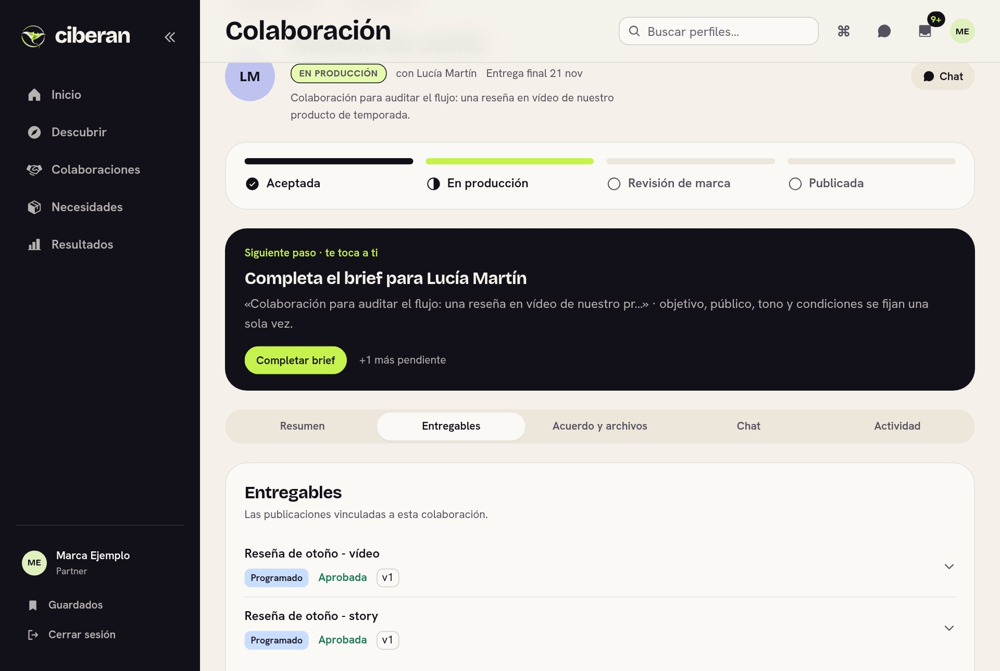

El creador tendrá que **confirmarlos** antes de que sean exigibles para completar la colaboración.

> **Atención:** los entregables **solo se pueden definir una vez**. Redáctalos con cuidado.

### Revisar contenido: aprobar o pedir cambios

Cuando el creador envía una publicación a revisión (estado **Para revisar**), te aparece en la tarjeta **Por revisar** de tu Inicio y en la pestaña **Entregables** de la colaboración, y la fase pasa a **Revisión de marca**.

#### Pasos

1. Abre la colaboración y la pestaña **Entregables**, o el aviso de **Por revisar**.
2. Mira el contenido: la imagen, el texto, los hashtags y, si el creador lo puso, el **enlace al borrador**.
3. Elige una de dos opciones:
   - **Aprobar**: puedes añadir un comentario opcional.
   - **Pedir cambios**: escribe en «¿Qué hay que cambiar?». Sé concreto: **es justo lo que verá el creador**. El comentario es obligatorio.

> **Captura pendiente:** la pantalla con los botones **Aprobar** y **Pedir cambios** solo aparece cuando hay una publicación pendiente de revisar, y no la había al preparar el manual. La descripción está comprobada en la aplicación; falta la imagen.

#### Qué sucede después

- Si **apruebas**, la entrega queda marcada como **Aprobada** y el creador la puede programar y publicar. Queda anotado en **Actividad** («… aprobada (v1)»).
- Si **pides cambios**, el creador recibe tu comentario, lo corrige y vuelve a enviarlo como **nueva versión** (v2, v3…). Verás en **Actividad** «Cambios pedidos» y luego «Nueva versión enviada a revisión».

> **Consejo:** cuanto más concretos sean tus comentarios («falta la captura del producto y dos líneas de opinión»), menos rondas de revisión harán falta. En el brief puedes limitar las **revisiones incluidas**.

### Finalizar la colaboración

Cuando todas las entregas están aprobadas, el **Siguiente paso** pasa a «Cierra la colaboración…». Pulsa **Marcar como completada** en el bloque **Presupuesto y respuesta**. La colaboración queda **Completada** y puedes **valorar** al creador con estrellas y un comentario opcional.

> **Aviso:** CIBERAN **no gestiona pagos ni cobra comisión**. Verás el mensaje: «el importe acordado lo pagas al creador por el medio que acordéis». El pago lo haces tú directamente, fuera de CIBERAN.

La pestaña **Acuerdo y archivos** y las opciones de **Más acciones** (cancelar de común acuerdo, terminar por incumplimiento) son iguales que las del creador; están explicadas en la Parte III.

## Gestión de campañas

CIBERAN no tiene un módulo de «campañas» como tal. Lo que sí ofrece para organizar y controlar tus colaboraciones es esto:

| Herramienta | Para qué te sirve |
|---|---|
| **Nombre de campaña** | Al contactar o proponer, puedes ponerle un nombre («Lanzamiento de primavera»). Ese nombre identifica la colaboración en tableros, listas, la bandeja y el buscador. Si no lo pones, se usa el nombre del paquete o la primera frase del brief. |
| **Tablero y Lista** | Ves todas tus colaboraciones por fase. |
| **Calendario** | Ves las fechas de entrega y puedes suscribir tu calendario externo con **Suscribirme al calendario**. |
| **Exportar CSV** | Descargas el listado para trabajar en una hoja de cálculo. |
| **Resultados** | Mides plazos, respuestas y revisiones. |
| **Necesidades** | Publicas lo que buscas para que los creadores te hagan ofertas. |
| **Chat y Actividad** | Hablas con el creador y consultas la cronología de cada colaboración. |

> **Consejo:** si lanzas varias colaboraciones a la vez para una misma campaña, usa el mismo **nombre de campaña** en todas para encontrarlas juntas con el buscador.

## Necesidades

**Qué son:** lo que buscas. Una necesidad describe un encargo y su presupuesto (por ejemplo «Campaña de temporada · 500 €»). Un creador puede hacerte una **oferta** ajustándose a ella. Es el equivalente a los **paquetes** del creador.

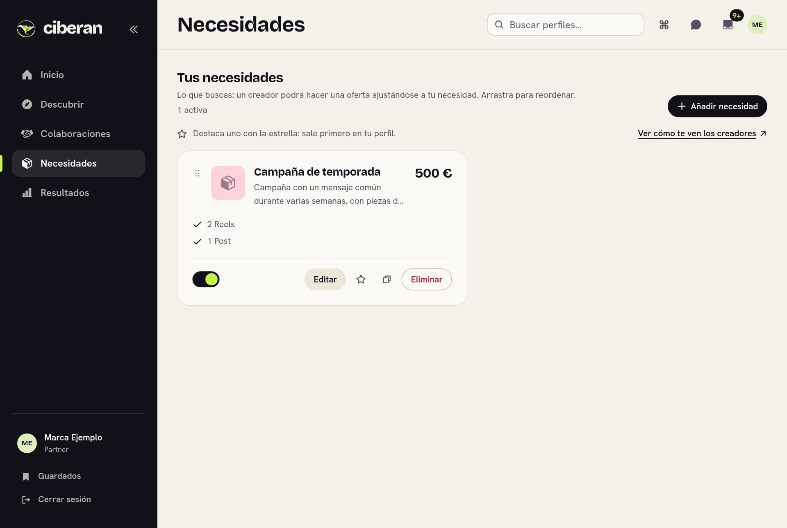

#### Publicar una necesidad

1. Pulsa **Necesidades** en el menú y luego **Añadir necesidad**.
2. Escribe el **Título**, la **Descripción**, los **Entregables** (uno por uno, con Intro) y el **Presupuesto**.
3. Pulsa el botón de publicar.

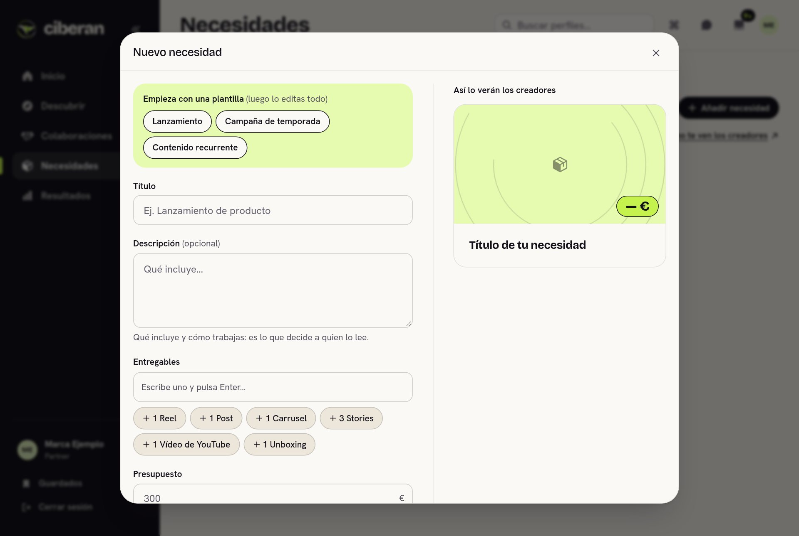

Como en los paquetes del creador, cada tarjeta permite **Pausar**, **Editar**, **Duplicar**, **Eliminar**, **Destacar** (la necesidad destacada sale primero en tu perfil) y **reordenar** arrastrando. Con **Ver cómo te ven los creadores** abres tu perfil público.

> **Atención:** eliminar una necesidad la borra de forma permanente, junto con las ofertas hechas sobre ella.

## Resultados

Igual que en el creador, **Resultados** muestra cómo van tus colaboraciones **dentro de CIBERAN**, por periodos de **3 meses**, **6 meses**, **12 meses** o **Todo**.

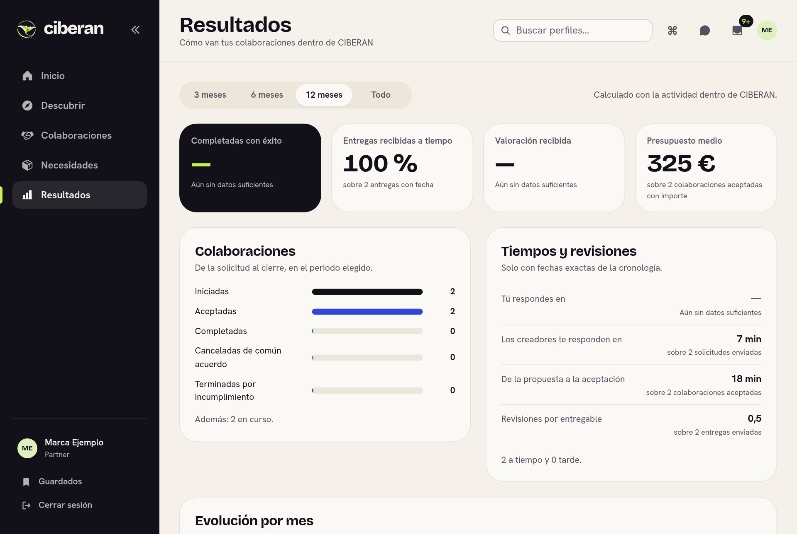

Incluye **Completadas con éxito**, **Entregas recibidas a tiempo**, **Valoración recibida**, **Presupuesto medio**, el recorrido de las colaboraciones, los **tiempos y revisiones** («Tú respondes en…», «Los creadores te responden en…»), la **Evolución por mes** y **Tu fiabilidad**: lo que dice tu historial en CIBERAN, que hoy solo ves tú y el equipo.

## Cuenta y configuración

Pulsa tu avatar para ir a **Perfil**. Tiene cuatro pestañas: **Resumen**, **Ficha pública**, **Necesidades** y **Privacidad**.

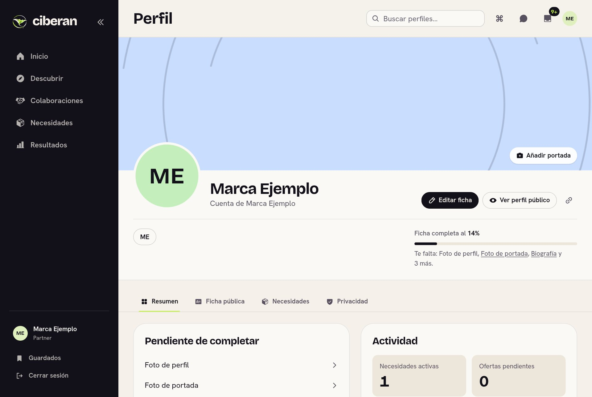

| Quiero… | Dónde |
|---|---|
| Completar mi ficha (logo, portada, biografía, categorías, presupuesto, **qué tipo de creador buscas**) | **Perfil → Editar ficha** |
| Ver cómo me ven los creadores | **Perfil → Ver perfil público** |
| Ver mis necesidades activas y las ofertas pendientes | **Perfil → Resumen**, con **Ver colaboraciones** y **Gestionar necesidades** |
| Elegir quién me escribe, qué avisos recibo y si mi perfil se ve sin iniciar sesión | **Perfil → Privacidad** |
| Ver el recorrido de bienvenida otra vez | **Perfil → Resumen → Ver el recorrido de bienvenida** |
| Cambiar mi contraseña o mi email | **Perfil → Privacidad → Acceso a la cuenta** |
| Ver los manuales en PDF | Menú → **Ayuda** |
| Cerrar sesión | Abajo del menú: **Cerrar sesión** |

También tienes **Chat**, **Bandeja de entrada**, **Guardados** y la **paleta de comandos (Ctrl o Cmd + K)**, que funcionan igual que en el creador.

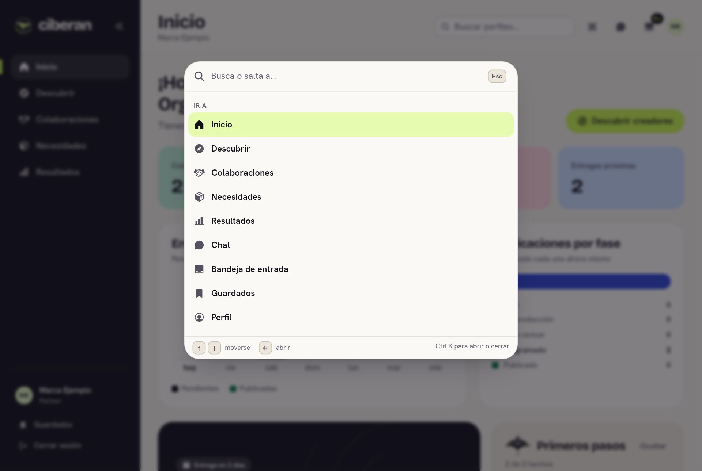

> **Aviso:** como partner, la paleta te ofrece tus pantallas (Inicio, Descubrir, Colaboraciones, Necesidades, Resultados…) y busca colaboraciones y perfiles. No muestra «Biblioteca», que es del creador.

# Parte V · Una colaboración de principio a fin

> **Ejemplo:** todo este capítulo es un **ejemplo ilustrativo con personajes ficticios**. «**Marca Ejemplo**» es una marca de cosmética natural, y «**Lucía Martín**», una creadora. Los importes y los nombres son inventados para explicarlo. Los pasos y las pantallas, en cambio, son los reales de CIBERAN. Cuando algo no se ha podido comprobar, se indica.

**La situación:** Marca Ejemplo quiere contratar a Lucía para una campaña de **Instagram** con un **Reel** y **dos Stories**, por **300 €**.

## Paso 1 · La marca descubre a la creadora

| La marca ve | La creadora ve |
|---|---|
| En **Descubrir** filtra por categoría «Belleza» y ordena por «Responden antes». Aparece la tarjeta de Lucía con su paquete destacado. | Nada todavía. |

## Paso 2 · La marca consulta su perfil

| La marca ve | La creadora ve |
|---|---|
| Pulsa el nombre de Lucía y abre su perfil: su **valoración**, sus **colaboraciones**, cuánto tarda en **responder**, sus **paquetes** y su audiencia declarada. | Nada. |

## Paso 3 · La marca envía una propuesta

| La marca hace | La creadora ve |
|---|---|
| Pulsa **Contactar**. Escribe «Campaña de otoño» como nombre de campaña, cuenta que busca un Reel y dos Stories para el 30 de noviembre, pone **300 €** de presupuesto y envía. Ve «Solicitud enviada». | Nada aún: el aviso llega al paso siguiente. |

## Paso 4 · La creadora recibe la solicitud

| La marca ve | La creadora ve |
|---|---|
| La solicitud en **Colaboraciones → Solicitudes**, en estado **Pendiente de respuesta**. | Un aviso en la **Bandeja de entrada** y la tarjeta **Solicitudes pendientes** en Inicio. Abre la solicitud y lee el brief y los 300 €. Verá un aviso de que la solicitud caduca en 7 días. |

## Paso 5 · La creadora responde: acepta o hace una contraoferta

Lucía puede elegir entre **Aceptar · 300 €**, **Hacer contraoferta** o **Rechazar solicitud**. Supongamos que quiere **350 €** porque la campaña lleva más trabajo:

| La creadora hace | La marca ve |
|---|---|
| Pulsa **Hacer contraoferta**, escribe 350 y un mensaje («Incluye guion y edición»), y envía. Su **Siguiente paso** pasa a «le toca a la marca». | Un aviso. En la colaboración, su **Siguiente paso** dice «te toca a ti», porque la última propuesta fue de Lucía. |

## Paso 6 · La marca responde

La marca tiene tres opciones. Supongamos que **acepta los 350 €**:

| La marca hace | La creadora ve |
|---|---|
| Pulsa **Aceptar · 350 €**. | Un aviso de que la colaboración ha sido **aceptada**. |

> **Aviso:** la marca también podría haber hecho una **nueva contraoferta** (por ejemplo, 320 €). La negociación puede repetirse: el aviso de **Siguiente paso** indica siempre a quién le toca.

## Paso 7 · La colaboración queda aceptada

| La marca ve | La creadora ve |
|---|---|
| La colaboración pasa de **Solicitudes** a la columna **Aceptada** del tablero. Su **Siguiente paso** es **Completar brief**. | La colaboración en la columna **Aceptada**. Su **Siguiente paso** es «Crea la primera publicación para Marca Ejemplo». |

## Paso 8 · Se prepara el contenido

| La marca hace | La creadora hace |
|---|---|
| Pulsa **Completar brief** y rellena objetivo, público, tono, revisiones incluidas (2) y derechos de uso. En **Entregables**, pulsa **Definir entregables** y escribe «1 Reel de 30 s», «2 Stories». | Entra en **Entregables** y pulsa **Confirmar entregables**. Después, **Crear publicación** para cada uno: se abre el editor con la colaboración ya elegida. Prepara el texto, los hashtags y la imagen, y mueve cada publicación a **En producción**. |

La fase de la colaboración pasa a **En producción**.

## Paso 9 · Se entregan las publicaciones

| La creadora hace | La marca ve |
|---|---|
| Sube el borrador a Drive y pega el enlace en **Enlace al borrador**. Cambia la publicación a **Para revisar**. | La fase pasa a **Revisión de marca**. La tarjeta **Por revisar** de su Inicio sube a 1, y la publicación aparece en **Entregables**, con el enlace al borrador. |

## Paso 10 · La marca revisa el contenido

| La marca hace | La creadora ve |
|---|---|
| Abre el contenido y lo mira. Elige **Aprobar** o **Pedir cambios**. | Espera. Su **Siguiente paso** indica que la marca tiene que revisar. |

## Paso 11 · Revisiones, si hacen falta

Supongamos que a la marca le falta algo en la primera Story:

| La marca hace | La creadora ve |
|---|---|
| Pulsa **Pedir cambios** y escribe: «Falta la captura del producto y dos líneas de opinión». | Un aviso. En **Historial de revisión** y en **Actividad** lee el comentario. Corrige el contenido y lo envía otra vez: aparece como **nueva versión (v2)**. |

La marca revisa la v2.

## Paso 12 · Se aprueba el trabajo

| La marca hace | La creadora ve |
|---|---|
| Pulsa **Aprobar** en cada entrega. | Cada entrega muestra **Aprobada**. Programa la publicación y, cuando sale en Instagram, pulsa **Marcar como publicada** y pega el **Enlace de la publicación**. |

## Paso 13 · Se completa la colaboración

| La marca ve | La creadora ve |
|---|---|
| Con todo aprobado y publicado, el **Siguiente paso** pasa a «Cierra la colaboración…». Pulsa **Marcar como completada**. | Lo mismo: el **Siguiente paso** le pide cerrar. Cualquiera de las dos partes puede marcarla como completada. |

La colaboración queda **Completada**. Cada parte puede dejar una **valoración** con estrellas y un comentario opcional. **El pago de los 350 € lo acuerdan entre ellos**: CIBERAN no lo gestiona.

## Y si algo no sale como estaba previsto

### La creadora rechaza la propuesta

En el paso 5, Lucía pulsa **Rechazar solicitud** y confirma con **Sí, rechazar**. La colaboración queda **Rechazada**. La marca ve el cambio de estado. Puede enviar otra propuesta distinta o contactar con otra persona.

### Nadie responde

Una solicitud **caduca a los 7 días** si no se responde. Pasado ese plazo ya no se puede aceptar.

### La marca pide cambios

Es el paso 11: la creadora corrige y vuelve a enviar. Cada envío es una nueva versión. Si el brief limitaba las **revisiones incluidas**, conviene tenerlo presente.

### Se cancela una colaboración ya aceptada

Cualquiera de las dos partes puede, en **Más acciones**, **Proponer cancelar de común acuerdo**. La otra puede **Aceptar la cancelación** o **Seguir con la colaboración**. Si se acepta, queda **Cancelada**.

### Una parte incumple

Quien se sienta perjudicado puede **Dar por terminada por incumplimiento**. Es una acción unilateral: queda en la cronología y la ve el equipo de CIBERAN. La colaboración queda **Terminada por incumplimiento**.

### Se cambia una publicación después de aprobarla

La aprobación puede quedar **invalidada** y la marca tendrá que revisarla otra vez.

> **Captura pendiente:** al preparar el manual no se pudo capturar el momento de la negociación (contraoferta) ni el de la revisión de la marca, porque no había colaboraciones en esos estados y el manual no modifica datos. La **cronología real** de una colaboración con cambios pedidos y aprobación sí se ve en la captura de **Actividad** de la Parte III.

# Parte VI · Preguntas frecuentes

## Sobre mi cuenta

**¿Qué diferencia hay entre creador y partner?**
El creador crea contenido y lo entrega; el partner (marca, empresa o agencia) contacta, acuerda y revisa. Cada cuenta tiene un único perfil, que se elige al registrarse. Mira la tabla de la Parte I.

**¿Qué ocurre si tengo un problema de acceso?**
Si olvidaste la contraseña, usa **¿Olvidaste tu contraseña?**. Si no te llega el correo, mira el spam y pide otro; usa siempre el último. Si ves «Todavía no has confirmado tu email», abre el correo de confirmación. Si ves «Demasiados intentos seguidos», espera unos minutos. Si nada de esto funciona, escribe al equipo de CIBERAN.

**¿Puedo entrar con Google?**
No. Por ahora solo se entra con email y contraseña.

**¿Puedo cambiar mi contraseña o mi email?**
Sí, en **Perfil → Privacidad y cuenta → Acceso a la cuenta** (en el partner, **Perfil → Privacidad**). Para la contraseña te pedimos la actual y un código de 6 dígitos que enviamos a tu correo. Si cambias el email, te pide tu contraseña actual y tendrás que abrir el enlace que enviamos al correo nuevo para que se aplique.

**¿Puedo borrar mi cuenta?**
Sí, en **Perfil → Privacidad y cuenta → Eliminar mi cuenta**. No se puede deshacer. Antes puedes **Descargar** una copia de tus datos.

## Sobre las colaboraciones

**¿Cómo recibo una colaboración?**
Una marca te contacta o te hace una oferta sobre un paquete. Te llega un aviso a la **Bandeja de entrada** y aparece en **Colaboraciones → Solicitudes**. Tienes 7 días para responder.

**¿Puedo negociar el precio?**
Sí. En lugar de aceptar o rechazar, pulsa **Hacer contraoferta** y propón otro importe. La negociación puede repetirse hasta que alguien acepte o rechace.

**¿Qué sucede si rechazo una propuesta?**
La colaboración queda **Rechazada** y la otra parte lo ve. Rechazar **no se puede deshacer**: CIBERAN te pide confirmación antes.

**¿Cómo sé cuándo tengo que actuar?**
Mira el **Siguiente paso** de cada colaboración («te toca a ti» o «le toca a…»), la tarjeta **Por responder** (partner) o **Solicitudes pendientes** (creador) de Inicio y la pestaña **Qué me toca** de la **Bandeja de entrada**.

**¿Cómo se aprueba un entregable?**
Lo aprueba el partner, en la pestaña **Entregables** de la colaboración o desde **Por revisar** en su Inicio, con el botón **Aprobar**. Si algo no encaja, **Pedir cambios** con un comentario.

**¿Qué significa cada estado?**
Hay estados de **colaboración** (Pendiente de respuesta, Aceptada, En curso, Completada, Rechazada, Cancelada, Terminada por incumplimiento) y fases de **publicación** (Idea, En producción, Para revisar, Programado, Publicado). Están explicados en la Parte III y en el glosario.

**¿Cuánto cuesta usar CIBERAN? ¿Cómo se paga una colaboración?**
Durante el lanzamiento CIBERAN es **gratis**: sin cuotas ni comisiones. La plataforma **no gestiona pagos**: lo que acordáis lo pagáis y cobráis entre vosotros.

**¿Qué pasa si una colaboración no se cumple?**
Puedes **Proponer cancelar de común acuerdo** o **Dar por terminada por incumplimiento**. También puedes **Reportar**. El equipo puede avisar o bloquear cuentas, pero no puede reclamar importes ni emprender acciones legales.

## Sobre las publicaciones y los resultados

**¿Cómo puedo consultar mis publicaciones?**
En **Publicaciones** (creador), en vista **Tablero**, **Calendario** o **Lista**. Las de una colaboración también están en su pestaña **Entregables**.

**¿Puedo recuperar una publicación que borré sin querer?**
Durante **8 segundos** tras borrarla aparece **Deshacer**. Pasado ese tiempo, se borra del todo.

**¿Se pierde lo que escribo si cierro «Nueva publicación» a medias?**
No: CIBERAN guarda un borrador en tu navegador durante 14 días y te lo devuelve al abrir la ventana. Puedes descartarlo con **Descartar**.

**¿Dónde puedo encontrar mis estadísticas?**
En **Resultados**: cómo van tus colaboraciones dentro de CIBERAN. Las **métricas de redes sociales** (alcance, likes, seguidores) **todavía no están disponibles** («Próximamente»).

**¿Qué pasa con la predicción de rendimiento con IA?**
No está disponible en este momento.

**¿Por qué mi imagen de la biblioteca sigue en una publicación si la borré?**
Porque al elegirla se hace una **copia**. Borrar el original no afecta a lo que ya la usa.

## Otras dudas

**¿Puedo usar CIBERAN en el móvil?**
Sí. La web se adapta al móvil y se puede **instalar como app** (página **Instalar**), sin pasar por ninguna tienda.

**¿Quién ve mi perfil?**
Tú decides en **Perfil → Privacidad y cuenta → Visibilidad del perfil**: puede verse solo dentro de CIBERAN o también sin iniciar sesión con tu enlace. Las tarifas, el catálogo y el contacto siempre piden sesión.

**¿Quién puede escribirme?**
En **Privacidad del chat** eliges: **Cualquiera**, o **Solo tras oferta aceptada**.

# Parte VII · Glosario

| Término | Qué significa |
|---|---|
| **Acuerdo** | Lo que las dos partes han pactado en una colaboración: brief, condiciones e importe. Se consulta en la pestaña **Acuerdo y archivos**. |
| **Aprobación** | Cuando el partner da el visto bueno a un entregable. Se muestra como **Aprobada**. |
| **Bandeja de entrada** | El lugar donde ves lo que te toca hacer y tus avisos. |
| **Biblioteca** | Tu almacén de imágenes para reutilizar como portada (solo creadores). |
| **Borrador** | Lo que escribes en «Nueva publicación» y todavía no has guardado. CIBERAN lo conserva en tu navegador hasta 14 días. |
| **Brief** | La descripción de lo que se quiere conseguir con una colaboración: objetivo, público, tono y alcance. |
| **Campaña** | El conjunto de contenido que una marca encarga con un mismo objetivo. En CIBERAN se identifica con el **nombre de campaña**. |
| **Colaboración** | Un acuerdo entre un creador y un partner, con importe, entregables y plazos. |
| **Contraoferta** | Una respuesta a una propuesta con otro importe, en lugar de aceptar o rechazar. |
| **Creador** | Persona que crea contenido y lo publica en sus redes. |
| **Descubrir** | El buscador: los creadores buscan marcas y las marcas buscan creadores. |
| **Entregable** | Cada pieza de contenido que se acuerda entregar. |
| **Ficha** | La información de tu perfil (presentación, categorías, tarifa…). Tiene un porcentaje de completado. |
| **Métricas** | Datos de rendimiento de tus redes (alcance, likes…). **Todavía no disponibles en CIBERAN.** |
| **Necesidad** | Lo que busca un partner, con un presupuesto. Es el equivalente a los paquetes del creador. |
| **Oferta** | Una propuesta de precio sobre un paquete (o necesidad) concreto. |
| **Paquete** | Lo que ofrece un creador: un servicio con descripción, entregables y precio. |
| **Paleta de comandos** | La ventana que se abre con **Ctrl + K** (o **Cmd + K**) para ir a cualquier pantalla o buscar colaboraciones y perfiles. |
| **Partner** | Marca, empresa o agencia que contrata contenido. |
| **Plantilla** | Un formulario guardado (de publicación, de propuesta o de paquete) para no escribirlo de nuevo. |
| **Propuesta** | El primer paso de una colaboración: alguien plantea trabajar junto con unas condiciones. También se llama **solicitud**. |
| **Publicación** | Una pieza de contenido que el creador prepara y lleva de la idea a publicarla. Si es de una colaboración, es un entregable. |
| **Raya** | La mantarraya mascota de CIBERAN. Forma parte de la identidad visual: aparece en la página de inicio y en algunas pantallas vacías. **No es una herramienta.** |
| **Resultados** | La pantalla donde ves cómo van tus colaboraciones dentro de CIBERAN (plazos, respuestas, valoraciones). |
| **Revisión** | Cuando el partner examina un contenido y decide aprobarlo o pedir cambios. |
| **Siguiente paso** | El aviso de cada colaboración que dice qué hay que hacer ahora y a quién le toca. |
| **Solicitud** | Una propuesta de colaboración que espera respuesta. Caduca a los 7 días. |
| **Studio** | Término que se usa para las herramientas de creación del creador. **En la aplicación no existe una sección con ese nombre**; esas herramientas son Publicaciones, Biblioteca, Paquetes, plantillas y deshacer. |
| **Versión (v1, v2…)** | Cada vez que el creador reenvía un contenido tras unos cambios, se crea una versión nueva. |

# Estado y mantenimiento de este manual

## Datos de esta edición

| | |
|---|---|
| **Fecha de elaboración** | 20 de noviembre de 2026 (v1.1; primera edición: 19 de noviembre) |
| **Versión del manual** | 1.1 |
| **Aplicación documentada** | CIBERAN en su lanzamiento gratuito (noviembre de 2026). La aplicación no muestra un número de versión. |
| **Cómo se ha elaborado** | Recorriendo la aplicación con una cuenta de creador y otra de partner de prueba, y contrastando cada pantalla con su comportamiento real. Las capturas son reales; los datos personales se han sustituido por datos ficticios. |

## Lo que no se ha podido comprobar

| Tema | Situación |
|---|---|
| Pantallas de **responder a una solicitud** (Aceptar, Contraoferta, Rechazar) y de **revisión de la marca** (Aprobar, Pedir cambios) | Descritas a partir de la aplicación y de su uso en cuentas de prueba, pero **sin captura**: no había colaboraciones en esos estados y el manual no modifica datos. |
| **Valoración** al completar una colaboración | Descrita a partir de la pantalla de la aplicación; sin captura. |
| **Chat** con conversaciones reales | No había conversaciones; solo se capturó la pantalla vacía. |
| Modo **Con IA** de Descubrir | Existe en pantalla; no se ha probado. |
| **Envío de correos** (confirmación, recuperación, avisos por correo) | Dependen de la configuración del servicio de correo; no se ha podido garantizar su entrega. |
| **Código del correo** al cambiar la contraseña, y cambio de **email** desde el perfil | La pantalla y sus mensajes están comprobados; la entrega del correo de confirmación depende del servicio de correo y no se ha podido garantizar. |

## Funciones previstas pero no disponibles

Métricas de redes sociales, pagos y cobros dentro de CIBERAN, predicción de rendimiento con IA y acceso con Google.

## Historial de cambios

| Versión | Fecha | Cambios |
|---|---|---|
| **1.0** | 19-11-2026 | Primera edición completa: creador y partner, colaboración de principio a fin, preguntas frecuentes y glosario. Incluye biblioteca de archivos, plantillas y duplicado, paleta de comandos, deshacer, enlaces de entrega, nombre de campaña, varias redes por publicación, paquetes y necesidades destacados, recuperación de contraseña y rechazo con confirmación. |
| **1.1** | 20-11-2026 | Cambio de contraseña (con código al correo, medidor de fortaleza y cierre de otras sesiones) y de email desde el perfil, enlace «Ayuda» dentro de la app, subida de imágenes desde el selector de la biblioteca, borrador automático de publicaciones, comparación de perfiles guardados, suscripción al calendario con enlace privado y renovable, avance de entregables «listas», perfiles sin ficha al final en Descubrir y tope de 50 imágenes en la biblioteca. |

> **Aviso:** cuando CIBERAN incorpore una función nueva o cambie una pantalla, este manual debe actualizarse y subir de versión. Las fuentes editables están en `docs/manual/` y se regeneran con `node docs/manual/_build/build.mjs`.
